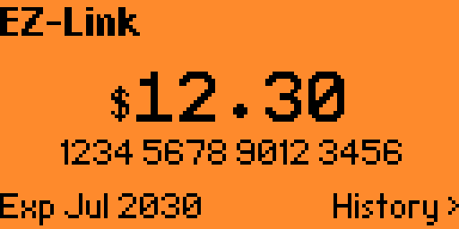
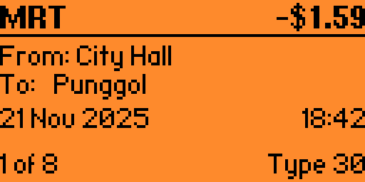
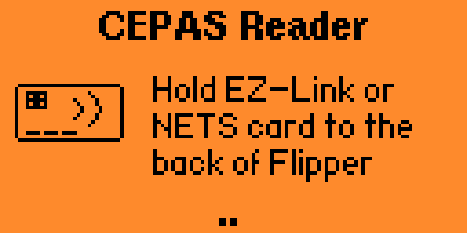

# CEPAS Reader for Flipper Zero

A Flipper Zero app that reads Singapore **EZ-Link** and **NETS FlashPay** stored-value cards (the CEPAS standard). It shows the balance and the recent transaction history. The app only reads the card and never writes to it.

## Screenshots

<table>
  <tr>
    <td align="center"><br><b>Balance</b></td>
    <td align="center"><br><b>History</b></td>
  </tr>
  <tr>
    <td align="center"><br><b>Transaction detail</b></td>
    <td align="center"><br><b>Scan screen</b></td>
  </tr>
</table>

<sub>Screenshots use a made-up demo card.</sub>

## What it shows

- **Main page:** the card name (EZ-Link / NETS FlashPay), the balance, the card number and the expiry month.
- **History** (press Right): up to 30 transactions, each with its type, amount, full station names or bus service, and date and time.
- **Detail** (press OK on a transaction): from/to stations, date and time, and the raw type code.

## Controls

| Screen | Button | Action |
|---|---|---|
| Main | OK | Scan again |
| Main | Right / Down | Open history |
| History | Up / Down | Move the selection |
| History | OK / Right | Open the transaction detail |
| History / Detail | Back / Left | Go back |
| Main | Back | Exit |

## Install

Download the `.fap` for your firmware from the [Releases](../../releases) page, copy it to `/ext/apps/NFC/` on the Flipper's SD card, then open **Apps → NFC → CEPAS Reader**.

## Build from source

You need [ufbt](https://github.com/flipperdevices/flipperzero-ufbt) (`pip install ufbt`).

```sh
# Momentum firmware SDK (what v1.0 was tested on)
ufbt update --index-url=https://up.momentum-fw.dev/firmware/directory.json --channel=dev
# or the official firmware SDK
ufbt update --channel=release

ufbt          # build -> dist/cepas_reader.fap
ufbt launch   # build, install and start on a Flipper connected by USB
```

The card-parsing code has PC unit tests:

```sh
gcc -Wall -Wextra -o test_cepas tests/test_cepas.c cepas.c cepas_stations.c && ./test_cepas
```

GitHub Actions runs the tests and builds the `.fap` for Momentum and official firmware on every push. Pushing a `v*` tag publishes a release with all builds attached.

## How it works

Both card types are ISO 14443-4 Type B. The app sends these commands:

| Step | Command (APDU) | Notes |
|---|---|---|
| Select | `00 A4 00 00 02 40 00` | NETS cards reply with the name `NEST-CEPAS` |
| Read purse | `90 32 03 00 00` | Accepted by EZ-Link |
| Read purse | `90 32 03 00 00 00` | NETS FlashPay needs this form (it rejects the first with `67 00`) |
| Read history | `90 32 03 00 01 <start> 00` | Returns 16-byte records, about 15 per reply |

Record layouts and transaction types follow [Metrodroid](https://github.com/metrodroid/metrodroid)'s CEPAS implementation. Station codes come from Metrodroid's `data/ezlink/mapping.csv`, with names from public station lists. Times count from 1995-01-01 00:00 Singapore time.

## Files

- `cepas_app.c`: the screens, input handling and NFC communication.
- `cepas.c` / `cepas.h`: decoding of the purse and history records, and transaction descriptions.
- `cepas_stations.c`: the MRT/LRT station code table.
- `tests/test_cepas.c`: PC unit tests, using real card responses with the card numbers replaced.

## Limitations

- Accounts on SimplyGo (account-based) cards may be stored on the operator's servers, so a SimplyGo card's on-card balance may be out of date. Not tested.
- Transaction types 0x10 and 0x11 are undocumented. Records marked `TL` show as "Ticket office" (TransitLink).
- Some newer station codes may not be in the table yet; those show as the raw code.
