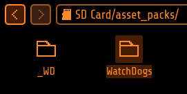
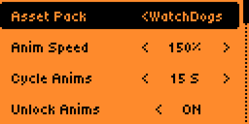
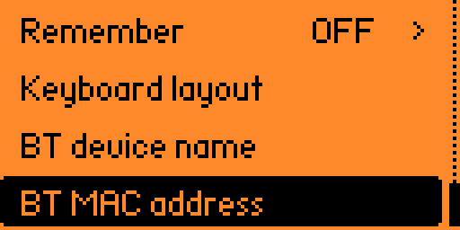

<h1 align="center"><a href='https://rogue-master.net'></a>
<br><a href='https://discord.gg/gF2bBUzAFe' target='_blank'></a>
&nbsp;<a href='https://github.com/RogueMaster/flipperzero-firmware-wPlugins/releases/latest' target='_blank'></a>
&nbsp;<a href='https://www.patreon.com/RogueMaster?filters[tag]=Latest%20Release' target='_blank'></a>
&nbsp;<a href='https://github.com/RogueMaster/awesome-flipperzero-withModules' target='_blank'></a></h1>

# Install GitHub Version With [WEB INSTALLER](https://lab.flipper.net/?url=https%3A%2F%2Frogue-master.net%2F%3Ffile%3DRM1117-1555-26299030.tgz&channel=RM1117-1555-26299030&version=0.420.0&target=f7)

## Thank you so much to our RM Pro/SUPER Patreon supporters! Because of people like you, we are able to offer the best and most up-to-date Flipper Zero Firmware!

<table><tr><th><div align="left">
This firmware is a fork of all Flipper Zero community projects! We are NOT paywalled. I will keep RM Custom Firmware the most cutting-edge with active development and updates from all projects that can be found to be useful to the community. Although there are features exclusive to this firmware, there are also many updates by the rest of the Flipper Zero community. With the help of the entire community, we get the best firmware! See the RM <a href='https://github.com/RogueMaster/flipperzero-firmware-wPlugins#games'>Games</a> and <a href='https://github.com/RogueMaster/flipperzero-firmware-wPlugins#plugins'>Plugins</a> for a list of most of those projects.
<br><a href='https://discord.gg/gF2bBUzAFe' target="_blank">Discord</a> - <a href='https://github.com/RogueMaster/flipperzero-firmware-wPlugins#build'>Build</a> - <a href='https://github.com/RogueMaster/flipperzero-firmware-wPlugins#install'>Install Instructions</a> - <a href='https://github.com/RogueMaster/flipperzero-firmware-wPlugins#howto'>More Links And How To</a> - <a href='https://github.com/RogueMaster/flipperzero-firmware-wPlugins#all'>Firmware Changes</a> - <a href='https://github.com/RogueMaster/flipperzero-firmware-wPlugins#support'>Support RM Custom Firmware</a> - <a href='https://www.patreon.com/RogueMaster' target="_blank">Patreon</a>
</div></th><th style='width:50%;'>
This software is for experimental purposes only and is not meant for any illegal activity/purposes. We do not condone illegal activity and strongly encourage keeping transmissions to legal/valid uses allowed by law.
</th></tr></table>

<a name="support"></a>

- Keep Your Flipper Up To Date With [PATREON membership](https://www.patreon.com/RogueMaster/membership)
- [PATREON for frequent compiled releases](https://www.patreon.com/RogueMaster) for nearly ALL updates. GitHub releases will occur monthly.
- [Contact me on Discord/Patreon to RENAME your Flipper or for GIF conversion for Flipper Zero](https://www.patreon.com/RogueMaster/membership)
- [:fire: PATREON ASSET PACKS AVAILABLE](https://www.patreon.com/RogueMaster/membership): [ALL](https://www.patreon.com/posts/animation-all-v4-77935728) (For Preview Only), Android, 420, 420+18, Anime Only, Anime+420, Anime+420+18, BMO, CHERRY 18+, CyberPunk77, DBZ, Dolphin, GTA, HACKZ, MARIO, MARVEL, NoAnim, ONE PIECE, P0KEMON, Pwnagotchi, RM 18PLUS, RM SELECT, RM SELECT + 18PLUS, RM MINIMAL (default on GitHub), SAO, SCIENCE, SCIFI, SJUMP, SQUATCH, VIRUS, WATCHDOGS AND STOCK with assets updated to look like stock. Anime and RM Select builds are very large and can slow down F0.
- [VIDEO PREVIEW FOR ALL ANIMATIONS](https://www.patreon.com/RogueMaster/posts/august-2023-all-87925007)
- [Supporters also get SD Card Assets zip file with extra NFC Assets such as Infrared remotes, NFC files, SubGHz files and 86 RM Pro Trained Level 50 Sm@sh Amiib0 (By RogueMaster)](https://www.patreon.com/RogueMaster/membership)
- We are open to PRs, suggestions and advice if you feel you need anything that has been left out. [Contact me on Discord](https://discord.gg/gF2bBUzAFe)

<a name="latest"></a>

## Latest Updates - [PATREON: Latest Release RM1125-2341-bbe52de7-Patreon](https://www.patreon.com/RogueMaster?filters[tag]=Latest%20Release)

- Last Synced/Checked OFW, changes in [commits](https://github.com/flipperdevices/flipperzero-firmware/commits/dev): `2026-11-25 23:41 EST`
- Last Synced/Checked CFW, changes in [changelog](https://github.com/RogueMaster/flipperzero-firmware-wPlugins/blob/420/CHANGELOG.md): `2026-11-25 23:41 EST`
- Updated: [Sub-GHz Scheduler v3.5 (By shalebridge)](https://github.com/shalebridge/flipper-subghz-scheduler)
- Added: [Dolphin Dash v0.1 (By Rasul Kireev)](https://github.com/rasulkireev/dolphin-dash) - Three-lane bubble collection and reef dodging
- CFW Settings: [Fix spoof remount lifetime and avoid persisting the real OTP name as a spoof (By lewisQ17)](https://github.com/lewisQ17/Momentum-Firmware/commit/3f932590d6cf877f3ce4a13bc05cb32ead290fd0)
- GPIO: [Show all 13 non-debug pins in the Logic Monitor with a compact three-column layout (By lewisQ17)](https://github.com/lewisQ17/Momentum-Firmware/commit/e0f4d9b46e3fe784d6fce3308d0b2bc54b3ef084)
- BadUSB MSC: [Reject out-of-image READ/WRITE ranges and cap the exposed medium to 32-bit file offsets (By lewisQ17)](https://github.com/lewisQ17/Momentum-Firmware/commit/e96bf19deed56e35b630ab272d2c4a30efaea18c)
- GPIO SFP: [Compact reserved connector entries and bound connector-name copies (By lewisQ17)](https://github.com/lewisQ17/Momentum-Firmware/commit/fc64db47d71832728a037f18aaee2c5d4362e5ac)
- Updated: [Reaction Time Stats v1.0: show the saved-result count beside the average (By luvrltop)](https://github.com/luvrltop/ReactionTime)
- HID: [Add a Mouse Jiggler auto-stop timer and countdown for USB and Bluetooth (By FelixLgr)](https://github.com/RogueMaster/flipperzero-firmware-wPlugins/pull/1215)
- Added: [Zero Buster v1.1 (By DonJulve)](https://github.com/DonJulve/Zero_Buster)
- Sub-GHz: [Validate incoming Feron LED remote checksums and recalculate them before transmission (By Lechnio)](https://github.com/DarkFlippers/unleashed-firmware/pull/1219)
- Fixed: [Gallagher EM4305 write bit offset (By Firat17aze)](https://github.com/DarkFlippers/unleashed-firmware/pull/1217)
- Added: [GTA VI Cheats v0.2 (By RogueMaster)](https://github.com/RogueMaster/flipperzero-firmware-wPlugins/tree/420/applications/external/gta_vi_cheats)
- Sub-GHz: [Open saved RAW captures in RAW Edit from the More menu (By Lechnio)](https://github.com/DarkFlippers/unleashed-firmware/pull/1221)
- Sub-GHz: [Ignore unsupported bits in saved receiver filters (By Lechnio)](https://github.com/DarkFlippers/unleashed-firmware/pull/1220)
- Added: [Optimal Blackjack v1.0, a basic strategy and card-counting trainer. (By Optimal Blackjack)](https://github.com/flipperdevices/flipper-application-catalog/pull/1411)
- Added: [AVR UPDI v0.2 for programming AVR microcontrollers. (By gztproject)](https://github.com/flipperdevices/flipper-application-catalog/pull/1413)
- Added: [SIM800 v1.0 and open saved contacts from the Archive Phone tab. (By xMasterX)](https://github.com/DarkFlippers/unleashed-firmware/commit/62ed7711ef072a9d0929225b74c68838fbb779e2)
- Games: [Update Tetris to v1.7 with a ghost piece, hard drop, and lock delay. (By PurelyAndy)](https://github.com/xMasterX/all-the-plugins/pull/284)
- Sub-GHz: [Fix the Enhanced Sub-GHz Chat MemManage crash on launch. (By mishamyte)](https://github.com/xMasterX/all-the-plugins/pull/285)
- Bluetooth: [Fix PC Monitor display updates and initialize the status display on launch. (By xMasterX)](https://github.com/xMasterX/all-the-plugins/commit/cb339f82d2d0855313183920f0154d9fdb665e5a)
- GPIO: [Rework nRF24 Channel Scanner with a 128-channel activity plot, adjustable dwell, and rate-limited redraws. (By xMasterX)](https://github.com/xMasterX/all-the-plugins/commit/cb339f82d2d0855313183920f0154d9fdb665e5a)
- Updated: [Internet Bridge v0.5.1 (By mete888)](https://github.com/mete888/flipper_usb_to_wifi)
- Added: [ServoMotor v1.0 (By alcdaniel)](https://github.com/alcdaniel/flipper-servo-tester-hw)
- Added: [UART Logger v1.0 (By 2p4g0)](https://github.com/2p4g0/flipper-uart-logger)
- Sub-GHz: [Update Enhanced Sub-GHz Chat to v1.6 and fix NFC key sharing with the firmware NFC API. (By xMasterX)](https://github.com/xMasterX/all-the-plugins/commit/64182ebf87e21232a98e53c90ffd7a5de2d52c2e)
- [Sub-GHz Chat reliability fixes & Weather Station RAW fixes (By RogueMaster)](https://github.com/RogueMaster/flipperzero-firmware-wPlugins/commit/75db628d56ee3ab6968a3db3e06ed3d032d52a72)
- Sub-GHz: [Two more frequencies in the default list - 317.0 and 336.1 MHz (By xMasterX)](https://github.com/xMasterX/all-the-plugins/commit/64182ebf87e21232a98e53c90ffd7a5de2d52c2e)
- Updated: [Ghost Tracker v1.1 (By Zinetick)](https://github.com/Zinetick/ghost_tracker) - RF and proximity instruments [Add FM reception and calibrate EMF. (By Zinetick)](https://github.com/flipperdevices/flipper-application-catalog/pull/1416)
- Updated: [Quadrastic v1.1 (By ivanbarsukov)](https://github.com/ivanbarsukov/flipperzero-quadrastic) [Guard Quadrastic against GUI layout changes. (By xMasterX)](https://github.com/xMasterX/all-the-plugins/commit/981826ad5e4c94e210b16712f3bba92e7e0e7ecd)
- Added: [Lanternfall v1.0, a lantern-lit procedural island RPG (By Dusk Engineering)](https://github.com/DuskEngServices/lanternfall-flipper)
- Added: [FZReader v1.0 for EPUB books (By leptopt1los)](https://github.com/Leptopt1los/fzreader)
- ESP Flasher: [Comes with Marauder v1.21.0 (By justcallmekoko)](https://github.com/justcallmekoko/ESP32Marauder/releases/tag/v1.21.0)
- Updated: [Marauder GUI v1.3 (By mel4mi & AzureSky)](https://github.com/mel4mi/Marauder-GUI-Flipper)
- Furi: [Harden heap block size checks. (By jeje77131)](https://github.com/DarkFlippers/unleashed-firmware/pull/1243)
- OFW: [Preserve BLE key storage callbacks across radio restarts. (By yorha59)](https://github.com/flipperdevices/flipperzero-firmware/pull/4515)
- Updated: [AVR UPDI v0.2 documents supported chips and programming behavior (By gztproject)](https://github.com/gztproject/avr-updi) [AVR UPDI catalog submission (By gztproject)](https://github.com/flipperdevices/flipper-application-catalog/pull/1413)
- Updated: [eReader v1.2.0 moves its default books folder into app data and adds a setup guide (By Daniel Baker)](https://github.com/daniebker/flipper_ereader)
- Added: [RF Studio v0.1 (By Maurice Rogers)](https://github.com/cruzer45/rf-studio) - Build and operate virtual Sub-GHz remotes
- OFW: [Reject missing BadUSB mouse arguments (By theobarrague)](https://github.com/flipperdevices/flipperzero-firmware/pull/4521)
- Sub-GHz: [New KeeLoq manufacturer - FAAC FIX, with `KL: FAAC FIX` in Add Manually and custom button support (thanks Anat01y)](https://github.com/DarkFlippers/unleashed-firmware/commit/e62d78cd70712a75e81fd1100740ec2b0f09a9b9)
- Sub-GHz: [Fix `Edit button` in Signal Settings not saving the new button to the file for static protocols (By xMasterX)](https://github.com/DarkFlippers/unleashed-firmware/commit/a922b3d46da30b0a2297a05b2d6f92cd99d1eda5)
- JS: [Fix `subghz.isExternal()` reporting internal radio when an external CC1101 is connected (By xMasterX)](https://github.com/DarkFlippers/unleashed-firmware/commit/a922b3d46da30b0a2297a05b2d6f92cd99d1eda5)
- GUI: [Fix TextInput writing past its buffer when drawing the cursor and mishandling 256+ character strings (By jeje77131)](https://github.com/DarkFlippers/unleashed-firmware/commit/7a06653e3a838093de687c19177349875ecef4d9)
- Sub-GHz: [Serialize receive history between the worker and GUI, and keep the open signal from being dropped when `Delete old signals` is on (By jeje77131)](https://github.com/DarkFlippers/unleashed-firmware/commit/5f6fb7caff88394fc2cf76a638616eae5b8b370c)
- Sub-GHz: [Fix renaming a saved file with a 64+ character name dropping its `.sub` extension (By jeje77131)](https://github.com/DarkFlippers/unleashed-firmware/commit/edc5e57dda9bb8348be66954057d220ed582d5ab)
- Furi: [`realloc()` copies only the old block when growing, and `calloc()` checks for overflow (By jeje77131)](https://github.com/DarkFlippers/unleashed-firmware/commit/3414ad8975ede7ecbdf0dfa493d0727384860df7)
- Sub-GHz: [Keep open captures stable during receiver history updates (By RogueMaster)](https://github.com/RogueMaster/flipperzero-firmware-wPlugins/commit/cab80b1038ce4320569283e09604c851f340e1db)
- Added: [Z5Flip v1.0 (By Tobirg)](https://github.com/Tobirg/z5flip) - Controller Maintenance Tool `Req: IronLogic Z-5R`
- Updated: [Amiibo Emulator v1.3 adds manual playlists (By Soap-n-Cartridge)](https://github.com/Soap-n-Cartridge/flipper_amiibo)
- Updated: [BadUSB MSC v0.1 (By ZombieDolphin)](https://github.com/ZombieDolphin/BadUSB_MSC)
- Sub-GHz: [Label half-rate KeeLoq captures in history and signal details (By xMasterX)](https://github.com/DarkFlippers/unleashed-firmware/commit/6f9d96f6ac035cdfb7c4b38b411c3e03693d974d)
- Updated: [VaultFlipper v0.1 clarifies setup and shows prior PIN attempts (By Sven Würth / its-sven)](https://github.com/its-sven/vaultflipper)
- Added: [Moon Lander v1.0 with optional Video Game Module tilt controls (By FToThe3rdPower)](https://github.com/FToThe3rdPower/flipperMoonLander)
- BadUSB: [Hardened keyboard layout validation (By ANTONiO-eagle)](https://github.com/DarkFlippers/unleashed-firmware/pull/1224)
- Updated: [AC Detector v1.1 improves IR capture detection and adds AC protocols (By xMasterX)](https://github.com/xMasterX/all-the-plugins)
- Updated: [Barcode App v2.1 (By Kingal1337 & AzureSky)](https://github.com/Kingal1337/flipper-barcode-generator)
- Added: [TommyBox Capture v1.0 (By mitchsurp)](https://github.com/mitchsurp/Tonies-Capture-Flipper)
- Removed: Desktop: [Hold Right in the up-menu for brightness, volume and vibro controls (By xMasterX; RM adaptation by RogueMaster)](https://github.com/DarkFlippers/unleashed-firmware/commit/f587620ec563e84219ddf80aca157ee83f3a259a)
- Updated: [Tesla Mod v2.17.0b7 (By hypery11)](https://github.com/hypery11/flipper-tesla-fsd)
- Added: [POCSAG TX v0.1 (By renaudgweb)](https://github.com/renaudgweb/Pocsag_TX)
- Added: [AirRounds v0.2 (By pavelzaitsau)](https://github.com/pavelzaitsau/airrounds) - Passive Wi-Fi diagnostics `Req: ESP32-S2 WiFi DevBoard with AirRounds Firmware`
- Updated: [POCSAG Pager v2.0 adds a Send plugin, receive history improvements and saved settings (By xMasterX & Shmuma)](https://github.com/xMasterX/flipper-pager)
- Updated: [Sub-GHz RAW Edit v2.0 (By Lechnio)](https://github.com/Lechnio/SubGHz-RAW-Edit)
- Sub-GHz: [Add Manually: `Alutech AT4L` (`Alutech AT-4N` protocol with `0x1Dxxxxxx` serial prefix) & Alutech AT-4N CounterMode 1 & 2 now transmit full smart clone packs - Mode 1 uses a 3-press cycle (`0x0000` x4, `0x0001` x4, then `0xFFFE` x4 + `0xFFFF` x4 in one press for MCSW-3.3M); Mode 2 sends `0x0000..0x0005` (14 frames) in a single press while preserving the file counter (By xMasterX)](https://github.com/DarkFlippers/unleashed-firmware/commit/34c2cf2d0b6917357c6304de295db2ac1f433203)
- Updated: [SIM800 v1.0 - Fix SIM800C wake/baud/profile-store timeouts and persist audio settings; add embedded Cyrillic `.fal` viewer for SMS, history, and USSD with UCS2 decoding, cached chunked inbox, multipart SMS read/delete/history, delete confirmation, and incoming SMS alerts (By xMasterX)](https://github.com/DarkFlippers/unleashed-firmware/commit/ebd1838e12aa83d88df848cd515b009a95c3882b)
- Updated: [MTools v1.2 (By MTools Tec)](https://github.com/mtoolstec/flipper-mtools)
- Updated: [UHF Expansion v1.9 (By mtoolstec)](https://github.com/mtoolstec/fz-uhf-expansion)
- Updated: [GS1 Parser v0.3 (By kdiller713)](https://github.com/kdiller713/public-FlipperApps/tree/main/gs1_rfid_parser) `Req: U107 or YRM100`
- Updated: [NFC Sniffer v0.3 (By kdiller713)](https://github.com/kdiller713/public-FlipperApps/tree/main/nfc_sniffer)
- Added: [Tile Scanner v0.2 (By kdiller713)](https://github.com/kdiller713/public-FlipperApps/tree/main/tile_scanner) `Req: ESP32`
- Updated: [A/C Master v0.3 improves small-font readability and menu spacing (By Enlighten Tech)](https://github.com/gbhobbytech/flipper-ac-multi-remote)
- Updated: [Badge Wallet v1.0 fixes long filenames and unsupported listeners, marks badge lists above 128 entries, and cleans up the active scene on close (By lewisQ17)](https://github.com/lewisQ17/Momentum-Firmware)
- Updated: [GPIO Frequency Counter v1.0 keeps the input callback responsive when its queue is full (By lewisQ17)](https://github.com/lewisQ17/Momentum-Firmware)
- Updated: [IR Remote Maker v1.0 rejects incomplete loads, preserves edited commands, reports save-close errors, and cleans up the active scene on close (By lewisQ17)](https://github.com/lewisQ17/Momentum-Firmware)
- Updated: [NFC Compare v1.0 returns from results to the file chooser and cleans up the active scene on close (By lewisQ17)](https://github.com/lewisQ17/Momentum-Firmware)
- Storage CLI: [Exit write and chunked-read commands when the host closes the session (By oliveiraantoniocc)](https://github.com/flipperdevices/flipperzero-firmware/pull/4529)
- GPIO: [USB-UART Bridge buffers UART bursts with a 2 KB buffer (By oliveiraantoniocc)](https://github.com/flipperdevices/flipperzero-firmware/pull/4528) and [starts the TX thread with a read (By oliveiraantoniocc)](https://github.com/flipperdevices/flipperzero-firmware/pull/4530)
- Storage: [Bound CLI/RPC open and MD5 waits on busy files using internal timeout helpers (By oliveiraantoniocc)](https://github.com/flipperdevices/flipperzero-firmware/pull/4526)
- Sub-GHz: [Reduce KeeLoq/KeeloqHR false positives with sync-gap bounds and bit-period validation (By xMasterX)](https://github.com/DarkFlippers/unleashed-firmware/commit/e924f7e45633dc9c1984f13a085ce2dd0183339d)
- Updated: [Weather Station v2.2 (By Skorpionm)-OFW](https://github.com/flipperdevices/flipperzero-good-faps) [Read RAW (By Lechnio)](https://github.com/flipperdevices/flipperzero-good-faps/pull/314) [Ignore unknown LaCrosse TX packet types (By shubaly)](https://github.com/flipperdevices/flipperzero-good-faps/pull/315) [RAW decode notifications (By xMasterX)](https://github.com/xMasterX/all-the-plugins/commit/56b08cb8f99c910164d31846f8cbec9e205dbe5c) [RM RAW fixes (By RogueMaster)](https://github.com/RogueMaster/flipperzero-firmware-wPlugins/commit/75db628d56ee3ab6968a3db3e06ed3d032d52a72)
- NFC: [Updated low-level NFC handling for Texkom protocol support, apply some tim16 bus fixes in texkom to avoid crashes due to busy bus (By xMasterX)](https://github.com/DarkFlippers/unleashed-firmware/commit/1ad182170dfe07948994ec8299aef5eb199668de)
- Updated: [BadUSB MSC v0.1 adds configurable storage names, FAT16 host-label compatibility, lower memory use, and script/USB cleanup fixes (By ZombieDolphin)](https://github.com/ZombieDolphin/BadUSB_MSC) [UL app integration (By xMasterX)](https://github.com/xMasterX/all-the-plugins/commit/581c45ff79d9)
- Updated: [BarCode ScannerE v0.5 disables expansion during scanner use (By polarikus)](https://github.com/polarikus/flipper-zero_bc_scanner_emulator) [UL app integration (By xMasterX)](https://github.com/xMasterX/all-the-plugins/commit/581c45ff79d9)
- Updated: [CAN Commander v2.3.1 (By MatthewKuKanich)](https://github.com/MatthewKuKanich/CAN_Commander) `Req: CAN Commander Board`
- Updated: [LEGO Dimensions Toy Pad v0.5 (By SegerEnd)](https://github.com/SegerEnd/Flipper-Zero-LD-Toypad-Emulator)
- Updated: [NFC Maker v2.1 (by WillyJL)](https://github.com/RogueMaster/flipperzero-firmware-wPlugins/commit/343cb39d08f60b75b537e1a31100707935cf6e9d)
- Updated: [Programmer Calculator v0.9.2 (By armixz)](https://github.com/armixz/Flipper-Zero-Programmer-Calculator)
- Updated: [Pwnpal v3.0.1 refreshes the displayed app and expected companion firmware revisions (By mrq1911)](https://github.com/mrq1911/pwnpal)
- Updated: [TagTinker v2.1 exits from the main menu with Back and accepts Right on the final startup warning (By i12bp8)](https://github.com/i12bp8/TagTinker) [UL navigation fixes (By xMasterX)](https://github.com/xMasterX/all-the-plugins/commit/cc4edae5a3d5)
- Updated: [Tesla Mod v2.17.0b7 restores the ESP32 dashboard generator and stack checker to RM's companion build directory (By hypery11; RM path adaptation by RogueMaster)](https://github.com/hypery11/flipper-tesla-fsd)
- Added: [Guess The Number v1.2 (By Prevo128)](https://github.com/xMasterX/all-the-plugins/commit/7ad9eb834bde) - Player and computer guessing modes, saved statistics, and high scores
- Updated: [ESP32CAM Marauder v0.7.6 (By 0xchocolate & eried)](https://github.com/eried/flipperzero-mayhem) `Req: ESP32-CAM (Mayhem)` - stop the script worker before the final stopscan on console exit and correct Sniff command mappings
- Updated: [GTA VI Companion v2.0.2 (By RogueMaster)](https://github.com/RogueMaster/GTA_VI_Companion)
- Added: [CEPAS Reader v1.0 (By smolbun)](https://github.com/smolbun/flipper-cepas)
- Updated: [TommyBox Capture v1.0 (By mitchsurp)](https://github.com/mitchsurp/Tonies-Capture-Flipper)
- OFW: [BLE HID service only claims GATT writes to its own attributes (By SokolskyNikita)](https://github.com/flipperdevices/flipperzero-firmware/commit/be4fb60ebd1a37e6c7217093f7038694196e1723)
- Updated: [Codex Meter v1.4 keeps the configured backlight brightness and restores automatic management on exit (By kamylwnb)](https://github.com/kamylwnb/codex-monitor)
- Updated: [Morse Flipper v0.3.0 includes the author changelog and removes obsolete RF sources after the radio plugin migration (By yo3gnd)](https://github.com/yo3gnd/morse-flipper)
- Updated: [NFC Seader v4.2 includes the author changelog and removes unused ASN.1 skeleton source copies (By bettse)](https://github.com/bettse/seader)
- Updated: [NFC Stock Manager v0.1.7 removes an obsolete host test after its source layout migration (By Endika)](https://github.com/Endika/flipper-nfc-stock) [UL source cleanup (By xMasterX)](https://github.com/xMasterX/all-the-plugins/commit/581c45ff79d9c086e1b46c012b213fad00535e71)
- Updated: [Seos compatible v1.4 adds reader inspection, shares ISO-DEP card framing, and consolidates Seos AIDs and BLE UUIDs (By haw8411 & bettse)](https://github.com/bettse/seos_compatible)
- Updated: [UART Logger v1.0 wraps the save-dialog path before the filename and includes the author changelog (By 2p4g0)](https://github.com/2p4g0/flipper-uart-logger) [UL integration (By xMasterX)](https://github.com/xMasterX/all-the-plugins/commit/cc4edae5a3d5) [Save UART logs in app data. (By 2p4g0)](https://github.com/flipperdevices/flipper-application-catalog/pull/1415)
- Added: [IR & Wii Mouse v1.0 maps IR remotes to BLE mouse and keyboard actions with an optional webcam pointer (By TheMajorFuego)](https://github.com/TheMajorFuego/FlipperApps)
- UL: [Refresh SIM800 and Sub-GHz documentation, including Euro5 identification and signal-edit guidance (By xMasterX)](https://github.com/DarkFlippers/unleashed-firmware/commit/4c55ea75d09b37e646d24486addeadb7e076319f)

<a name="release"></a>

## Install Latest Release

- FLASH STOCK FIRST BEFORE UPDATING TO CUSTOM FIRMWARE!
- To avoid Application errors, delete /ext/apps before doing the any RM firmware update
- Get <a href='https://github.com/RogueMaster/flipperzero-firmware-wPlugins/releases/latest' target="_blank">Latest GitHub Release</a> or for PATREON members <a href='https://www.patreon.com/RogueMaster?filters[tag]=Latest%20Release' target="_blank">Latest Patreon Release</a>.
- See <a href='https://github.com/RogueMaster/flipperzero-firmware-wPlugins#install'>Install Instructions</a>

<a name="howto"></a>

## How To

- [How to install firmware](https://github.com/RogueMaster/flipperzero-firmware-wPlugins/blob/420/documentation/HowToInstall.md)
- [How to build firmware](https://github.com/RogueMaster/flipperzero-firmware-wPlugins/blob/420/documentation/HowToBuild.md)
- [How to change Flipper name](https://github.com/RogueMaster/flipperzero-firmware-wPlugins/blob/420/documentation/CustomFlipperName.md)
- [How to use: NRF24 plugins](https://github.com/RogueMaster/flipperzero-firmware-wPlugins/blob/420/documentation/NRF24.md)
- [How to use: SentrySafe plugin](https://github.com/RogueMaster/flipperzero-firmware-wPlugins/blob/420/documentation/SentrySafe.md)
- [Barcode Generator readme](https://github.com/RogueMaster/flipperzero-firmware-wPlugins/blob/420/documentation/BarcodeGenerator.md)
- [How to extend SubGHz frequency range](https://github.com/RogueMaster/flipperzero-firmware-wPlugins/blob/420/documentation/DangerousSettings.md)
- [How to add extra SubGHz frequencies](https://github.com/RogueMaster/flipperzero-firmware-wPlugins/blob/420/documentation/SubGHzSettings.md)
- [Configure Sub-GHz Remote App](https://github.com/RogueMaster/flipperzero-firmware-wPlugins/blob/420/documentation/SubGHzRemotePlugin.md)
- [GAMES ONLY MODE PASSWORD: UP UP DOWN DOWN LEFT RIGHT LEFT RIGHT IN CLOCK](https://github.com/RogueMaster/flipperzero-firmware-wPlugins/blob/420/GAMES_ONLY.md)
- [FLIPPER PROJECT WISH LIST](https://github.com/RogueMaster/flipperzero-firmware-wPlugins/blob/420/RoadMap.md)

## New on MNTM RM Branch!

- TLDR: More Assets, Game Mode, RM Passport & Many more apps! Extra NFC, RFID & SubGHz features!
- ESP Flasher: [Comes with Marauder v1.21.0 (By justcallmekoko)](https://github.com/justcallmekoko/ESP32Marauder/releases/tag/v1.21.0)
- Animations: [Asset Packs for RM HERE](https://github.com/RogueMaster/awesome-flipperzero-withModules/tree/rogue_main/RM_AssetPacks)
- Animations: [PREVIEW "RM Minimal" animations (build default)](https://www.patreon.com/posts/animation-rm-77441581) or [OTHER SETS](https://www.patreon.com/RogueMaster?filters[tag]=Animations)
- Archive: Open MP3 from File Browser, thanks to [MP3 Player v3.5 (By coolshrimp)](https://github.com/coolshrimp/flipperzero-mp3-player)
- Assets: Includes 3 Sample Beacon Spam Marauder Companion Scripts (Thanks to TalkingSasquach for the RM Beacon Spam)
- Assets: Includes a NFC Level 50 Z3lda Amiibo
- Assets: Includes a NFC link to TalkingSasquach on YouTube
- Assets: Includes a NFC Rick Roll link
- Assets: Includes NFC Assets: 86 RM Pro Trained Level 50 Sm@sh Amiib0 (By RogueMaster) It is recommended you randomize UID with this script. [Patreon Build Only](https://www.patreon.com/RogueMaster/membership)
- Assets: Includes NFC Assets: RogueMaster GitHub and RogueMaster Patreon
- Assets: Includes sample Infrared remotes and IR files for Roku and Vizio
- Assets: Includes sample Music Player tunes
- Assets: Includes Sonic Screw Driver sound for the Wav Player
- Assets: Includes SubGHz assets for Crosswalk, CVS/Walgreens CS Buttons [Thanks jimilinuxguy](https://github.com/jimilinuxguy/customer-assistance-buttons-sdr/tree/main/cvs/English), Handicap Doors, Honda Lock/Unlock, Lowes, Sextoys, Tesla Charge Port & Unitree Go1 Robot Dog.
- Assets: Includes SubGHz Gas Sign Captures by [0day](https://github.com/0dayCTF)
- Assets: Includes SubGHz Playlist config and SubGHz Remote config for CVS, Lowes & Walgreens.
- Assets: Includes SubGHz Remote config for Gas_Sign_Edit [from UberGuidoZ](https://github.com/UberGuidoZ/Flipper)
- Assets: Includes SubGHz Remote config for Riding_Dirty [from UberGuidoZ](https://github.com/UberGuidoZ/Flipper)
- Assets: Includes SubGHz SexToy files [from UberGuidoZ](https://github.com/UberGuidoZ/Flipper)
- Assets: Includes Tama P1 Rom Game file. [this rom](https://tinyurl.com/tamap1)
- Assets: Includes Wifi Marauder scripts for: [Create EAPOLpacketsSniffer.json #714 (By grugnoymeme)](https://github.com/RogueMaster/flipperzero-firmware-wPlugins/pull/714) & Wifi Scripts for Beacon Spam themed for Aperature Science, Funny and RM.
- BadUSB: [Assets for CVE-2024-1086 on LINUX targets (By hed0rah & ComradeOrion)](https://github.com/Notselwyn/CVE-2024-1086)
- BadUSB: Assets for Kiosk Evasion (By nocomp) and Wifi Stealer (By 7h30th3r0n3)
- BadUSB: Assets for RickRoll, RogueMaster GitHub and RogueMaster Patreon
- BadUSB: [feat: Add NFC BLE pairing emulation #1154 (By phra)](https://github.com/RogueMaster/flipperzero-firmware-wPlugins/pull/1154)
- Bluetooth Remote: [Add camera control mode to bluetooth remote app. #2336 (By LoganMD)](https://github.com/flipperdevices/flipperzero-firmware/pull/2336)
- Desktop: ['Game Mode' added to UP menu (By RogueMaster)]
- Dolphin: Assigned profile pic for levels 1-10 (Happy Lvl 1 Dolphin), 11-15 (Happy Lvl 2 Dolphin), 16-18 (Happy Lvl 3 Dolphin), 19-21 (Kid G0ku), 22-24 (Adult G0ku), 25-27 (SSJ G0ku) and 28-30 (SSJ3 G0ku)
- Dolphin: CFW Settings: Passport: Now has 15 selectable backgrounds options and 74 profile image options. (Changes By RogueMaster with thanks to ESurge) (Section By ESurge)
- Dolphin: Expanded max level from 3 to 30 using [Roll20](https://roll20.net/compendium/dnd5e/Monsters#h-Experience%20Points), Increased max deed XP per action type from 15 to 45 exp daily & updated animation manifest for max level 30 for all animations (By RogueMaster)
- Dolphin: Mood Stays Happy [(Thanks to biocage)](https://github.com/biocage/flipperzero-firmware), changed to Mood Stays Less Than 6 / Mood Stays High (but not in game mode) (By RogueMaster)
- Dolphin: Passport: Default Mario & AD Police Themed [(Thanks to Kuronons)](https://github.com/Kuronons/FZ_graphics/tree/main/Passport%20background)
- Dolphin: Passport: Many thanks to Kuronons for the many passport backgrounds and profile images available and included.
- Dolphin: Passport: Rename Dolphin with CFW Settings or Name Changer app under Applications=>Settings [(By ESurge)](https://github.com/RogueMaster/flipperzero-firmware-wPlugins/pull/488)
- Dolphin: Passport: Show EXP [(By Dabolus)](https://github.com/Dabolus/flipperzero-firmware-rpg/)
- Dolphin: Passport: Stored on SD with Multiple Pages, and Dynamic Icons/Images support [(By ESurge)](https://github.com/RogueMaster/flipperzero-firmware-wPlugins/pull/527)
- Dolphin: Changed daily MAX to 198 on all 7 Deed Types. Random Deed Selection used for MAX +3 EXP daily gain.
- Dolphin: Plugin Achivement +3 EXP for a total of up to 700 EXP daily. Plugin Achivements are:
	- Any Application is Opened
	- Dice First Roll for d20+ = sides on dice (i.e. Nat 20 on d20)
	- Dice First Roll for d20+ = sides on dice - 1 (+1 EXP) (i.e. 19 on d20)
	- Games Only Mode from Lock Menu
	- Getting 2048 in 2048
	- Mouse Jacker Ducky Run
	- NRFSniffer Found Address
	- Dab Timer @ Alert
	- Tetris, Snake, or Flappy Bird Score For EXP
	- Zombiez for every 20 Zombie kills
- Infrared: Assets for Toto and BioBidet bidets.
- NFC: [Added additional aid GeldKarte (for emv) (thanks to haisenteck) (From Korai-Labs / ankris812)](https://github.com/Korai-Labs/Korai)
- NFC: [Extra NFC Mifare Keys (By Korai-Labs / ankris812)](https://github.com/Korai-Labs/Korai)
- NFC: [FeliCa: Add card generator for FeliCa Lite-S #4371 (By dogtopus)](https://github.com/flipperdevices/flipperzero-firmware/pull/4371)
- NFC: [FeliCa: Add Standard card emulation support #4383 (By nikachu2012)](https://github.com/flipperdevices/flipperzero-firmware/pull/4383)
- NFC: [Parser for Bambu Lab filament spool (By mishamyte)](https://github.com/DarkFlippers/unleashed-firmware/pull/1012)
- NFC: [Parser for CTAS Andalucia (By Alejandro12120 & duhow)](https://github.com/DarkFlippers/unleashed-firmware/pull/808)
- NFC: [Parser for treA (By grugnoymeme)](https://github.com/Next-Flip/Momentum-Firmware/pull/441)
- Plugins: 2048, Arkanoid, Snake, and Tetris show score. Thanks to [whoamins](https://github.com/flipperdevices/flipperzero-firmware/commit/7feda832ede1ba8468eff2ca055fef3ddbdc16ac) and [DevMilanIan](https://github.com/RogueMaster/flipperzero-firmware-wPlugins/pull/188) With position changes by RogueMaster. Also all + Tic Tac Toe updated by [Unleashed/Eng1n33r](https://github.com/DarkFlippers/unleashed-firmware) for stability.
- Plugins: Icon for Clock [Thanks to Redlink](https://github.com/redlink2/flipperzero-firmware/tree/menuChanges)
- RFID: [2 new T5577 extra actions: Set/clear custom pw; write block - NO WIPE #678 (By plgcoder)](https://github.com/RogueMaster/flipperzero-firmware-wPlugins/pull/678)
- RFID: [Support of Hitag Micro chips (8265/8210/H5.5) (By mishamyte)](https://github.com/DarkFlippers/unleashed-firmware/pull/1002)
- RFID: [Wipe T5577 (reset to blank, with read-back verification) (By mishamyte)](https://github.com/DarkFlippers/unleashed-firmware/pull/1003)
- Settings: Battery Meter on Desktop [Thanks to McAzzaMan](https://github.com/McAzzaMan/flipperzero-firmware/tree/BatteryPercentageView)
- Settings: [Customizable Game Mode Menu (By ESurge & RogueMaster)](https://github.com/RogueMaster/flipperzero-firmware-wPlugins/pull/756)
- CFW Settings => Interface => General => [Game Mode (By RogueMaster)](https://github.com/RogueMaster/flipperzero-firmware-wPlugins/blob/420/GAMES_ONLY.md)
- - [UP UP DOWN DOWN LEFT RIGHT LEFT RIGHT FROM CLOCK to EXIT](https://github.com/RogueMaster/flipperzero-firmware-wPlugins/blob/420/GAMES_ONLY.md)
- Settings: Power: [About on Power Off (By LeeroysHub)](https://github.com/LeeroysHub/)
- SubGHz: [Add Cardin S508 rolling-code decoder (decode-only) (By half2me)](https://github.com/DarkFlippers/unleashed-firmware/pull/1004)
- SubGHz: [Add Telcoma/Cardin EDGE protocol (By half2me)](https://github.com/DarkFlippers/unleashed-firmware/pull/1001)
- SubGHz: [All Supported Protocols](https://github.com/RogueMaster/flipperzero-firmware-wPlugins/tree/420/documentation/SubGHzSupportedSystems.md)
- SubGHz: Region Locked -  To transmit to outside ranges (Unlock), use the CFW Settings app under Apps=>Settings.
- SubGHz: [Transmit Indicator before Out of Region Frequency Use (By RogueMaster)](https://github.com/RogueMaster/flipperzero-firmware-wPlugins/commit/e24d4a0689db555ae083fec23a471e878adb6cd4)
- SubGHz: USE CFW Settings to use unlock from SD flag from [(cloudbreakdaniel)](https://github.com/RogueMaster/flipperzero-firmware-wPlugins/commit/97db0dc91ee3dff812b4dec0618e3f198de14405).  Update `subghz/assets/extend_range.txt` with [this file](https://github.com/RogueMaster/flipperzero-firmware-wPlugins/blob/420/applications/main/subghz/resources/subghz/assets/extend_range.txt) on SD.  **UPDATE IGNORE FLAG TO TRUE TO UNLEASH YOUR FLIPPER!!**
- SubGHz: [X10 Protocol Decoder (By CodeAllNight/jamisonderek)](https://github.com/jamisonderek/flipper-zero-tutorials/tree/main/subghz/protocols/x10)

<a name="games"></a>

## Games

| Game | Folder |
| --- | --- |
| [15 v1.2 (By x27)](https://github.com/x27/flipperzero-game15) | `Games` |
| [1D Pacman v0.1 (By easiwork)](https://github.com/easiwork/1dpacman) | `Games` |
| [2048 v1.1 (By OlegSchwann)](https://github.com/OlegSchwann/flipperzero-firmware/tree/hackaton/game_2048/applications/game-2048) | `Games` |
| [2048 v1.6 (By eugene-kirzhanov)](https://github.com/eugene-kirzhanov/flipper-zero-2048-game) (Titled 2048 (Improved)) | `Games` |
| [20Q Flipper v1.0 (By Cheesedog223)](https://github.com/Cheesedog223/20Q_Flipper0) | `Games` |
| [4 In A Row v1.4 (By leo-need-more-coffee)](https://github.com/leo-need-more-coffee/flipperzero-4inrow) | `Games` |
| [99 Bottles (By bolknote)](https://github.com/bolknote/99-Flipper) | `Games` |
| [Air Arkanoid  v1.1 (By DrZlo13)](https://github.com/flipperdevices/flipperzero-good-faps/pull/141) `Req: Video Game Module By Flipper Devices` | `GPIO/VGM` |
| [Air Labyrinth v0.1 (By jamisonderek)](https://github.com/jamisonderek/flipper-zero-tutorials/tree/main/vgm/apps/air_labyrinth) `Req: Video Game Module By Flipper Devices` | `GPIO/VGM` |
| [Apple Grabber v0.1 (By d7d8)](https://github.com/d7d8/apple-grabber) | `Games` |
| [Ardudrivin v1.0.3 (By apfxtech)](https://github.com/apfxtech/FlipperDrivin) | `Games` |
| [ArduGolf v1.0 (By apfxtech)](https://github.com/apfxtech/FlipperGolf) | `Games` |
| [Arduventure v2.0 (By apfxtech)](https://github.com/apfxtech/FlipperArduventure) | `Games` |
| [Arkanoid v1.3 (By gotnull)](https://github.com/gotnull/flipperzero-firmware-wPlugins) | `Games` |
| [Asteroids v1.3 (By antirez)](https://github.com/antirez/flipper-asteroids) | `Games` |
| [Avocado Zero v0.1.2 (By Endika)](https://github.com/Endika/flipper-avocado-zero) | `Games` |
| [Banana v0.4 (By DrEverr)](https://github.com/DrEverr/FlipperApps) | `Games` |
| [BeepBack v1.1 (By h4sw5q2wr9-byte)](https://github.com/h4sw5q2wr9-byte/BEEPBACK) | `Games` |
| [Blackjack v0.1 (By RocketGod)](https://github.com/RocketGod-Git/Flipper-Zero-Blackjack) | `Games` |
| [BlackJack v1.1 (By teeebor)](https://github.com/teeebor/flipper_games) | `Games` |
| [Bomberduck v1.3 (By leo-need-more-coffee)](https://github.com/leo-need-more-coffee/flipperzero-bomberduck) | `Games` |
| [Bomberfox v1.0 (By ashleyhuxley)](https://github.com/ashleyhuxley/bomber) | `Games` |
| [Bounce v1.0 (By Tom Varghese)](https://github.com/tomxposed/flipper-bounce) | `Games` |
| [Brainy v1.1 (By deya-eldeen)](https://github.com/deya-eldeen/flipperzero-brainy) | `Games` |
| [BzzBzz v0.3 (By ikiruneo)](https://github.com/ikiruneo/BzzBzz) | `Games` |
| [CarJacker v1.0 (By RocketGod-git)](https://github.com/RocketGod-git/Flipper-Zero-CarJacker) | `Games` |
| [Catacombs Of The Damned! v4.0 (By apfxtech)](https://github.com/apfxtech/FlipperCatacombs) | `Games` |
| [Cell Lab v1.1 (By PilotOfAsuka)](https://github.com/PilotOfAsuka/cell_lab_fliperzero) | `Games` |
| [Checkers v1.0 (By H4W9)](https://github.com/H4W9/FlipCheckers) | `Games` |
| [Chess Clock (By ihatecsv)](https://github.com/ihatecsv/flipper_chess_clock) | `Games` |
| [Chess v1.12 (By xtruan)](https://github.com/xtruan/flipper-chess) | `Games` |
| [CIDR Challenge v1.0 (By AlastorApps)](https://github.com/AlastorApps/cidrchallengef0) | `Games` |
| [Cigarette v0.1.2 (By fuckmaz)](https://github.com/fuckmaz/flipper-cigarette) | `Games` |
| [City Bloxx (By Milk-Cool)](https://github.com/Milk-Cool/fz-citybloxx) | `Games` |
| [Cognizant Flipper v1.0 (By TunnelDog)](https://github.com/TunnelDog/Cognizant-Flipper) | `Games` |
| [Color Guess v1.6 (By leedave)](https://github.com/leedave/Leeds-Flipper-Zero-Applications) | `Games` |
| [Connect Wires v1.2 (By AlexTaran)](https://github.com/AlexTaran/flipperzero) | `Games` |
| [CountDown v1.0 (By sistemasorp)](https://github.com/sistemasorp/flipper-countdown) | `Games` |
| [Cribbage Calc v1.0 (By dchristiansen)](https://github.com/dchristiansen/cribCalc) | `Games` |
| [Crossy Road v1.0 (By Mikael098)](https://github.com/Mikael098/CrossyRoad-FlipperZero-) | `Games` |
| [DeadZone v0.2 (By retrooper)](https://github.com/retrooper/deadzone) | `Games` |
| [Decision Maker v1.0 (By Gerijacki)](https://github.com/Gerijacki/random_decision_maker) | `Games` |
| [Devilliers Platformer v0.1 (By adevil5)](https://github.com/adevil5/flipper-platformer-game) | `Games` |
| [Dice (RM) Including SEX/WAR/8BALL/WEED/DRINK DICE v2.6 (By RogueMaster)](https://github.com/RogueMaster/flipperzero-dice) | `Games` |
| [DigiPet v1.0 (By AzureSky)](https://github.com/AzzureSkyy/flipper-games) | `Games` |
| [Digital Kaleidoscope v0.1 (By JamesR555)](https://github.com/JamesR555/digital_kaleidoscope) | `Games` |
| [DnD Dice v1.3 (By Ka3u6y6a)](https://github.com/Ka3u6y6a/flipper-zero-dice) | `Games` |
| [DNDAdventure v4.20.2 (By RogueMaster)](https://github.com/RogueMaster/Dungeons_and_Dolphins) | `Games` |
| [DNDBackup & Restore v4.20.2 (By RogueMaster)](https://github.com/RogueMaster/Dungeons_and_Dolphins) | `Games` |
| [DNDBestiary v4.20.2 (By RogueMaster)](https://github.com/RogueMaster/Dungeons_and_Dolphins) | `Games` |
| [DNDCharacter Sheet v4.20.2 (By RogueMaster)](https://github.com/RogueMaster/Dungeons_and_Dolphins) | `Games` |
| [DNDCombat v4.20.2 (By RogueMaster)](https://github.com/RogueMaster/Dungeons_and_Dolphins) | `Games` |
| [DNDGrants v4.20.2 (By RogueMaster)](https://github.com/RogueMaster/Dungeons_and_Dolphins) | `Games` |
| [DNDInitiative v4.20.2 (By RogueMaster)](https://github.com/RogueMaster/Dungeons_and_Dolphins) | `Games` |
| [DNDInventory v4.20.2 (By RogueMaster)](https://github.com/RogueMaster/Dungeons_and_Dolphins) | `Games` |
| [DNDJournal v4.20.2 (By RogueMaster)](https://github.com/RogueMaster/Dungeons_and_Dolphins) | `Games` |
| [DNDolphins v4.20.2 (By RogueMaster)](https://github.com/RogueMaster/Dungeons_and_Dolphins) | `Games` |
| [DNDSpellbook v4.20.2 (By RogueMaster)](https://github.com/RogueMaster/Dungeons_and_Dolphins) | `Games` |
| [Dolphin Dash v0.1 (By Rasul Kireev)](https://github.com/rasulkireev/dolphin-dash) | `Games` |
| [Doom v1.6 (By p4nic4ttack)](https://github.com/p4nic4ttack/doom-flipper-zero) | `Games` |
| [DopeWars v0.7.9 (By lordbuffcloud)](https://github.com/lordbuffcloud/flipper-ck42x-dopeflipper) | `Games` |
| [Dragotchi v0.4 (By Mohnki)](https://github.com/Mohnki/dragotchi-flipper) `Optional: ESP32` | `Games` |
| [Drifter v0.2 (By jean-edouard)](https://github.com/jean-edouard/drifter) | `Games` |
| [DVD Bounce (By schaene)](https://github.com/schaene/Flipper-DVD-Bounce) | `Games` |
| [DVD Screensaver v1.1 (By shantih19)](https://github.com/shantih19/flipper_dvd_screensaver) | `Media` |
| [Elementis Zeta v1.0 (By jahziel1)](https://github.com/jahziel1/Elementis-Zeta) | `Games` |
| [Etch-A-Sketch (By SimplyMinimal)](https://github.com/SimplyMinimal/FlipperZero-Etch-A-Sketch) | `Games` |
| [Executor Keychain v0.1 (By EstebanFuentealba)](https://github.com/EstebanFuentealba/Flipper-Keyller) | `Games` |
| [Fart Sound Generator v0.2 (By fgreil)](https://github.com/fgreil/mitzi-windbreak) | `Media` |
| [Fighter Jet v0.1.1 (By Erbonator3000)](https://github.com/Erbonator3000/flipper-fighter-jet) | `Games` |
| [Five Nights at Flippers v1.3 (By sillygir1)](https://github.com/sillygir1/flipperzero-fnaf) | `Games` |
| [Flappy Bird v1.5 (By DroomOne)](https://github.com/DroomOne/flipperzero-firmware/tree/dev/applications/flappy_bird) | `Games` |
| [Flight Assault v0.4 (By evillero)](https://github.com/evillero/flight_assault) | `Games` |
| [Flipcraft v2.8 (By apfxtech)](https://github.com/apfxtech/Flipcraft) | `Games` |
| [Flipper Hero v1.4 (By mentoster)](https://github.com/mentoster/Flipper-hero) | `Games` |
| [Flipper Poser v1.0 (By mrnullone)](https://github.com/MrNull1/flipperpose) | `Games` |
| [Flippy Road v1.1 (By rkilpadi)](https://github.com/rkilpadi/flippy-road) | `Games` |
| [FlipRogue v1.2.2 (By Abzac)](https://github.com/Abzac/fliprogue) | `Games` |
| [FMatrix v0.3.5 (By misterwaztaken)](https://github.com/misterwaztaken/fmatrix) | `Games` |
| [Fortune Cookie v0.1 (By evillero)](https://github.com/evillero/fortune_cookie) | `Games` |
| [Fortune Spinner v1.0 (By xantopren)](https://github.com/xantopren/fortune-spinner) | `Games` |
| [Free Roam v0.6 (By jblanked)](https://github.com/jblanked/Free-Roam) `Req: ESP32` with [FliperHTTP Firmware](https://github.com/jblanked/FlipperHTTP) | `GPIO/ESP32` |
| [Furious Birds v1.1 (By bmstr-ru)](https://github.com/bmstr-ru/furious-birds) | `Games` |
| [Game of Life v1.3 (By Mad-MO)](https://github.com/Mad-MO/FlipperGoL) | `Games` |
| [GameBoy Emu / FlipGB v5.1 (By D4C1-Labs & jgilchrist)](https://github.com/D4C1-Labs/Flipper-ARF) | `Games` |
| [Gauntlet v1.0 (By at0m-b0mb)](https://github.com/at0m-b0mb/Gauntlet-FlipperZero) | `Games` |
| [Geometry Dash v0.1 (By goosedev72-projects)](https://github.com/goosedev72-projects/flipperzero-geometryflip) | `Games` |
| [Ghouls v0.6 (By jblanked)](https://github.com/jblanked/Ghouls-Flipper) `Req: ESP32` with [FliperHTTP Firmware](https://github.com/jblanked/FlipperHTTP) | `GPIO/ESP32` |
| [Grimoire v0.1 (By rseufert)](https://github.com/rseufert/grimoire) | `Games` |
| [Groks Adventure v0.15 (By DigiMancer3D)](https://github.com/DigiMancer3D/Groks_Adventure) | `Games` |
| [Guess The Number v1.3 (By kWAYTV)](https://github.com/kWAYTV/guess-the-number-fz) | `Games` |
| [Guess The Number v1.2 (By Prevo128)](https://github.com/xMasterX/all-the-plugins/tree/dev/non_catalog_apps/guess_the_number) - Player and computer guessing modes | `Games` |
| [Gurpil v0.1.10 (By Endika)](https://github.com/Endika/flipper-gurpil) | `Games` |
| [Hangman v1.5 (By Evgeny Stepanischev & Eva Stepanischeva)](https://github.com/bolknote/Flipper-Zero-Hangman-Game) | `Games` |
| [Hanoi Towers v1.0 (By AlexTaran)](https://github.com/AlexTaran/flipperzero) | `Games` |
| [Hazke v1.0 (By REZOR)](https://github.com/therezor/hazke-flipper) | `Games` |
| [Heap Defence v1.4 (By xMasterX)](https://github.com/RogueMaster/flipperzero-firmware-wPlugins/commit/fc776446de9fdd553b221c02668b925b689378d8) | `Games` |
| [Hirn - Crack Color Codes v0.2 (By fgreil)](https://github.com/fgreil/mitzi-hirn) | `Games` |
| [Hold em v1.1 (By code-phreak)](https://github.com/code-phreak/flipper-holdem) | `Games` |
| [Hotspot Arcade v1.10.1 (By tarikbc)](https://github.com/tarikbc/hotspot-arcade) `Req: ESP32` | `GPIO/ESP32` |
| [Hunter Killer v1.0 (By josephburnett)](https://github.com/josephburnett/hunter-flipper) | `Games` |
| [Impostor v0.1.3 (By Endika)](https://github.com/Endika/flipper-impostor-game) | `Games` |
| [Infinite Tic Tac Toe v0.1 (By kdiller713)](https://github.com/kdiller713/public-FlipperApps/tree/main/infinite_tic_tac_toe) | `Games` |
| [Insults v1.0 (By ERSUCC)](https://github.com/ERSUCC/Flipper-Insults) | `Games` |
| [IRONWYRM v1.1 (By Atompunk78)](https://github.com/Atompunk78/IRONWYRM) | `Games` |
| [JetPack v1.1 (by timstrasser)](https://github.com/RogueMaster/flipperzero-firmware-wPlugins/commit/1164e4d214efa38847e08c6387bf53578bc0d366) | `Games` |
| [Jumping Pawns v0.1 (By Tyl3rA)](https://github.com/Tyl3rA/Jumping-Pawns) | `Games` |
| [KC Line v1.2 (By HappyAmos)](https://github.com/HappyAmos/Flipper_FAPS/tree/master/kcline) | `Games` |
| [Keilerei v1.0 (By JB)](https://github.com/boeheimjonas-rgb/keilerei-flipper) - LCD brawler with enemy waves, weapon crates and changing arenas | `Games` |
| [Lanternfall v1.0 (By Dusk Engineering)](https://github.com/DuskEngServices/lanternfall-flipper) - Lantern-lit procedural island RPG | `Games` |
| [Laser Tag v2.3 (By RocketGod & jamisonderek)](https://github.com/RocketGod-git/Flipper-Zero-Laser-Tag) | `Games` |
| [Lettercade v1.0 (By andreimagic)](https://github.com/andreimagic/flipper-lettercade) | `Games` |
| [Lifecounter v1.0 (By antsy)](https://github.com/antsy/Lifecounter) (Multi Counter remake) | `Games` |
| [Lights Out Flipper Zero v1.1 (By DigiMancer3D)](https://github.com/DigiMancer3D) | `Games` |
| [Loteria Zero v1.1 (By databrainsco)](https://github.com/databrainsco/Loteria_Zero) | `Games` |
| [Magic 8-ball v0.1 (By stevenquinn)](https://github.com/stevenquinn/flipper-8-ball) | `Games` |
| [Mancala v0.1 (By fgreil)](https://github.com/fgreil/mitzi-mancala) | `Games` |
| [Mandelbrot Set v1.4 (By Possibly-Matt)](https://github.com/Possibly-Matt/flipperzero-firmware-wPlugins) | `Games` |
| [Matagotchi v1.1 (By MrModd)](https://github.com/MrModd/Matagotchi) | `Games` |
| [Maze 3D v7.2 (By k20120509)](https://github.com/k20120509/flipper-release) | `Games` |
| [MicroCity v2.0 (By apfxtech)](https://github.com/apfxtech/FlipperMicroCity) | `Games` |
| [Mind Probe v0.1 (By Miksang)](https://github.com/Miksang/flipper_guessing_game) | `Games` |
| [Minesweeper Redux v1.7 (By squee72564)](https://github.com/squee72564/F0_Minesweeper_Fap) | `Games` |
| [Minesweeper v1.2 (By panki27)](https://github.com/panki27/minesweeper) | `Games` |
| [Monster Slayer v0.1 (By ratmanZorry)](https://github.com/ratmanZorry/monster_slayer_flipper_zero) | `Games` |
| [Monty Hall v1.3 (By DevMilanIan)](https://github.com/RogueMaster/flipperzero-firmware-wPlugins/pull/203) | `Games` |
| [Moon Lander v1.0 (By FToThe3rdPower)](https://github.com/FToThe3rdPower/flipperMoonLander) | `Games` |
| [Morse Master v1.1 (By w84death)](https://github.com/w84death/morse-master) | `Games` |
| [Morse Trainer v1.0 (By Baris Mert)](https://github.com/barismert98/flipper-morse-trainer) | `Games` |
| [Multi Counter v1.1 (By JadePossible)](https://github.com/JadePossible/Flipper-Multi-Counter) | `Games` |
| [Mystic Balloon v3.0 (By apfxtech)](https://github.com/apfxtech/FlipperMysticBalloon) | `Games` |
| [Nah 2 da Nah Nah Nah v0.2 (By DigiMancer3D)](https://github.com/DigiMancer3D/nah2nah3) | `Games` |
| [Network Defender v1.2.1 (By w84death)](https://github.com/w84death/network-defender) | `Games` |
| [Nu Pogodi! (Ну, погоди!) v1.3 (By sionyx)](https://github.com/sionyx/flipper_nupogodi) | `Games` |
| [NW Crawl v0.4 (By rseufert)](https://github.com/rseufert/nw_crawl) | `Games` |
| [Optimal Blackjack v1.0 (By Optimal Blackjack)](https://github.com/blackjackprostudio/optimal-blackjack-flipper) - Blackjack strategy and card-counting trainer | `Games` |
| [Oregon Trail v0.1 (By jlaughter)](https://github.com/jlaughter/flipper_oregon_trail) | `Games` |
| [P1X Adventure v0.1 (By w84death)](https://github.com/w84death/flipper-zero-apps) | `Games` |
| [P1X Your Own Adventure v0.1 (By w84death)](https://github.com/w84death/flipper-zero-apps) | `Games` |
| [PacMan WIP v0.1 (By DanieleMaffi)](https://github.com/DanieleMaffi/flipper-pacman) | `Games` |
| [Paint v1.4 (By n-o-T-I-n-s-a-n-e)](https://github.com/n-o-T-I-n-s-a-n-e) | `Games` |
| [Panis - A Grumpy Bread v0.1 (By fgreil)](https://github.com/fgreil/mitzi-panis) | `Games` |
| [Paper Plane v1.3 (By Larry-the-Pig)](https://github.com/Larry-the-Pig/flipper-plane) | `Games` |
| [Partition Panic v1.0 (By slavik0329)](https://github.com/slavik0329/partition-panic-flipper) | `Games` |
| [Pinball0 v0.5.2 (By rdefeo)](https://github.com/rdefeo/pinball0) | `Games` |
| [Pocket Battle+ v2.0 (By HermeticCode)](https://github.com/HermeticCode/showdown-current) | `Games` |
| [Pod v1.0 (By thecoolguy2001)](https://github.com/thecoolguy2001/flipper-pod) | `Games` |
| [Pong v1.4 (By nmrr)](https://github.com/nmrr/flipperzero-pong) | `Games` |
| [Portal Putt v0.1 (By rseufert)](https://github.com/rseufert/portal_putt) | `Games` |
| [Prince Of Arabia v1.0.12 (By apfxtech)](https://github.com/apfxtech/FlipperPrinceOfArabia) | `Games` |
| [Puck Girl v0.3 (By fgreil)](https://github.com/fgreil/mitzi-puck) | `Games` |
| [Quadrastic v1.1 (By ivanbarsukov)](https://github.com/ivanbarsukov/flipperzero-quadrastic) | `Games` |
| [Questions v1.1 (By nikilark)](https://github.com/nikilark/flipper_questions) | `Games` |
| [Race Game v1.0 (By mrc19056)](https://github.com/mrc19056/flipper-race-game) | `Games` |
| [Race v1.3 (By zyuhel)](https://github.com/zyuhel/flipperzero-racegame) | `Games` |
| [Reaction Test v1.3 (By Milk-Cool)](https://github.com/Milk-Cool/fz-reaction-game) | `Games` |
| [Reaction Time (By ihatecsv)](https://github.com/ihatecsv/flipper_reaction_time) | `Games` |
| [Reaction Time Stats v1.0 (By luvrltop)](https://github.com/luvrltop/ReactionTime) | `Games` |
| [Reversi v1.4 (By dimat)](https://github.com/dimat/flipperzero-reversi) | `Games` |
| [Rock Paper Scissors v1.5 (By CodeAllNight/jamisonderek)](https://github.com/jamisonderek/flipper-zero-tutorials/tree/main/subghz/plugins/rock_paper_scissors) | `Games` |
| [Rock Paper Scissors 2 v1.1 (By benwoo1110)](https://github.com/benwoo1110/rps-FlipperZero) | `Games` |
| [Rock Paper Scissors 3 v1.0 (By xantopren)](https://github.com/xantopren/rock-paper-scissors) | `Games` |
| [Root of Life v1.4 (By Xorboo)](https://github.com/Xorboo/root-of-life) | `Games` |
| [Roulette v1.0 (By thecoolguy2001)](https://github.com/thecoolguy2001/flipper-roulette) | `Games` |
| [Rubiks Cube Scrambler v1.4 (By RaZeSloth)](https://github.com/RaZeSloth/flipperzero-rubiks-cube-scrambler) | `Games` |
| [Rush Hour v0.1.8 (By Endika)](https://github.com/Endika/flipper-tutu) | `Games` |
| [Scorched Tanks v1.4 (By jasniec)](https://github.com/jasniec/flipper-scorched-tanks-game) | `Games` |
| [Secret Toggle (By nostrumuva)](https://github.com/nostrumuva/secret_toggle) | `Games` |
| [Simon Says v0.2 (By SimplyMinimal)](https://github.com/SimplyMinimal/FlipperZero-SimonSays) | `Games` |
| [Slot Machine v1.4 (By Daniel-dev-s)](https://github.com/Daniel-dev-s/flipperzero-slots) | `Games` |
| [Slots v1.0 (By vh8t)](https://github.com/vh8t/flipper-slots) | `Games` |
| [Snake 2.0 v2.4 (By Willzvul)](https://github.com/Willzvul/Snake_2.0/) | `Games` |
| [Snake v1.7 (By OlegSchwann)-OFW](https://github.com/flipperdevices/flipperzero-firmware/pull/829) | `Games` |
| [Sokoban v1.6 (By Racso)](https://github.com/Racso/fzero-apps) | `Games` |
| [Solitaire v2.0.2 (By doofy-dev)](https://github.com/doofy-dev/flipper_solitaire) | `Games` |
| [Space Impact II v1.0.2 (By Erbonator3000 & VoidXH)](https://github.com/Erbonator3000/Flipper-Zero-Space-Impact-II) | `Games` |
| [Space Impact WIP v0.2 (By Ka3u6y6a)](https://github.com/Ka3u6y6a/flipper-zero-space-impact) | `Games` |
| [Space Invaders v0.1 (By PavelZurek)](https://github.com/PavelZurek/flipperzero-space-invaders) | `Games` |
| [Spectre v0.1 (By rseufert)](https://github.com/rseufert/spectre) | `Games` |
| [Stack v1.0 (By bergr22)](https://github.com/bergr22/Stack) | `Games` |
| [Stack Attack v1.0 (By Negenii)](https://github.com/Negenii/flipper-stack-attack) | `Games` |
| [Stratagem Hero v1.0.1 (By maximkulkin)](https://github.com/maximkulkin/flipper-zero-stratagem-hero) | `Games` |
| [Strategem Zero v0.1 (By nymda)](https://github.com/nymda/StratagemZero) | `Games` |
| [Sudoku v1.2 (By profelis)](https://github.com/profelis/fz-sudoku) | `Games` |
| [SUPER-CHIP Emulator (By Milk-Cool)](https://github.com/Milk-Cool/fz-schip) | `Games` |
| [Swimmy Fish v3.1 (By Invizabel)](https://github.com/Invizabel/fish) | `Games` |
| [T-Rex Runner v1.5 (By Rrycbarm)](https://github.com/Rrycbarm/t-rex-runner) | `Games` |
| [TAMA P1: Save State & Layout Update (By DroomOne)](https://github.com/DroomOne/flipperzero-tamagotch-p1) | `Games` |
| [Tanks v1.4 (By Alexgr13)](https://github.com/alexgr13/flipperzero-firmware/tree/fork/dev/applications/tanks-game) | `Games` |
| [Tarot v0.2 (By pionaiki & tihyltew)](https://github.com/pionaiki/fz-tarot) | `Games` |
| [Tetris Modern v1.5 (By Alloy-Lou)](https://github.com/Alloy-Lou/all-the-plugins/tree/dev/base_pack/tetris_modern_game) | `Games` |
| [Tetris v1.7 (By jeffplang & PurelyAndy)](https://github.com/xMasterX/all-the-plugins/pull/284) | `Games` |
| [Tic Tac Toe v1.3 (By gotnull)](https://github.com/gotnull/flipperzero-firmware-wPlugins) | `Games` |
| [Tic-Tac-Toe Multi v1.1 (By RouNNdeL)](https://github.com/RouNNdeL/flipper-tictactoe-multi) | `Games` |
| [Tower Defense v2.1 (By apfxtech)](https://github.com/apfxtech/FlipperTowerDefense) | `Games` |
| [Trivia Zero v0.1.14 (By Endika)](https://github.com/Endika/flipper-trivia-zero) | `Games` |
| [UART Pong v1.0 (By Olejka)](https://github.com/TheSainEyereg/flipper-uart-pong) | `GPIO/Games` |
| [Ultimate Tic-Tac-Toe v1.1 (By Racso)](https://github.com/Racso/fzero-apps) | `Games` |
| [Umpire Indicator v0.1 (By RocketGod)](https://github.com/RocketGod-Git/Flipper-Zero-Umpire-Indicator) | `Games` |
| [Vexed v1.1 (By dlvoy)](https://github.com/dlvoy/flipper-zero-vexed) | `Games` |
| [Video Game Module Tool v1.4 (By gsurkov)](https://github.com/flipperdevices/flipperzero-good-faps/pull/127) `Req: Video Game Module By Flipper Devices` | `GPIO/VGM` |
| [Video Poker v1.5 (By PixlEmly)](https://github.com/PixlEmly/flipperzero-firmware-testing/blob/420/applications/VideoPoker/poker.c) | `Games` |
| [VL6180X Pong v0.1 (By kdiller713)](https://github.com/kdiller713/public-FlipperApps/tree/main/vl6180x_pong) `Req: Adafruit VL6180X` | `GPIO/Games` |
| [VolorSavanna v1.0 (By Invizabel)](https://github.com/Invizabel/VolorSavanna) | `Games` |
| [Wave v0.2 (By Sladkisnovraper)](https://github.com/Sladkisnovraper/Wave-game-for-Flipper-Zero) | `Games` |
| [Wolfenduino v1.0 (By apfxtech)](https://github.com/apfxtech/FlipperWolfenstein) | `Games` |
| [Yappy Invaders (By dagnazty)](https://github.com/dagnazty/Yappy_Invaders) | `Games` |
| [Yatzee v1.2 (By emfleak)](https://github.com/emfleak/flipperzero-yatzee) | `Games` |
| [Yulias Cats v0.8 (By rseufert)](https://github.com/rseufert/yulia_cats) | `Games` |
| [Zero v1.4 (By Racso)](https://github.com/Racso/fzero-apps) | `Games` |
| [Zombiez v1.3 (Reworked By DevMilanIan)](https://github.com/RogueMaster/flipperzero-firmware-wPlugins/pull/240) | `Games` |

<a name="plugins"></a>

## Apps / Plugins

| App / Plugin | Folder |
| --- | --- |
| [24Cxx Programmer v2.1 (By kamylwnb)](https://github.com/kamylwnb/24cxxprog) | `GPIO` |
| [5Ghost Wifi Lab v2.8.1 (By pingequalab)](https://github.com/pingequalab/5ghost-wifi-lab) `Req: BW15` | `GPIO` |
| [A/C Master v0.3 (By Enlighten Tech)](https://github.com/gbhobbytech/flipper-ac-multi-remote) | `Infrared` |
| [AC Detector v1.1 (By xMasterX)](https://github.com/xMasterX/all-the-plugins) | `Infrared` |
| [AC Fujitsu General Remote v1.0 (By j-stud-res)](https://github.com/j-stud-res/flipper-ac-fujitsu-general-remote) | `Infrared` |
| [Access Audit v1.13 (By matthewkayne)](https://github.com/matthewkayne/flipper-access-audit) | `Tools` |
| [Agentic Remote USB/BT v0.28 (By Wet-wr-Labs)](https://github.com/Wet-wr-Labs/claupper) | `Bluetooth`, `USB` |
| [AI Composer v1.0 (By TheProductAgency)](https://github.com/TheProductAgency/flipper-ai-composer) | `Media` |
| [Air Level v1.0 (By jamisonderek)](https://github.com/jamisonderek/flipper-zero-tutorials/tree/main/vgm/air_level) `Req: Video Game Module By Flipper Devices` | `Tools` |
| [AirRounds v0.2 (By pavelzaitsau)](https://github.com/pavelzaitsau/airrounds) - Passive Wi-Fi diagnostics `Req: ESP32-S2 WiFi DevBoard with AirRounds Firmware` | `GPIO/ESP32` |
| [Air Stats v1.0 (By thevan4)](https://github.com/thevan4/flipper-air-stats) Req: [See App Readme For Supported Modules](https://github.com/RogueMaster/flipperzero-firmware-wPlugins/blob/420/applications/external/air_stats/README.md) | `GPIO` |
| [Alcohol Calc v1.0 (By vtlklr)](https://github.com/vtlklr/alcohol_calc) | `Tools` |
| [Allstar Firefly v0.1 (By jlaughter)](https://github.com/jlaughter/flipper-allstar-firefly) - Gate remote decoder/encoder | `Sub-GHz` |
| [Amiibo Browser v1.0 (By AzureSky)](https://github.com/AzzureSkyy/flipper-amiibo-browser) | `NFC` |
| [Amiibo Emulator v1.3 (By Soap-n-Cartridge)](https://github.com/Soap-n-Cartridge/flipper_amiibo) | `NFC` |
| [AmiiTool v0.3 (By Firefox2100)](https://github.com/Firefox2100/ami_tool) `Req: key_retail.bin on SD card /nfc/assets` | `NFC` |
| [Amusement IC v0.1 (By object-Object)](https://github.com/object-Object/flip_aic) | `NFC` |
| [Analog Clock v1.2 (By scrolltex)](https://github.com/scrolltex/flipper_analog_clock) | `Tools` |
| [Analog Output v0.1 (By jamisonderek)](https://github.com/jamisonderek/flipper-zero-tutorials/tree/main/gpio/dac) | `GPIO` |
| [Android KB Bridge v0.5.8 (By andybeg)](https://github.com/andybeg/AndroidFlipperZeroKBD) | `Bluetooth` |
| [Anim Previewer v1.0 (By H4W9)](https://github.com/H4W9/AnimationPreviewerFlipperApp) | `Tools` |
| [Animation Switcher v1.1 (By lsalik2)](https://github.com/lsalik2/FlipperAnimationSwitcher) | `Settings` |
| [Anki Remote v1.3 (By Blue5GD)](https://github.com/Blue5GD/Anki-Remote) | `Bluetooth` |
| [Answer Book v0.1 (By redbson)](https://github.com/redbson/The-Book-of-Answers) | `Tools/Educational` |
| [API Caller v0.1.4 (By todotge)](https://github.com/todotge/Flipper-api-caller) | `Tools` |
| [App Search v0.2 (By tbelbek)](https://github.com/tbelbek/flipper-app-search) | `Tools` |
| [APRS TX v1.3.24 (By yo3gnd)](https://github.com/yo3gnd/flipper-zero-aprs-tx) | `Sub-GHz` |
| [Argus v1.0 (By at0m-b0mb)](https://github.com/at0m-b0mb/Argus-FlipperZero) - Wi-Fi attack detection `Req: ESP32` | `GPIO/ESP32` |
| [ASCII Table v1.0 (By x10102)](https://github.com/x10102/flipper_ascii) | `Tools/Educational` |
| [Atari SIO Emulator v0.5 (By cepetr)](https://github.com/cepetr/sio2flip) | `GPIO` |
| [ATM Player v1.0.8 (By apfxtech)](https://github.com/apfxtech/FlipperATM) - Four-channel tracker music player | `Media` |
| [Atomic Dice Roller v1.1 (By nmrr)](https://github.com/nmrr/flipperzero-atomicdiceroller) | `GPIO/Sensors` |
| [Authenticator/TOTP v5.19.0 (By akopachov)](https://github.com/akopachov/flipper-zero_authenticator) | `Tools` |
| [AVR Flasher v1.5 (By Skorpionm)](https://github.com/flipperdevices/flipperzero-firmware/pull/2475) | `GPIO/Debug` |
| [AVR UPDI v0.2 (By gztproject)](https://github.com/gztproject/avr-updi) - AVR microcontroller programmer | `GPIO` |
| [AZERTY Mouse Jacker v1.2 (By mothball187)](https://github.com/mothball187/flipperzero-nrf24/tree/main/mousejacker) `Req: NRF24` (Uses AZERTY keyboard - Source Unknown) | `GPIO/NRF24` |
| [Bad Duck3 v1.1 (By dutchpatriot)](https://github.com/dutchpatriot/all-the-plugins) - USB/BLE DuckyScript interpreter | `USB` |
| [Bad KB (By WillyJL)](https://github.com/RogueMaster/flipperzero-firmware-wPlugins/pull/739) (Part of BadUSB) | `Tools` |
| [Badge Audit v1.0 (By ViperDroid)](https://github.com/ViperDroid/flipper-badge-audit) | `NFC` |
| [Badge Wallet v1.0 (By lewisQ17)](https://github.com/lewisQ17/Momentum-Firmware) | `NFC` |
| [BadUSB MSC v0.1 (By ZombieDolphin)](https://github.com/ZombieDolphin/BadUSB_MSC) | `USB` |
| [BadUSB Pro v1.0 (By barkandbite)](https://github.com/barkandbite/flipper_suite) | `USB` |
| [BadUSB wPlaceholders v1.0 (By whitewhidow)](https://github.com/whitewhidow/flipper-badusb-ph) | `USB` |
| [Ballu AC v1.0 (By xMasterX)](https://github.com/xMasterX/flipper_ac) | `Infrared` |
| [Bambu RFID v0.3 (By DanTheMan827)](https://github.com/DanTheMan827/bambu-rfid-flipper) | `NFC` |
| [Barcode App v2.1 (By Kingal1337 & AzureSky)](https://github.com/Kingal1337/flipper-barcode-generator) | `Tools` |
| [BarCode Scanner Emulator v0.5 (By polarikus)](https://github.com/polarikus/flipper-zero_bc_scanner_emulator) `Uses: COM-port` | `USB` |
| [Battery Checker v0.2 (By Programistich)](https://github.com/Programistich/battery_checker) | `GPIO` |
| [Better Mouse v1.2 (By timon)](https://github.com/xMasterX/all-the-plugins) | `USB` |
| [Bible [BSB] v1.2 (By dpshde)](https://github.com/dpshde/bible-bsb) | `Media` |
| [Big Clock v1.3 (By Eris-Margeta)](https://github.com/Eris-Margeta/flipper-apps) | `Tools` |
| [BioVault v0.1 (By flamebarke)](https://github.com/flamebarke/biovault-flipper) - NFC implant password vault | `NFC` |
| [BlackJack Counter v1.0 (By grugnoymeme)](https://github.com/grugnoymeme/flipperzero-blackjack_counter-fap) | `Tools` |
| [BLE Beacon v1.1 (By steanlab)](https://github.com/steanlab/BLE-Beacon) | `Bluetooth` |
| [BLE Clicker v1.0 (By random1st)](https://github.com/random1st/flipper-ble-clicker) | `Bluetooth` |
| [BLE Clipboard v0.5.4 (By otcan)](https://github.com/otcan/ble-clipboard) | `Bluetooth` |
| [BLE Killer v1.1 (By H4lo)](https://github.com/H4lo/flipper_zero_ble_killer) `Req: ESP32` | `GPIO/ESP32` |
| [BLE Scanner v1.0 (By barkandbite)](https://github.com/barkandbite/flipper_suite) `Req: ESP32` | `GPIO/ESP32` |
| [BLE Spam v6.6 (By WillyJL & ECTO-1A & Spooks4576 with research from xMasterX; OFW API thanks to noproto)](https://github.com/Next-Flip/Momentum-Apps/tree/dev/ble_spam) | `Bluetooth` |
| [Bleepsentry v1.1 (By hdyrawan)](https://github.com/hdyrawan/bleepsentry) - Passive RF activity monitor | `Sub-GHz` |
| [Bluetooth Bridge v0.1 (By excitoon)](https://github.com/excitoon/zero-bluetooth-bridge) | `Bluetooth` |
| [Bluetooth/USB Remote v1.8 (By Cutch)-OFW](https://github.com/flipperdevices/flipperzero-firmware/pull/1330) | `Bluetooth`, `USB` |
| [BME280 Vario v1.1 (By xumbax)](https://github.com/xumbax/flipper-vario) `Req: BME280` | `GPIO` |
| [BME680 v1.2 (By Dr.Mosfet)](https://github.com/kamylwnb/bme680_flipper_zero) `Req: BME680 sensor` | `GPIO` |
| [BMI Air Mouse v1.4 (By ginkage)](https://github.com/ginkage/FlippAirMouse/) `Req: BMI160 or GY-521` | `GPIO` |
| [BPM Tapper v1.3 (By panki27)](https://github.com/panki27/bpm-tapper) | `Media` |
| [Brainfuck v1.5 (By nymda)](https://github.com/nymda/FlipperZeroBrainfuck) - Programming interpreter and editor | `Tools` |
| [BreachMap v1.0 (By Gerijacki)](https://github.com/Gerijacki/BreachMap) - Physical security assessment notebook | `Tools` |
| [BT Audio v1.2 (By FatherDivine)](https://github.com/FatherDivine/flipperzero-mayhem/tree/bt_audio/flipper_companion_apps/bt_audio) `Req: ESP32 w BT` & [This FW](https://github.com/RogueMaster/flipperzero-firmware-wPlugins/tree/420/applications/external/bt_audio/.esp32_firmware) | `GPIO/ESP32` |
| [BT Remote for Kodi v1.2 (Remixed By coded-with-claws)](https://github.com/coded-with-claws/flipperzero-tools/tree/main/applications_user/bt_hid_kodi) | `Bluetooth` |
| [BT Trigger v1.5 (By Nem0oo)](https://github.com/Nem0oo/flipper-zero_ios-bluetooth-trigger) - Bluetooth camera intervalometer | `Bluetooth` |
| [BTHome v0.1 (By ghedo)](https://github.com/ghedo/flipper-bthome) - Home automation BLE beacon | `Bluetooth` |
| [BunnyConnect v1.0 (By C0d3-5t3w)](https://github.com/C0d3-5t3w/flipper-bunnyconnect) `Req: BashBunny` | `GPIO` |
| [BusterMan v1.0 (By Mr-Nobody88)](https://github.com/Mr-Nobody88/BusterMan) - Layered text decoder `Req: ESP32` | `GPIO/ESP32` |
| [C5 Lab v0.41 (By C5Lab / Lab Team)](https://github.com/C5Lab/projectZero) - Wireless security testing platform | `GPIO` |
| [Caesar Cipher v1.3 (By panki27)](https://github.com/panki27/caesar-cipher) | `Tools` |
| [Calculator v1.4 (By n-o-T-I-n-s-a-n-e)](https://github.com/n-o-T-I-n-s-a-n-e) | `Tools` |
| [Calendar (By Adiras)](https://github.com/Adiras/flipperzero-calendar) | `Tools` |
| [Calendar of weeks v0.1 (By fgreil)](https://github.com/fgreil/mitzi-cal-weeks) | `Tools` |
| [Calendar TECHART v1.1 (By techartdev)](https://github.com/techartdev/Calendar) | `Tools` |
| [Camera (By Z4urce)](https://github.com/Z4urce/flipper-camera) `Req: ESP32-CAM` | `GPIO/ESP32` |
| [CAN Commander v2.3.1 (By MatthewKuKanich)](https://github.com/MatthewKuKanich/CAN_Commander) `Req: CAN Commander Board` | `GPIO` |
| [CAN Tools v1.1 (By MatthewKuKanich)](https://github.com/MatthewKuKanich/FlipperCANTools) | `Tools` |
| [CAN Transceiver v0.1 (By Chainmanner)](https://github.com/Chainmanner/Flipper-CAN-Transceiver) | `GPIO` |
| [CAN-FD-HS v0.1 (By SERMA Safety and Security)](https://github.com/serma-safety-security/Flipper-Zero-CAN-FD-HS-SW) `Req: SERMA CAN FD board` | `GPIO` |
| [CANBUS ATTACK v1.0 (By jorgepnaranjo25)](https://github.com/jorgepnaranjo25/CAN-Bus-Attack) `Req: CANBUS By ElectronicCats` | `GPIO` |
| [CANBUS v1.1.6.2 (By ElectronicCats)](https://github.com/ElectronicCats/flipper-MCP2515-CANBUS) `Req: CANBUS By ElectronicCats` | `GPIO` |
| [Canon Intervalometer v1.0 (By TravisCG)](https://github.com/TravisCG/canonivm) | `GPIO` |
| [Carrier AC v1.0 (By xMasterX)](https://github.com/xMasterX/flipper_ac) | `Infrared` |
| [CatDriver v1.0 (By EVL87)](https://github.com/EVL87/catwardrive) - GPS Wi-Fi/BLE wardriving `Req: ESP32` | `GPIO/ESP32` |
| [CCID Emu v1.0 (By kidbomb)](https://github.com/kidbomb/flipper-ccid-app) | `USB` |
| [CCID Emulator v1.1 (By barkandbite)](https://github.com/barkandbite/flipper_suite) | `USB` |
| [CEPAS Reader v1.0 (By smolbun)](https://github.com/smolbun/flipper-cepas) | `NFC` |
| [Cerberus v1.1 (By at0m-b0mb)](https://github.com/at0m-b0mb/flipper-cerberus) - Passive Sub-GHz anomaly monitor | `Sub-GHz` |
| [CFS Tag Writer v1.0 (By pwschattenberg)](https://github.com/pwschattenberg/cfs-tag-writer) | `NFC` |
| [CFS Tag Writer+ v1.5 (By BaniMun)](https://github.com/BaniMun/cfs-tag-writer) | `NFC` |
| [CFW Settings v2.3 (By WillyJL)](https://github.com/Next-Flip/Momentum-Firmware/tree/dev/applications/main/momentum_app) | `Settings` |
| [Chameleon Ultra v1.0 (By muylder)](https://github.com/muylder/Chameleon_Flipper) | `USB` |
| [ChaosID v0.6 (By cybersantana83)](https://github.com/cybersantana83/ChaosID) - RFID/NFC security assessment | `NFC` |
| [Chief Cooker v1.1 (By denr01)](https://github.com/denr01/FZ-ChiefCooker) - Restaurant pager signal tool | `Sub-GHz` |
| [Chronometer (By nmrr)](https://github.com/nmrr/flipperzero-chronometer) | `Tools` |
| [CK42X Passvault v0.4.6 (By lordbuffcloud)](https://github.com/lordbuffcloud/flipper-ck42x-passvault) | `Tools` |
| [CK42X Wakeup v2.29 (By lordbuffcloud)](https://github.com/lordbuffcloud/flipper-ck42x-wakeup) - Multi-alarm clock utility | `Tools` |
| [Claude Buddy v0.6 (By jxw1102)](https://github.com/jxw1102/flipper-claude-buddy) | `Bluetooth` |
| [Claude Remote v0.4 (By Petr Korobeinikov)](https://github.com/petr-korobeinikov/f0-claude-remote) | `Bluetooth` |
| [ClayLoop v1.0 (By b0bby225)](https://github.com/b0bby225/ClayLoop) - Timed Sub-GHz transmission sequences | `Sub-GHz` |
| [CLI-GUI Bridge v0.2 (By ranchordo)](https://github.com/ranchordo/flipperzero-cli-bridge) | `Tools` |
| [Click Recorder v1.2 (By 0x78f1935)](https://github.com/0x78f1935/Click-Recorder) | `USB` |
| [Clippy v0.1 (By mtormento)](https://github.com/mtormento/clippy) - Cross-device shared clipboard | `USB` |
| [Clock v1.2 (By kowalski7cc)](https://github.com/kowalski7cc/flipperzero-firmware/tree/clock-v1) | `Tools` |
| [Clock LED v1.0 (RGB LED RTC Clock) (By TONYIVCZ1)](https://github.com/TONYIVCZ1/tiv_led_hodiny) | `Tools` |
| [Clock-o-Dial v1.1 (By ManeFunction)](https://github.com/ManeFunction/clock-o-dial--fz) | `Tools` |
| [CO2 Logger v0.4 (By harryob2)](https://github.com/harryob2/co2_logger) `Req: MH-Z19` | `GPIO` |
| [Coach Watch v1.0 (By alaviation)](https://github.com/alaviation/flipper-coach-watch) | `Tools` |
| [Cocktail Book v0.4 (By resu95)](https://github.com/resu95/flipper_cocktail_book) | `Tools/Educational` |
| [Codex Monitor v1.4 (By Dr. Mosfet)](https://github.com/kamylwnb/codex-monitor) - Codex quota and reset timers over Bluetooth or USB | `Bluetooth` |
| [Coffee-EEPROM (By wh00hw)](https://github.com/wh00hw/Coffee-EEPROM-FAP) For ethical pentest only. | `GPIO` |
| [COGS MyKey v1.1 (By lupettohf)](https://github.com/lupettohf/mykey) - COGES vending key editor | `NFC` |
| [Combo Cracker v0.5 (By CharlesTheGreat77)](https://github.com/CharlesTheGreat77/ComboCracker-FZ) | `Tools` |
| [Continuity Tester (By benallen-dev)](https://github.com/benallen-dev/flipper-zero-apps/tree/main/continuity) | `GPIO` |
| [Controller Ducky v1.0 (By eric-m-holub)](https://github.com/eric-m-holub/controller-ducky) - Scriptable USB game controller | `USB` |
| [Cookie Clicker v1.1 (By jamisonderek)](https://github.com/jamisonderek/flipper-zero-tutorials/tree/main/hid/hid_cookie) | `Bluetooth` |
| [Coolix AC v1.0 (By xMasterX)](https://github.com/xMasterX/flipper_ac) | `Infrared` |
| [Count Down Timer v1.5 (By 0w0mewo)](https://github.com/0w0mewo/fpz_cntdown_timer) | `Tools` |
| [Counter v1.5 (By Krulknul & TEXploder)](https://github.com/TEXploder/TEX-Counter) | `Tools` |
| [Cross Remote v3.5 (By leedave)](https://github.com/leedave/flipper-zero-cross-remote) - IR/Sub-GHz command playlists | `Infrared` |
| [Crypto Dictionary v0.1 (By armixz)](https://github.com/armixz/Flipper-Zero-Crypto-Dictionary) | `Tools/Educational` |
| [Cube Timer v0.1 (By navarr393)](https://github.com/navarr393/CubeTimer) | `Tools` |
| [Cyborg Detector v1.1 (By RocketGod-Git)](https://github.com/RocketGod-Git/Flipper-Zero-Cyborg-Detector) - Activates NFC implant LEDs | `NFC` |
| [Dab Timer v2.5 (By RogueMaster)](https://github.com/RogueMaster/flipperzero-dabtimer) | `Main` |
| [Daikin AC v1.0 (By xMasterX)](https://github.com/xMasterX/flipper_ac) | `Infrared` |
| [Daikin64 AC Remote v0.1 (By mrcalifornium)](https://github.com/mrcalifornium/flipperzero-daikin64-ac-remote) | `Infrared` |
| [Dallas Tester v0.1 (By mishamyte)](https://github.com/DarkFlippers/flipper-dallas-tester) | `iButton` |
| [DAP Link v1.4 (By DrZlo13)-OFW](https://github.com/flipperdevices/flipperzero-firmware/pull/1897) | `GPIO/Debug` |
| [DCF77 Clock Spoof v1.4 (By mdaskalov & molodos)](https://github.com/mdaskalov/dcf77-clock-sync) | `RFID` |
| [DCF77 Transmitter v2.0 (By arha)](https://github.com/arha/flipper-dcf77) | `RFID` |
| [Deauther PWNDTOOLS V2.6.0 (By HEX0DAYS)](https://github.com/HEX0DAYS/FlipperZero-PWNDTOOLS) `Req: ESP8266` [Original](https://github.com/SpacehuhnTech/esp8266_deauther) | `GPIO/ESP8266` |
| [Debug Mode v0.5 (By Alex Dean)](https://github.com/deanmachinedev/debug_mode) | `Tools` |
| [DelfiRTL v0.1 (By gorebrau)](https://github.com/gorebrau/delfyRTL) - Dual-band Wi-Fi testing tool `Req: RTL8720DN` | `GPIO` |
| [Delonghi AC v1.0 (By xMasterX)](https://github.com/xMasterX/flipper_ac) | `Infrared` |
| [Device Info (By hedger)](https://github.com/hedger/flipperdevinfo) | `Tools` |
| [DFC v1.1.1 (By cindersocket)](https://github.com/cindersocket/dfc-flipper) - DESFire card reader/emulator | `NFC` |
| [Digimon F-Com v1.5 (By TylerWilley)](https://github.com/TylerWilley/flipper-f-com) - Digimon virtual pet interface | `GPIO` |
| [Disn3y Toolbox v0.2 (By Nathaniel.Belles)](https://gitlab.com/Nathaniel.Belles/flipper-disney-toolbox) | `Tools` |
| [Distance Sensor v1.1 (By Sanqui)](https://github.com/Sanqui/flipperzero-firmware/tree/hc_sr04) `Req: HC-SR04` | `GPIO/Sensors` |
| [Distance Sensor v1.2 (By privet971)](https://github.com/privet971/FlipperZeroApps/tree/main/usping) `Req: Parallax (3 wires) SKU 28015` | `GPIO/Sensors` |
| [Doc Viewer Lite v0.1 (By C0d3-5t3w)](https://github.com/C0d3-5t3w/docviewlite) | `Tools` |
| [Dooya Remote v1.2 (By Lechnio)](https://github.com/Lechnio/Dooya-Remote) | `Sub-GHz` |
| [DrMosfetCan v1.1 (By Dr Mosfet)](https://github.com/kamylwnb/DrMosfetCan) - GVRET USB-CAN bridge `Req: MCP2515 with 16 MHz oscillator and CAN transceiver` | `GPIO` |
| [DroidBeacon v0.1 (By spandox2)](https://github.com/spandox2/droidbeacon) - Droid Depot beacon emulator | `Bluetooth` |
| [DropDetect Live v0.1 (By TheRealLuro)](https://github.com/TheRealLuro/Flipper-zero-drop-detector.-) `Req: ICM42688P IMU` | `Tools` |
| [DSTIKE Deauther v1.1 (By SequoiaSan)](https://github.com/SequoiaSan/FlipperZero-Wifi-ESP8266-Deauther-Module/tree/FlipperZero-Module-v2/FlipperZeroModule/FlipperZero-ESP8266-Deauth-App) `Req: ESP8266` | `GPIO/ESP8266` |
| [DTMF Dolphin v1.5 (By litui)](https://github.com/litui/dtmf_dolphin) | `Tools` |
| [Ducobox v0.1 (By Martin Elsner)](https://github.com/martinelsner/flipper-zero-ducobox) - Home ventilation remote control | `Sub-GHz` |
| [E220 LoRa Configurator v0.1 (By crackerjacques)](https://github.com/crackerjacques/Flipper_E220_Lora_Module_Configurator) `Req: E220-900T22S(JP)` | `GPIO` |
| [E6B Flight Computer v1.0 (By Marcopiiit)](https://github.com/skylovervibecoder/Flipper-Zero-E6B-Flight-Computer) | `Tools` |
| [Ear Trainer v1.1 (By barismert98)](https://github.com/barismert98/flipper-ear-trainer) | `Media` |
| [EM4100 Key Generator v1.1 (By Milk-Cool)](https://github.com/Milk-Cool/fz-em4100-generator) | `RFID` |
| [Embraco Starter v1.0.0 (By Adam Gray (Expert Hub))](https://github.com/graycoderep/Embraco-Starter) `Req: External PWM-controlled compressor interface` | `Tools` |
| [eMRTD Reader v1.0 (By filipsedivy)](https://github.com/filipsedivy/emrtd-flipperzero) | `NFC` |
| [EMV Reader v0.1 (By AmsaOne)](https://github.com/AmsaOne/Flipper-EMV-Reader) | `NFC` |
| [Encoder Reader v0.1 (By Engineegor)](https://github.com/Engineegor/Enc_reader) | `GPIO` |
| [Enhanced Sub-Ghz Chat v1.6 (By twisted-pear)](https://github.com/twisted-pear/esubghz_chat) | `Sub-GHz` |
| [Enigma v1.1 (By xtruan)](https://github.com/xtruan/flipper-enigma) - Enigma cipher machine emulator | `Tools` |
| [eReader v1.2.0 (By Daniel Baker)](https://github.com/daniebker/flipper_ereader) | `Tools` |
| [ESP Flasher v1.9 (By 0xchocolate)](https://github.com/0xchocolate/flipperzero-esp-flasher) | `GPIO/ESP32` |
| [ESP WiFi Scanner v1.1 (By SequoiaSan)](https://github.com/SequoiaSan/FlipperZero-WiFi-Scanner_Module-ESP8266) `Req: ESP8266 or ESP32` | `GPIO/ESP8266` |
| [ESP32 Camera Suite v1.9 (By CodyTolene)](https://github.com/CodyTolene/Flipper-Zero-Camera-Suite) | `GPIO/ESP32` |
| [ESP32 Gravity v1.0.1 (By chris-bc)](https://github.com/chris-bc/Flipper-Gravity) - Wireless exploration companion `Req: ESP32` | `GPIO/ESP32` |
| [ESP32 WIFI Mapping v0.2 (By carvilsi)](https://github.com/carvilsi/flipper0-wifi-map) `Req: ESP32` & [ESP32 FW](https://github.com/carvilsi/esp32-wifi-map) | `GPIO/ESP32` |
| [ESP32CAM Camera v1.0.0 (By Z4urce & eried)](https://github.com/eried/flipperzero-mayhem) `Req: ESP32-CAM (Mayhem)` | `GPIO/ESP32` |
| [ESP32CAM Marauder v0.7.6 (By 0xchocolate & eried)](https://github.com/eried/flipperzero-mayhem) `Req: ESP32-CAM (Mayhem)` | `GPIO/ESP32` |
| [ESP32CAM Morse Flasher v0.1 (By eried)](https://github.com/eried/flipperzero-mayhem) `Req: ESP32-CAM (Mayhem)` | `GPIO/ESP32` |
| [ESP32CAM Motion Detection v0.1 (By eried)](https://github.com/eried/flipperzero-mayhem) `Req: ESP32-CAM (Mayhem)` | `GPIO/ESP32` |
| [ESP32CAM Nanny Cam v0.1 (By eried)](https://github.com/eried/flipperzero-mayhem) `Req: ESP32-CAM (Mayhem)` | `GPIO/ESP32` |
| [ESP32CAM QR Code v0.1 (By eried)](https://github.com/eried/flipperzero-mayhem) `Req: ESP32-CAM (Mayhem)` | `GPIO/ESP32` |
| [Ethernet ENC28J60 v2.0 (By ElectronicCats)](https://github.com/ElectronicCats/flipper-ENC28J60-ethernet) | `GPIO` |
| [Ethernet W5500 v1.3 (By karasevia)](https://github.com/karasevia/finik_eth) `Req: W5500` | `GPIO/Debug` |
| [Evil BLE v1.0 (By barkandbite)](https://github.com/barkandbite/flipper_suite) `Req: ESP32` | `GPIO/ESP32` |
| [Evil BW16 Controller v1.0 (By dagnazty)](https://github.com/dagnazty/Flipper_Apps) | `GPIO` |
| [Evil Portal v0.6 (By bigbrodude6119)](https://github.com/bigbrodude6119/flipper-zero-evil-portal) | `GPIO/ESP32` |
| [Eye Saver v0.1 (By paul-sopin)](https://github.com/paul-sopin/flipper-eye-saver) | `Tools` |
| [Fake Chip Detector v0.13 (By hleserg)](https://github.com/hleserg/flipper-fake-chip-detector) | `GPIO` |
| [FAP Boilerplate v1.3 (By leedave)](https://github.com/leedave/flipper-zero-fap-boilerplate) | `Tools/Educational` |
| [Faraday v1.3 (By at0m-b0mb)](https://github.com/at0m-b0mb/Faraday-FlipperZero) - Signal-blocking pouch tester | `Tools` |
| [FastJS v1.3 (By JBlanked)](https://github.com/jblanked/FastJS-FlipperZero) | `Tools` |
| [Fav Launcher v0.8 (By tbelbek)](https://github.com/tbelbek/flipper-fav-launcher) | `Tools` |
| [FCC ID Lookup v0.1 (By lrehmann)](https://github.com/lrehmann/fcc-id-lookup-flipper) | `Tools` |
| [FDX-B Maker v1.0 (By snowsign)](https://github.com/snowsign/fdxb-maker) | `RFID` |
| [Fencing Test Box v0.1 (By aarjaneiro)](https://www.github.com/aarjaneiro/fencing_testbox) | `GPIO` |
| [Financial Calculator v1.0 (By schaene)](https://github.com/schaene/Flipper-Financial-Calculator) | `Tools` |
| [FindMy Flipper v3.5.2 (By MatthewKuKanich)](https://github.com/MatthewKuKanich/FindMyFlipper) | `Bluetooth` |
| [Fire String v2.0 (By RyanAboueljoud)](https://github.com/RyanAboueljoud/Fire-String) - Infrared random string generator | `Infrared` |
| [Flame RNG v0.3 (By OrionW06)](https://github.com/OrionW06/Flame-RNG) | `Infrared` |
| [Flashlight v1.3 (By xMasterX)](https://github.com/xMasterX/flipper-flashlight) | `GPIO` |
| [FliBuddy v1.0 - Bambu Lab spool NFC reader and Bambuddy inventory companion (By Gennady Sokolachko)](https://github.com/sokogen/flipperzero-flibuddy) | `NFC` |
| [Flight Monitor v1.0 (By kamylwnb)](https://github.com/kamylwnb/flight_monitor) | `Bluetooth` |
| [Flipagotchi v2.1.1 (By Matt-London)](https://github.com/Matt-London/pwnagotchi-flipper) - Pwnagotchi display companion | `GPIO` |
| [FlipBase v0.1 (By Space-Raler)](https://github.com/Space-Raler/FlipBase) - Disney Infinity base emulator | `USB` |
| [FlipBIP Crypto Wallet v2.1 (By xtruan)](https://github.com/xtruan/FlipBIP) | `Tools` |
| [FlipBoard Blinky v3.6 (By jamisonderek)](https://github.com/jamisonderek/flipboard) | `GPIO/FlipBoard` |
| [FlipBoard Keyboard v3.9 (By jamisonderek)](https://github.com/jamisonderek/flipboard) | `GPIO/FlipBoard` |
| [FlipBoard Signal v3.13 (By jamisonderek)](https://github.com/jamisonderek/flipboard) | `GPIO/FlipBoard` |
| [FlipBoard Simon v1.10 (By jamisonderek)](https://github.com/jamisonderek/flipboard) | `GPIO/FlipBoard` |
| [FlipCrypt v0.7 (By TAxelAnderson)](https://github.com/TAxelAnderson/FlipCrypt) - Ciphers, hashes and encoding | `Tools` |
| [FlipDeck v3.0 (By ismail-oe)](https://github.com/ismail-oe/flipdeck) - Programmable USB macro pad | `USB` |
| [FlipDeFlock v0.98 (By ReconGrunt)](https://github.com/ReconGrunt/FlipDeFlock) - Surveillance radio detection `Req: ESP32` | `GPIO/ESP32` |
| [FlipDownloader v1.3.5 (By jblanked)](https://github.com/jblanked/FlipStore) `Req: ESP32` with [FliperHTTP Firmware](https://github.com/jblanked/FlipperHTTP) | `GPIO/ESP32` |
| [Flipfetch v0.1 (By alexroses47)](https://github.com/alexroses47/flipper-flipfetch) - Device information dashboard | `Tools` |
| [FlipFlash v1.0 (By Mushi0)](https://github.com/Mushi0/FlippFlash) - Text-based study flashcards | `Tools` |
| [FlipGemini v1.0 (By jblanked)](https://github.com/jblanked/FlipGemini) - Gemini AI chat client `Req: ESP32` with [FliperHTTP Firmware](https://github.com/jblanked/FlipperHTTP) | `GPIO` |
| [FlipIRFreq v0.2 (By jsammarco)](https://github.com/jsammarco/FlipIRFreq) | `Infrared` |
| [FlipLibrary v1.5 (By jblanked)](https://github.com/jblanked/FlipLibrary) - Online reference and facts `Req: ESP32` with [FliperHTTP Firmware](https://github.com/jblanked/FlipperHTTP) | `GPIO/ESP32` |
| [FlipMap v0.2.2 (By jblanked)](https://github.com/jblanked/FlipMap) `Req: ESP32` with [FliperHTTP Firmware](https://github.com/jblanked/FlipperHTTP) | `GPIO/ESP32` |
| [FlipNote v1.0 (By morty517)](https://github.com/morty517/flipnote) | `Tools` |
| [FliPort v0.3 (By FliPort)](https://github.com/TheRealLuro/Flipper-zero-drop-detector.-) `Req: ICM42688P IMU` | `Tools` |
| [FlipPar v0.1 (By jsammarco)](https://github.com/jsammarco/FlipPar) - Golf round scorekeeper | `Tools` |
| [FlipPass v3.1 (By Arckanos)](https://github.com/Arckanos/FlipPass) - KeePass password manager | `USB` |
| [Flipper Aid v1.0 (By spaghety)](https://github.com/spaghety/flipper-aid) - Pulse and CPR timers | `Tools` |
| [Flipper Blackhat v0.4.1 (By o7-machinehum)](https://github.com/o7-machinehum/flipper-blackhat-app) `Req: Blackhat Board` with [Blackhat OS](https://github.com/o7-machinehum/flipper-blackhat-os) | `GPIO` |
| [Flipper Blinker v1.0 (By T3chieJack)](https://github.com/T3chieJack/FlipperBlinker) `Req: external LED on PC3` | `GPIO` |
| [Flipper Elements v2.0 (By steanlab)](https://github.com/steanlab/flipper-elements) - Periodic table reference | `Tools` |
| [Flipper Lotto v1.0 (By molykima)](https://github.com/molykima/Flipper-Lottery-Number-Generator) | `Tools` |
| [Flipper Printer v1.0 (By alxcrt)](https://github.com/alxcrt/flipper-zero-thermal-printer) `Req: T7-US thermal printer module` | `Tools` |
| [Flipper Share iButton v0.1 (By lomalkin)](https://github.com/lomalkin/flipper-zero-apps/blob/-/flipper_share_ibutton) | `iButton` |
| [Flipper Share IR v1.5 (By lomalkin)](https://github.com/lomalkin/flipper-zero-apps/tree/dev/flipper_share_ir) | `Infrared` |
| [Flipper Share NFC v1.5 (By lomalkin)](https://github.com/lomalkin/flipper-zero-apps/blob/-/flipper_share_nfc) | `NFC` |
| [Flipper Share RFID v0.1 (By lomalkin)](https://github.com/lomalkin/flipper-zero-apps/blob/-/flipper_share_rfid) | `RFID` |
| [Flipper Share v1.5 (By lomalkin)](https://github.com/lomalkin/flipper-zero-apps/tree/dev/flipper_share) | `Sub-GHz` |
| [Flipper Tag v1.0 (By thejudge156)](https://github.com/thejudge156/flippertag) - Nerf-compatible infrared laser tag | `Infrared` |
| [Flipper Wedge v1.1 (By DangerousThings)](https://github.com/DangerousThings/flipper-wedge) - RFID/NFC keyboard output | `Tools` |
| [Flipper95 v1.1 (By CookiePLMonster)](https://github.com/CookiePLMonster/flipper-bakery) - CPU prime-number stress test | `Tools` |
| [FlipperFire v1.0 (By jankammerath)](https://github.com/jankammerath/FlipperFire) - Animated Doom fire effect | `Media` |
| [FlipperHTTP v1.1 (By JBlanked)](https://github.com/jblanked/FlipperHTTP-App) `Req: ESP32 with FlipperHTTP firmware` | `GPIO/ESP32` |
| [FlipperPwn v1.7 (By barkandbite)](https://github.com/barkandbite/flipper_suite) - Modular security testing framework | `Tools` |
| [FlipperTrack v1.0 (By pinkpwningclub)](https://github.com/pinkpwningclub/flipperTrack) - USB HID activity simulator | `USB` |
| [FlipperZero Clock v1.3 (By mdaskalov)](https://github.com/mdaskalov/flipperzero-clock) | `Tools` |
| [Flippy Temp WIP v0.1 (By n0ciple)](https://github.com/n0ciple/flippy_sensors) `Req: Flippy Sensor Board` | `GPIO` |
| [FlipRPI v1.0 (By jblanked)](https://github.com/jblanked/FlipRPI) - Raspberry Pi remote control `Req: ESP32` with [FliperHTTP Firmware](https://github.com/jblanked/FlipperHTTP) | `GPIO/ESP32` |
| [FlipSocial v2.0.9 (By jblanked)](https://github.com/jblanked/FlipSocial) `Req: ESP32` with [FliperHTTP Firmware](https://github.com/jblanked/FlipperHTTP) | `GPIO/ESP32` |
| [FlipTDI v1.1 (By Skorpionm)](https://github.com/flipperdevices/flipperzero-good-faps/pull/234) | `USB` |
| [FlipTelegram v1.0.1 (By jblanked)](https://github.com/jblanked/FlipTelegram) `Req: ESP32` with [FliperHTTP Firmware](https://github.com/jblanked/FlipperHTTP) | `GPIO` |
| [FlipTok Live v1.0 (By kamylwnb)](https://github.com/kamylwnb/FlipTok_Live_Chat) - TikTok live chat monitor | `Bluetooth` |
| [FlipTrader v1.2 (By jblanked)](https://github.com/jblanked/FlipTrader) `Req: ESP32` with [FliperHTTP Firmware](https://github.com/jblanked/FlipperHTTP) | `GPIO/ESP32` |
| [FlipWeather v1.4 (By jblanked)](https://github.com/jblanked/FlipWeather) `Req: ESP32` with [FliperHTTP Firmware](https://github.com/jblanked/FlipperHTTP) | `GPIO/ESP32` |
| [FlipWifi v1.6.3 (By jblanked)](https://github.com/jblanked/FlipWiFi) `Req: ESP32` with [FliperHTTP Firmware](https://github.com/jblanked/FlipperHTTP) | `GPIO/ESP32` |
| [FlipWind v1.0 (By Marcopiiit)](https://github.com/skylovervibecoder/Flipper-Zero-FlipWind) - Runway crosswind calculator | `Tools` |
| [FlipWorld v1.0.4 (By jblanked)](https://github.com/jblanked/FlipWorld) - Open-world multiplayer game `Req: ESP32` with [FliperHTTP Firmware](https://github.com/jblanked/FlipperHTTP) | `GPIO/ESP32` |
| [Flizzer Tracker v0.11 (By LTVA1)](https://github.com/LTVA1/flizzer_tracker) - Four-channel chiptune composer | `Media` |
| [Flo Tracker v1.0 (By harimwoo)](https://github.com/harimwoo/flipper-flo-tracker) - Menstrual cycle tracker | `Tools` |
| [FM Radio RDS v0.1 (By victormico)](https://github.com/victormico/flipperzero-radio) | `GPIO` |
| [FM Radio v2.2 (By coolshrimp)](https://github.com/coolshrimp/flipperzero-fm-radio) `Req: TEA5767/Si4703` | `GPIO` |
| [FM Radio w Vol v0.10 (By coolshrimp & pchmielewski1)](https://github.com/pchmielewski1/tea5767-pt2257-fm-radio-with-volume-control) `Req: TEA5767+PT2257` | `GPIO` |
| [FM Transmitter KT0803 v1.0 (By goosedev72-projects)](https://github.com/goosedev72-projects/flipperzero-kt0803-transmitter) `Req: KT0803` | `GPIO` |
| [FM TX v0.1.0 (By yo3gnd)](https://github.com/yo3gnd/fmtx) | `Sub-GHz` |
| [FMF2USBMIDI v0.1 (By crackerjacques)](https://github.com/crackerjacques/Flipper_Zero_FMF2USBMIDI) | `Media` |
| [FN Tester v0.7.0 (By Igor Danilov)](https://github.com/polarikus/flipper-zero_fn_tester) `Req: FN/FN-M fiscal drive over UART` | `GPIO` |
| [Ford Radio Codes v0.1 (By DavidB445)](https://github.com/DavidB445/fz_fordradiocodes) | `Tools` |
| [FreeStyle Libre CGM v0.1 (By darendarrow)](https://github.com/darendarrow/flipnCGM) | `NFC` |
| [Frequency Analyzer (External) v1.2 (By xMasterX)](https://github.com/xMasterX/all-the-plugins/tree/dev/non_catalog_apps/freq_analyzer_ext) | `Sub-GHz` |
| [FRSScan v0.2 (By thecybermind)](https://github.com/thecybermind/frsscan) - FRS/GMRS radio scanner | `Sub-GHz` |
| [Fujitsu AC v1.0 (By xMasterX)](https://github.com/xMasterX/flipper_ac) | `Infrared` |
| [FuseZero v1.0 (By Marcopiiit)](https://github.com/skylovervibecoder/Flipper-Zero-FuseZero) - Four-city world clock | `Tools` |
| [FZ nRF24 Jammer v1.4 (By W0rthlessS0ul)](https://github.com/W0rthlessS0ul/FZ_nRF24_jammer) | `GPIO/NRF24` |
| [FZReader v1.0 (By leptopt1los)](https://github.com/Leptopt1los/fzreader) - EPUB reader with Latin and Cyrillic support | `Tools` |
| [Gas Sensor v0.1 (By iancohee)](https://github.com/iancohee/gas_sensor_fap) `Req: BME680 / SGP30` | `GPIO/Sensors` |
| [Gatekeeper v1.1 (By enexis1337)](https://github.com/enexis1337/Gatekeeper) - USB password manager | `USB` |
| [Gauge Tool v0.1 (By skotopes)](https://github.com/skotopes/flipperzero_gauge_tool) (Used To Downgrade From 10/07/2024 Update) | `Settings` |
| [GB Printer v0.5 (By kbembedded)](https://github.com/kbembedded/flipper-gb-printer) `Req: GB Link Cable / Malveke` | `GPIO/MALVEKE` |
| [Gemini IA v1.1 (By d4rks1d33 & jamisonderek)](https://github.com/d4rks1d33/Gemini-Flipper) | `GPIO/ESP32` |
| [Genie Recorder v3.2 (By jamisonderek)](https://github.com/jamisonderek/flipper-zero-tutorials/tree/main/subghz/apps/genie-recorder) | `Sub-GHz` |
| [Ghost ESP v1.9.1 (By jaylikesbunda & Spooks4576)](https://github.com/Spooks4576/ghost_esp_app) - Wi-Fi/Bluetooth testing companion `Req: ESP32` with [Ghost ESP Firmware](https://github.com/Spooks4576/Ghost_ESP) | `GPIO/ESP32` |
| [Ghost Tracker v1.1 (By Zinetick)](https://github.com/Zinetick/ghost_tracker) - RF and proximity instruments | `GPIO` |
| [GhostBook v0.6 (By digitard)](https://github.com/digitard/ghostbook) - Encrypted NFC contact sharing | `NFC` |
| [GhostTag v2.0 (By at0m-b0mb)](https://github.com/at0m-b0mb/GhostTag-FlipperZero) - Persistent Bluetooth tracker detection `Req: ESP32` | `GPIO/ESP32` |
| [Gitphin v1.2 (By Adhamura)](https://github.com/Adhamura/gitphin) - USB Git repository hosting | `USB` |
| [GlitchTrigger v1.3 (By at0m-b0mb)](https://github.com/at0m-b0mb/GlitchTrigger-FlipperZero) - GPIO fault-injection pulse generator | `GPIO` |
| [GnomishTool v1.0 (By Andreeved88)](https://github.com/Andreeved88/GnomishTool) - Ruler and electronics multitool | `Tools` |
| [Goodweather AC v1.0 (By xMasterX)](https://github.com/xMasterX/all-the-plugins) | `Infrared` |
| [Govee Control v0.1 (By devdotbo)](https://github.com/devdotbo/GlowFin) | `Bluetooth` |
| [GPIO 7-Segment Output v1.3 (By jamisonderek)](https://github.com/jamisonderek/flipper-zero-tutorials/tree/main/gpio) | `GPIO` |
| [GPIO Badge v1.0 (By jamisonderek)](https://github.com/jamisonderek/flipper-zero-tutorials/tree/main/gpio/gpio_badge) | `GPIO` |
| [GPIO Controller v1.1 (By Lokno)](https://github.com/Lokno/gpio_controller) | `GPIO` |
| [GPIO Explorer v1.0 (By EvgeniGenchev07)](https://github.com/EvgeniGenchev07/gpio_explorer) | `GPIO` |
| [GPIO Frequency Counter v1.0 (By lewisQ17)](https://github.com/lewisQ17/Momentum-Firmware) | `GPIO` |
| [GPIO Reader (biotinker) (By biotinker)](https://github.com/biotinker/flipperzero-gpioreader) | `GPIO` |
| [GPIO Reader v1.2 (Aurelilc) (By aureli1c)](https://github.com/aureli1c/flipperzero_GPIO_read) | `GPIO` |
| [GPIO w I2C (By gornekich)-OFW] with [I²C-Scanner #1431 (By GitChris3004)](https://github.com/flipperdevices/flipperzero-firmware/pull/1431) and [read EEPROM of SFP Modules using I2C (By marcusju)](https://github.com/RogueMaster/flipperzero-firmware-wPlugins/pull/198) | `GPIO` |
| [GPS NMEA Marauder v1.6 (By ezod & xMasterX & AzureSky)](https://github.com/AzzureSkyy/flipper-gps-marauder-c5) | `GPIO/ESP32` |
| [GPS Track v1.0 (By xumbax)](https://github.com/xumbax/GPS-Track) `Req: NMEA GPS Module` | `GPIO/GPS` |
| [GPS v1.5 (By ezod)](https://github.com/ezod/flipperzero-gps) `Req: NMEA 0183` | `GPIO/GPS` |
| [Gree AC v1.0 (By xMasterX)](https://github.com/xMasterX/flipper_ac) | `Infrared` |
| [GS1 Parser v0.3 (By kdiller713)](https://github.com/kdiller713/public-FlipperApps/tree/main/gs1_rfid_parser) `Req: U107 or YRM100` | `GPIO` |
| [GTA VI Companion v2.0.2 (By RogueMaster)](https://github.com/RogueMaster/GTA_VI_Companion) | `NFC` |
| [Guido Music Score Reader v0.1 (By fgreil)](https://github.com/fgreil/mitzi-guido) | `Media` |
| [Guitar Chords v1.0 (By KingBoa / NoodleNugget-com)](https://github.com/NoodleNugget-com/flipper-guitar-chords) | `Media` |
| [H1030L Writer v1.3 (By Zacvr)](https://github.com/Zacvr/h10301_writer) | `RFID` |
| [Habit Flow v0.1.4 (By Endika)](https://github.com/Endika/flipper-habit-flow) | `Tools` |
| [Haier AC v1.0 (By xMasterX)](https://github.com/xMasterX/flipper_ac) | `Infrared` |
| [Haier AC YR-HE2 v2.0 (By Marcopiiit)](https://github.com/skylovervibecoder/Flipper-Zero-Haier-AC) | `Infrared` |
| [HAM v0.6 (By lumen-rot)](https://github.com/lumen-rot/flipper-ham) - Keyboard/mouse activity simulator | `USB` |
| [Ham Cram v1.0 (By NicPWNs)](https://github.com/NicPWNs/HamCram) - Amateur radio exam practice | `Tools/Educational` |
| [Ham Scanner v1.1 (By Clawzman)](https://github.com/Clawzman/Flipper-HAM-Scanner) | `Sub-GHz` |
| [Handpan Chords v1.0 (By KingBoa / NoodleNugget-com)](https://github.com/NoodleNugget-com/handpan_chords) | `Media` |
| [Hanzi Cards v0.5 (By rseufert)](https://github.com/rseufert/hanzi_cards) - Mandarin vocabulary flashcards | `Tools` |
| [Hard Hat Brigade IR v0.1 (By Anomalous68)](https://github.com/Anomalous68/HHB-Flipper-App) `Req: Hard Hat Brigade Hat` | `Infrared` |
| [HC-11 Modem v1.3 (By Giraut)](https://github.com/Giraut/flipper_zero_hc11_wireless_modem) `Req: HC-11` | `GPIO` |
| [Hermes v1.3 (By at0m-b0mb)](https://github.com/at0m-b0mb/Hermes-FlipperZero) - UART detection and terminal | `GPIO` |
| [HEX Editor v1.4 (By dunaevai135)](https://github.com/dunaevai135/flipper-zero-hex_editor) | `Tools` |
| [HEX Viewer v2.0 (By QtRoS)](https://github.com/QtRoS/flipperzero-firmware) | `Tools` |
| [HID Exfil v1.0 (By barkandbite)](https://github.com/barkandbite/flipper_suite) | `USB` |
| [HID File Transfer v1.0 (By Kavakuo)](https://github.com/Kavakuo/HID-File-Transfer) | `USB` |
| [Hitachi AC Remote v1.1 (By dogtopus)](https://github.com/dogtopus/flipperzero-hitachi-ac-remote) | `Infrared` |
| [HTW AC Remote v1.2 (By sokogen)](https://github.com/sokogen/flipperzero-htw-ac-remote) | `Infrared` |
| [HyperFocus Calc v0.1.3 (By Endika)](https://github.com/Endika/flipper-hyper-focus-calc) | `Tools` |
| [I2C BMS Reader v0.4 (By gazirov)](https://github.com/gazirov/battery_reader) `Req: TI BQ30/BQ40 controllers` | `GPIO` |
| [I2C Explorer v0.9 (By 4mb3rz)](https://github.com/4mb3rz/Flipper-I2C-Explorer) | `GPIO` |
| [I2C Tools Cli v1.0 (By Tristus1er)](https://github.com/Tristus1er/flipperzero-i2c-tools-cli) | `GPIO` |
| [i2c Tools v1.2 (By NaejEL)](https://github.com/NaejEL/flipperzero-i2ctools) | `GPIO/Debug` |
| [iButton Converter v1.1 (By Leptopt1los)](https://github.com/Leptopt1los/ibutton_converter) | `iButton` |
| [iButton Fuzzer v1.8 (By gid9798)](https://github.com/DarkFlippers/unleashed-firmware/pull/507) | `iButton` |
| [IconEdit v0.7.1 (By rdefeo)](https://github.com/rdefeo/iconedit) | `Tools` |
| [ID Card v3.0 (By evillero)](https://github.com/evillero/ID_card_v2) | `Tools` |
| [IDentity v0.22 (By Dani)](https://github.com/daniqed/flipper-identity) - Electronic identity document reader | `NFC` |
| [IFTTT Button (By Ferrazzi)](https://github.com/Ferrazzi/FlipperZero_IFTTT_Virtual_Button) `Req: ESP8266 w/ IFTTT FW Flashed` | `GPIO/ESP8266` |
| [Image Scroller v0.1 (By fgreil)](https://github.com/fgreil/mitzi-scroller) | `Media` |
| [Image Viewer v0.2 (By polioan)](https://github.com/polioan/flipper-zero-image-viewer) | `Media` |
| [INA Meter v0.8 (By cepetr)](https://github.com/cepetr/flipper-tina) | `GPIO` |
| [InfraFi v2.0 (By amd989)](https://github.com/amd989/InfraFi) - Infrared Wi-Fi credential transfer | `Infrared` |
| [Infrared Playback v0.2 (By kdiller713)](https://github.com/kdiller713/public-FlipperApps) | `Infrared` |
| [Internet Bridge v0.5.1 (By mete888)](https://github.com/mete888/flipper_usb_to_wifi) | `Tools` |
| [Internet Time Screen v0.2 (By sureserverman)](https://github.com/sureserverman/internet-time-screen) | `Tools` |
| [Intervalometer v1.2 (By theageoflove)](https://github.com/theageoflove/flipperzero-zeitraffer) | `GPIO` |
| [IR & Wii Mouse v1.0 (By TheMajorFuego)](https://github.com/TheMajorFuego/FlipperApps) - IR remote controls and optional webcam pointer | `Infrared` |
| [IR Blaster v1.1 (By mateusz-szafraniec)](https://github.com/mateusz-szafraniec/flipperzero-IR_Blaster) | `Infrared` |
| [IR Builder v3.2 (By sanoobis)](https://github.com/sanoobis/IR-Builder) | `Infrared` |
| [IR Decoder v1.0 (By prplecake)](https://github.com/prplecake/f0/tree/master/infrared/apps/ir_decoder) | `Infrared` |
| [IR Identifier v1.0 (By Marcopiiit)](https://github.com/skylovervibecoder/Flipper-Zero-IR-Identifier) | `Infrared` |
| [IR Intervalometer v2.2 (By Nitepone)](https://github.com/Nitepone/flipper-intervalometer) | `Infrared` |
| [IR Jammer v1.0 (By Clawzman)](https://github.com/Clawzman/flipper-ir-jammer) | `Infrared` |
| [IR Pad v1.0 (By tbelbek)](https://github.com/tbelbek/flipper-ir-pad) | `Infrared` |
| [IR RAW Edit v1.0 (By Lechnio)](https://github.com/Lechnio/IR-RAW-Edit) - Trim, decode and merge infrared signal files | `Infrared` |
| [IR Remote v1.1 (By Hong5489)](https://github.com/Hong5489/ir_remote) | `Infrared` |
| [IR Remote Maker v1.0 (By lewisQ17)](https://github.com/lewisQ17/Momentum-Firmware) | `Infrared` |
| [IR Scope v1.4 (By kallanreed)](https://github.com/kallanreed/unleashed-firmware/tree/dev/applications/external/ir_scope) | `Infrared` |
| [IR Signal Generator v1.0 (By temboohms68)](https://github.com/temboohms68/Flipper-Zero-IR-Signal-Generator) | `Infrared` |
| [IR Transfer WIP v0.1 (By WBP20)](https://github.com/WBP20/ir_transfer) | `Infrared` |
| [IR Xbox Controller v1.5 (By gebeto)](https://github.com/gebeto/flipper-xbox-controller) | `Infrared` |
| [ISO15693-3 NFC Writer v1.0 (By ch4istO)](https://github.com/ch4istO/unleashed-firmware/tree/dev/applications_user/iso15693_nfc_writer) | `NFC` |
| [J305 Geiger Counter v1.5 (By nmrr)](https://github.com/nmrr/flipperzero-geigercounter) | `GPIO/Sensors` |
| [JAYX PC Monitor v0.4 (By contactjayclatty)](https://github.com/contactjayclatty/JAYX) | `USB` |
| [Jiggler v0.1 (By rseufert)](https://github.com/rseufert/jiggler) - Computer-awake mouse simulator | `USB` |
| [Joycon v1.0 (By ccyyturralde)](https://github.com/ccyyturralde/Flipper-Zero-Joycon) | `USB` |
| [K2 RFID v1.0 (By mitchsurp)](https://github.com/mitchsurp/K2-RFID-Flipper) - Creality filament tag manager | `RFID` |
| [Karl Eido v0.1 (By fgreil)](https://github.com/fgreil/mitzi-karl-eido) - Interactive kaleidoscope display | `Media` |
| [Kelon AC v1.0 (By xMasterX)](https://github.com/xMasterX/all-the-plugins) | `Infrared` |
| [Kelvinator AC v1.0 (By xMasterX)](https://github.com/xMasterX/all-the-plugins) | `Infrared` |
| [Key Copier v1.5 (By zinongli)](https://github.com/zinongli/KeyCopier) | `Tools` |
| [Key Copier Italia v1.0 (By Torron / Maranello89)](https://github.com/Maranello89/KeyCopier-Italia) | `Tools` |
| [Key Wizard v1.3 (By Vazgen Grigoryan)](https://github.com/vazgen3201/flipper-key-wizard) - RFID/NFC/iButton automatic identification | `RFID` |
| [Keylogger v1.0 (By dagnazty)](https://github.com/dagnazty/Flipper_Keylogger) | `USB` |
| [KeyRecoveryTool v1.0 (By Marcopiiit)](https://github.com/skylovervibecoder/Flipper-Zero-KeyRecoveryTool) - MIFARE dump key extraction | `NFC` |
| [Kindle Click v0.4 (By zuyan9)](https://github.com/zuyan9/Flipper-Zero-Kindle-Click) | `Bluetooth` |
| [KneeFlip Rehab v0.1 (By daryalok)](https://github.com/daryalok/KneeFlip-Rehab) | `Tools` |
| [Knit Counter v1.0.2 (By fridgepoet)](https://github.com/fridgepoet/knit-counter) | `Tools` |
| [Kota v0.2 (By cobanov)](https://github.com/cobanov/kota) - Claude usage quota monitor | `Bluetooth` |
| [KyberWrite v0.1 (By spandox2)](https://github.com/spandox2/KyberWrite) - Kyber crystal RFID programming | `RFID` |
| [Lab401/DigiLab v1.1.1 (By lab-401 & tixlegeek)](https://github.com/lab-401/fzDigiLab) - Digital electronics probing toolkit | `GPIO` |
| [Lab401/Light MESSENGER v1.4.1 (By tixlegeek)](https://github.com/lab-401/fzLightMessenger/tree/main/401lightMessengerApp) | `GPIO` |
| [LAN Tester v2.10 (By dok2d)](https://github.com/dok2d/fz-W5500-lan-analyse) | `GPIO` |
| [LaserCat v1.1 (By DroWez)](https://github.com/DroWez/LaserCat) - External laser pointer control | `GPIO` |
| [Lasko 2519 Timer v1.0 (By LN4CY)](https://github.com/LN4CY/lasko-2519-timer) | `Infrared` |
| [LD2410 Human Detector v1.0 (By sistemasorp)](https://github.com/sistemasorp/flipper-ld2410_human_detector) | `GPIO` |
| [LED Blinker v1.0 (By Cupprum)](https://github.com/Cupprum/Blinker) | `Tools` |
| [LED Pulsator (By leedave)](https://github.com/leedave/Leeds-Flipper-Zero-Applications) | `Tools` |
| [LED Remote v1.0 (By AugustinKrb)](https://github.com/AugustinKrb/flipper-led-remote) | `Infrared` |
| [LED Ring & Matrix Studio v0.1 (By xfwluna)](https://github.com/xfwluna/led_ring_matrix_studio) `Req: WS2812B / SK6812 NeoPixel` | `GPIO` |
| [LEGO Dimensions Toy Pad v0.5 (By SegerEnd)](https://github.com/SegerEnd/Flipper-Zero-LD-Toypad-Emulator) | `USB` |
| [Letter Beacon v1.0 (By nmrr)](https://github.com/nmrr/flipperzero-rfidbeacon) - RFID/NFC Morse code beacon | `RFID` |
| [LG AC v1.0 (By xMasterX)](https://github.com/xMasterX/flipper_ac) | `Infrared` |
| [LGT ISP (SWD) v0.7 (By mkrasem / SimonE)](https://github.com/mkrasem/flipper_lgt_isp) `Req: LGT8F328P` | `GPIO` |
| [LIDAR Emulator v0.2 (By regaly)](https://github.com/regaly/flipperzero-lidar_emulator) | `Infrared` |
| [Lightmeter v1.3 (By oleksiikutuzov)](https://github.com/oleksiikutuzov/flipperzero-lightmeter) `Req: BH1750/MAX44009` | `GPIO/Sensors` |
| [Lightning Distance v0.1 (By HyperMuffin12)](https://github.com/HyperMuffin12/Flipper-Lightning-Distance) | `Tools` |
| [Lishi HU66 v0.3 (By evillero)](https://github.com/evillero/lishi_hu66) - Lock decoding record keeper | `Tools` |
| [ListEM v1.5 (By Clawzman)](https://github.com/Clawzman/Flipper_ListEM) - RFID/NFC/iButton UID dictionary generator | `Tools` |
| [Logic Analyzer v1.1 (By g3gg0)](https://github.com/g3gg0/flipper-logic_analyzer) | `GPIO` |
| [Longwave Clock v0.1 (By m7i-org)](https://github.com/m7i-org/flipper_longwave_clock) | `GPIO` |
| [LoRa Relay v1.1.3 (By ElectronicCats)](https://github.com/ElectronicCats/flipper-SX1262-LoRa) `Req: SX1262 By ElectronicCats` | `GPIO` |
| [LoRa Sample v1.1.3 (By ElectronicCats)](https://github.com/ElectronicCats/flipper-SX1262-LoRa) `Req: SX1262 By ElectronicCats` | `GPIO` |
| [LORA Terminal (By aafksab)](https://github.com/aafksab/LORA-Term) | `GPIO` |
| [LoRadar v0.1 (By baptleduc)](https://github.com/baptleduc/flipper-loradar-app) - LoRa balloon position tracking | `GPIO` |
| [MagicBand Plus Lights v3.0 (By Haw8411)](https://github.com/Haw8411/magic-band-plus-lights) | `Bluetooth` |
| [MagSpoof v0.10 (By zacharyweiss)](https://github.com/zacharyweiss/magspoof_flipper) - Magnetic stripe card emulation | `GPIO` |
| [MALVEKE GAME BOY ADVANCE Cartridge v2.2 (By EstebanFuentealba)](https://github.com/EstebanFuentealba/MALVEKE-Flipper-Zero/tree/main/flipper_companion_apps/applications/external/malveke_gba_cartridge) `Req: Malveke` | `GPIO/MALVEKE` |
| [MALVEKE GAME BOY Cartridge (GB/GBC) v2.2 (By EstebanFuentealba)](https://github.com/EstebanFuentealba/MALVEKE-Flipper-Zero/tree/main/flipper_companion_apps/applications/external/malveke_gb_cartridge) `Req: Malveke` | `GPIO/MALVEKE` |
| [MALVEKE GAME BOY Emulator v2.1 (By EstebanFuentealba)](https://github.com/EstebanFuentealba/MALVEKE-Flipper-Zero/tree/main/flipper_companion_apps/applications/external/malveke_gb_emulator) `Req: Malveke` | `GPIO/MALVEKE` |
| [MALVEKE GAME BOY Link-Camera v2.1 (By EstebanFuentealba)](https://github.com/EstebanFuentealba/MALVEKE-Flipper-Zero/tree/main/flipper_companion_apps/applications/external/malveke_gb_link_camera) `Req: Malveke` | `GPIO/MALVEKE` |
| [MALVEKE GAME BOY Live Camera v2.1 (By EstebanFuentealba)](https://github.com/EstebanFuentealba/MALVEKE-Flipper-Zero/tree/main/flipper_companion_apps/applications/external/malveke_gb_live_camera) `Req: Malveke` | `GPIO/MALVEKE` |
| [MALVEKE GB Photo v2.3 (By EstebanFuentealba)](https://github.com/EstebanFuentealba/MALVEKE-Flipper-Zero/tree/main/flipper_companion_apps/applications/external/malveke_gb_photo) `Req: Malveke` | `GPIO/MALVEKE` |
| [MALVEKE PIN Test v2.2 (By EstebanFuentealba)](https://github.com/EstebanFuentealba/MALVEKE-Flipper-Zero/tree/main/flipper_companion_apps/applications/external/malveke_pin_test) `Req: Malveke` | `GPIO/MALVEKE` |
| [Marauder GUI v1.3 (By mel4mi & AzureSky)](https://github.com/mel4mi/Marauder-GUI-Flipper) | `GPIO/ESP32` |
| [Marmalade v0.1.1 (By RocketGod)](https://github.com/RocketGod-git/flipper-zero-rf-jammer) - Multi-mode RF jammer (Exercise Caution and Follow Your Local Laws) | `Sub-GHz` |
| [Math Wiz v1.1 (By ImPapaGhost)](https://github.com/ImPapaGhost/math_wiz) | `Tools` |
| [MAX31855 (By skotopes)](https://github.com/skotopes/flipperzero_max31855) | `GPIO/Sensors` |
| [Mayan Decoder v1.1 (By RogerF5-Security)](https://github.com/RogerF5-Security/Mayan_decoder) | `Tools` |
| [MDC1200 v0.2.2beta (By Marcopiiit)](https://github.com/skylovervibecoder/Flipper-Zero-MDC1200-beta-testing-) - Radio signaling encoder/decoder | `Sub-GHz` |
| [Meshcore Config v0.1 (By hleserg)](https://github.com/hleserg/flipperMeshCoreConfig/tree/main) | `GPIO` |
| [Metroflip v2.1-beta.1 (By luu176)](https://github.com/luu176/Metroflip) - Transit card data reader | `NFC` |
| [Metronome v1.3 (By panki27)](https://github.com/panki27/Metronome) | `Media` |
| [MFC Editor v1.0 (By TollyH)](https://github.com/TollyH/flipper-apps) | `NFC` |
| [MFDesfire Auth v1.0 (By Gatorixx)](https://github.com/Gatorixx/flipper-zero-legacy-authentication) | `NFC` |
| [Mfkey v4.1 (By noproto)](https://github.com/noproto/FlipperMfkey) - MIFARE Classic key recovery | `NFC` |
| [MFP Reader v1.1 (By Defensor7)](https://github.com/Defensor7/flipperzero-mfp-reader) | `NFC` |
| [MH-Z19 CO2 Sensor v0.2 (By meshchaninov)](https://github.com/meshchaninov/flipper-zero-mh-z19) | `GPIO/Sensors` |
| [MH-Z19 UART (By skotopes)](https://github.com/skotopes/flipperzero_mhz19_uart) | `GPIO/Sensors` |
| [Mi Band NFC Writer v1.0 (By LucaTomei)](https://github.com/LucaTomei/flipper-miband-nfc-writer) | `NFC` |
| [Midea AC v1.0 (By xMasterX)](https://github.com/xMasterX/flipper_ac) | `Infrared` |
| [Midea AC (Full) v1.0 (By xMasterX)](https://github.com/xMasterX/all-the-plugins) | `Infrared` |
| [Midea AC Remote v1.0 (By xakep666)](https://github.com/xakep666/flipperzero-midea-ac-remote) | `Infrared` |
| [MIDI Ocarina v0.1 (By crackerjacques)](https://github.com/crackerjacques/Flipper_Zero_MIDI_Ocarina) | `Media` |
| [MIDI Player v0.1 (By Aspenini)](https://github.com/Aspenini/Flipper-Zero-MIDI-Player) | `Media` |
| [MIDI RX v0.1 (By crackerjacques)](https://github.com/crackerjacques/flipper_zero_midi_rx) | `Media` |
| [Miele Scout RX2 v1.0 (By kallevaravas)](https://github.com/kallevaravas/flipper-miele-scout) - Robot vacuum infrared remote | `Infrared` |
| [Mifare Fuzzer v1.5 (By spheeere98)](https://github.com/spheeere98/mifare_fuzzer) | `NFC` |
| [Mitsubishi AC (Full) v1.0 (By xMasterX)](https://github.com/xMasterX/all-the-plugins) | `Infrared` |
| [Mitsubishi AC (New) v1.0 (By Str4ch)](https://github.com/Str4ch/flipperzero-mitsubishi-ac-remote-new-protocol) | `Infrared` |
| [MitsuHeavy AC v1.0 (By xMasterX)](https://github.com/xMasterX/flipper_ac) | `Infrared` |
| [Mitsubishi AC Remote v1.0 (By achistyakov)](https://github.com/achistyakov/flipperzero-mitsubishi-ac-remote) | `Infrared` |
| [Mitzi Type Aid Demo v0.1 (By fgreil)](https://github.com/fgreil/mitzi-tyaid) | `Tools` |
| [MiZip Balance Editor v1.0 (By teohumeau)](https://github.com/teohumeau/MiZipBalanceEditor) | `NFC` |
| [MODBUS v1.1.3.1 (By ElectronicCats)](https://github.com/ElectronicCats/flipper-rs485modbus) `Req: Modbus By ElectronicCats` | `GPIO` |
| [Moisture Sensor v1.0 (By smallwat3r)](https://github.com/smallwat3r/flipperzero-moisture-sensor) | `GPIO` |
| [Moon Phases v1.2 (By w84death)](https://github.com/w84death/moon-phases) | `Tools` |
| [Morse Beacon v1.0 (By jdmills)](https://github.com/jdmills-edu/flipper-morse-beacon) | `Sub-GHz` |
| [Morse Code v1.3 (By wh00hw)](https://github.com/wh00hw/MorseCodeFAP) | `Media` |
| [Morse Flipper v0.3.0 (By yo3gnd)](https://github.com/yo3gnd/morse-flipper) | `Sub-GHz` |
| [MorseTX v2.0 (By Marcopiiit)](https://github.com/skylovervibecoder/Flipper-Zero-MorseTX) | `Sub-GHz` |
| [Motion Lab v1.0 (By thecoolguy2001)](https://github.com/thecoolguy2001/flipper-motion-lab) `Req: VGM` | `Tools` |
| [Mouse Jacker for MS Mouse v1.2 (Remixed By coded-with-claws)](https://github.com/coded-with-claws/flipperzero-tools/tree/main/applications_user/mousejacker_ms) `Req: NRF24` | `GPIO/NRF24` |
| [Mouse Jacker v1.2 (By mothball187)](https://github.com/mothball187/flipperzero-nrf24/tree/main/mousejacker) [Pin Out from nocomp/Frog/UberGuidoZ](https://github.com/RogueMaster/flipperzero-firmware-wPlugins/tree/420/applications/mousejacker) `Req: NRF24` | `GPIO/NRF24` |
| [Mouse Jiggler v1.2 (By Jacob-Tate & ozgunawesome)](https://github.com/Jacob-Tate/flipperzero-firmware/blob/dev/applications/mouse_jiggler/mouse_jiggler.c) | `USB` |
| [MP3 Player v3.5 (By coolshrimp)](https://github.com/coolshrimp/flipperzero-mp3-player) | `Media` |
| [MQ-3 Alcometer v1.0 (By serjantlk)](https://github.com/serjantlk/MQ-3-Alcometer) `Req: MQ-3 Breathalyzer` [Sold Here](https://flipperaddons.com/product/mq-3-alkotester) | `GPIO` |
| [MR60FDA1 Radar v0.1 (By adamaratski)](https://github.com/adamaratski/flipperzero-r60afd1) `Req: MR60FDA1/MR60FDA2` | `GPIO` |
| [MTools v1.2 (By mtoolstec)](https://github.com/mtoolstec/flipper-mtools) | `NFC` |
| [MTP WIP v1.0 (By Alex4386)](https://github.com/Alex4386/f0-mtp) | `USB` |
| [Multi Converter v1.3 (By theisolinearchip)](https://github.com/theisolinearchip) | `Tools` |
| [Multi Tally v1.0 (By aseypalich1)](https://github.com/aseypalich1/flipper-multi-counter) | `Tools` |
| [MultiTimer v1.1 (By C0d3-5t3w)](https://github.com/C0d3-5t3w/flipper-multitimer) | `Tools` |
| [Music Beeper (By DrZlo13)](https://github.com/flipperdevices/flipperzero-firmware/pull/1189) | `Media` |
| [Music Player v1.4 (By DrZlo13)-OFW](https://github.com/flipperdevices/flipperzero-firmware/pull/1189) | `Media` |
| [Music to Sub-GHz Radio v1.2 (By jamisonderek)](https://github.com/jamisonderek/flipper-zero-tutorials/tree/main/subghz/fmf_to_sub) | `Sub-GHz` |
| [Music Tracker v1.5 (By DrZlo13)](https://github.com/DrZlo13/flipper-zero-music-tracker) | `Media` |
| [Mx2125 Dual-Axis Accelerometer (By jamisonderek)](https://github.com/jamisonderek/flipper-zero-tutorials/tree/main/gpio) | `GPIO/Sensors` |
| [Mx2125 Step Counter v1.0 (By 47lecoste a.k.a. grugnoymeme)](https://github.com/grugnoymeme/flipperzero-stepcounter-fap) | `GPIO` |
| [Name Changer (By ESurge)](https://github.com/RogueMaster/flipperzero-firmware-wPlugins/pull/488) | `Settings` |
| [Nearby Files v1.7 (By Stichoza)](https://github.com/Stichoza/flipper-nearby-files) | `GPIO/GPS` |
| [Neoclima AC v1.0 (By xMasterX)](https://github.com/xMasterX/flipper_ac) | `Infrared` |
| [NestBridge v1.0 (By Bibfortuna5057)](https://github.com/Bibfortuna5057/NestBridge-Flipper) `Req: Nest Gen 2 Thermostat` | `GPIO` |
| [Netflix TV Remote v0.1 (By ablaran)](https://github.com/ablaran/NetflixTvRemote) | `Infrared` |
| [Network Calculator v1.0 (By WolfRorDev)](https://github.com/WolfRorDev/Net-Calculator-for-Flipper-Zero) | `Tools` |
| [Network Subnet v0.1 (By aaumkar)](https://github.com/aaumkar/network_subnet) | `Tools` |
| [Networking NFC + QR v2.0 (By DonJulve)](https://github.com/DonJulve/Networking_NFC_QR_Flipper_Zero) | `NFC` |
| [NFC APDU Runner v0.3.5 (By SpenserCai)](https://github.com/SpenserCai/nfc_apdu_runner) | `NFC` |
| [NFC Canary v0.2 (By antitree)](https://github.com/antitree/nfc_canary) - NFC reader detection alerts | `NFC` |
| [NFC Comparator v2.6 (By acegoal07)](https://github.com/acegoal07/FlipperZero_NFC_Comparator) | `NFC` |
| [NFC Compare v1.0 (By lewisQ17)](https://github.com/lewisQ17/Momentum-Firmware) | `NFC` |
| [NFC Dict Manager v1.0 (By grugnoymeme)](https://github.com/grugnoymeme/nfc_dicts_manager) | `NFC` |
| [NFC E-Ink Tags v1.0.4 (By RebornedBrain)](https://github.com/flipperdevices/flipperzero-good-faps/pull/245) | `NFC` |
| [NFC Fuzzer v1.0 (By barkandbite)](https://github.com/barkandbite/flipper_suite) | `NFC` |
| [NFC Keyboard v1.0 (By Patrick762)](https://github.com/Patrick762/flipper-nfc-keyboard) | `NFC` |
| [NFC Login v1.1.3 (By Play2BReal)](https://github.com/Play2BReal/NFC-Login) | `NFC` |
| [NFC Magic v2.4 (By gornekich)](https://github.com/flipperdevices/flipperzero-firmware/pull/1966) - Rewritable NFC tag tools | `NFC` |
| [NFC Maker v2.1 (by WillyJL)](https://github.com/RogueMaster/flipperzero-firmware-wPlugins/commit/343cb39d08f60b75b537e1a31100707935cf6e9d) | `NFC` |
| [NFC Playlist v3.5 (By acegoal07)](https://github.com/acegoal07/FlipperZero_NFC_Playlist/tree/main) | `NFC` |
| [NFC QR Presenter v1.1 (By RogerF5-Security)](https://github.com/RogerF5-Security/NFC_QR_Presenter) | `NFC` |
| [NFC Relay v0.2 (By leommxj)](https://github.com/leommxj/nfc_relay) | `NFC` |
| [NFC Seader v4.2 (By bettse)](https://github.com/bettse/seader) - HID credential reader | `NFC` |
| [NFC Sniffer v0.3 (By kdiller713)](https://github.com/kdiller713/public-FlipperApps/tree/main/nfc_sniffer) | `NFC` |
| [NFC Stock Manager v0.1.7 (By Endika)](https://github.com/Endika/flipper-nfc-stock) | `NFC` |
| [NFC Tools v1.3 (By wakdev)](https://github.com/wakdev/nfctools-fz) | `NFC` |
| [NFC URL v1.0 (By y-dejong)](https://github.com/y-dejong/nfcurl) | `NFC` |
| [NFC USB Bridge v0.2 (By Space-Raler)](https://github.com/Space-Raler/nfc_bridge) | `NFC` |
| [NFC/RFID Detector v1.5 (By Skorpionm & mfcarroll)](https://github.com/flipperdevices/flipperzero-good-faps) | `NFC`, `RFID` |
| [Nice O-Code v2.0 (By zero-mega & xMasterX)](https://github.com/DarkFlippers/unleashed-firmware) | `Sub-GHz` |
| [Nickname Generator v0.2 (By disaxq)](https://github.com/disaxq/Nickname-Generator) | `Tools` |
| [Nightstand Clock v1.3 (By nymda)](https://github.com/nymda/FlipperNightStand) | `Tools` |
| [Nissan TPMS Dashboard v1.2beta (By Marcopiiit)](https://github.com/skylovervibecoder/Flipper-Zero-Nissan-TPMS-Dashboard) | `Sub-GHz` |
| [Noptel LRF Sampler v2.4 (By Giraut)](https://github.com/Giraut/flipper_zero_noptel_lrf_sampler) | `GPIO` |
| [Notes for FZ WIP (By AdrianN001)](https://github.com/AdrianN001/Flipper-Zero-Note-Application) | `Tools` |
| [Now Playing v1.2 (By Vchekryzhov)](https://github.com/Vchekryzhov/mac-media-remote) `Req: Mac` | `Bluetooth` |
| [NRF Sniff v1.2 (By mothball187)](https://github.com/mothball187/flipperzero-nrf24/tree/main/nrfsniff) [Pin Out from nocomp/Frog/UberGuidoZ](https://github.com/RogueMaster/flipperzero-firmware-wPlugins/tree/420/applications/nrfsniff) `Req: NRF24` | `GPIO/NRF24` |
| [NRF Sniffer for MS Mouse (Remixed By coded-with-claws)](https://github.com/coded-with-claws/flipperzero-tools/tree/main/applications_user/nrfsniff_ms) `Req: NRF24` | `GPIO/NRF24` |
| [NRF24 Batch v2.0 (By vad7)](https://github.com/vad7/nRF24-Batch) | `GPIO/NRF24` |
| [NRF24 Channel Scanner v1.4 (by htotoo)](https://github.com/htotoo/NRF24ChannelScanner) | `GPIO/NRF24` |
| [NRF24 Jammer v1.0 (By huuck)](https://github.com/huuck/FlipperZeroNRFJammer) (Exercise Caution and Follow Your Local Laws) | `GPIO/NRF24` |
| [NRF24 Monitor v1.0 (By CyberDemon73)](https://github.com/CyberDemon73/flipperzero-nrf24monitor) | `GPIO/NRF24` |
| [NRF24 Scanner v2.3 (By vad7)](https://github.com/vad7/nrf24scan) | `GPIO/NRF24` |
| [NRF24 Tool v1.0 (By S. Terrier)](https://github.com/OuinOuin74/nrf24tool) `Req: NRF24L01 module` | `GPIO/NRF24` |
| [Nyx v1.2 (By at0m-b0mb)](https://github.com/at0m-b0mb/Nyx-FlipperZero) - Infrared emitter detector | `Infrared` |
| [Ocarina v1.3 (By invalidna-me)](https://github.com/invalidna-me/flipperzero-ocarina) [Here are the LOTZ Songs](https://www.zeldadungeon.net/wiki/Ocarina_of_Time_Songs) | `Media` |
| [Onkyo Remote v1.0 (By gergely-xyz)](https://github.com/gergely-xyz/OnkyoRemote) | `Infrared` |
| [OpenPrintTag v1.0 (By Houzvicka)](https://github.com/Houzvicka/FlipperPrintTag) - Filament spool tag editor | `NFC` |
| [OpenShock v0.1 (By OpenShock Team)](https://github.com/OpenShock/FlipperZero) | `Sub-GHz` |
| [Orgasmotron v1.1 (By leedave)](https://github.com/leedave/Leeds-Flipper-Zero-Applications) - Vibration pattern player | `Tools` |
| [Oscilloscope v0.4 (By anfractuosity)](https://github.com/anfractuosity/flipperscope) | `GPIO` |
| [OSM Logger GPS v0.15 (By simongrossi)](https://github.com/simongrossi/flipperzero-osm-logger-gps) | `GPIO` |
| [Pack Track v1.0 (By thecoolguy2001)](https://github.com/thecoolguy2001/flipper-pack-track) - Parcel shipment tracker `Req: ESP32 / WiFi DevBoard` | `GPIO/ESP32` |
| [Panasonic AC v1.0 (By xMasterX)](https://github.com/xMasterX/flipper_ac) | `Infrared` |
| [Paranoia WIP v0.2 (By C0d3-5t3w)](https://github.com/C0d3-5t3w/flipper-paranoia) - RF/NFC/IR activity scanner | `Tools` |
| [Password Generator v1.4 (By anakod)](https://github.com/anakod/flipper_passgen) | `Tools` |
| [Password Keyboard v0.1 (By evgeniyraev)](https://github.com/evgeniyraev/password_keyboard) | `Bluetooth` |
| [Password Manager v1.2 (By Rrycbarm)](https://github.com/Rrycbarm/flipperZeroPasswordManager) | `Tools` |
| [Passy v1.6 (By bettse)](https://github.com/bettse/passy) - Electronic passport reader | `NFC` |
| [Pause Timer v1.0 (By Matt-London)](https://github.com/Matt-London/pause_timer) | `Infrared` |
| [PayTo Wallets v0.1 (By Rastislav Core)](https://github.com/rastislavcore/flipper_payto) | `NFC` |
| [PC Health Remote v1.1 (By ataman-lab)](https://github.com/ataman-lab/pc-health-remote) Req: [Backend](https://github.com/ataman-lab/pc-health-remote/tree/main/backend) | `Bluetooth` |
| [PC Monitor USB v2.0 (By DonJulve & TheSainEyereg)](https://github.com/DonJulve/Flipper-Zero-PC-Monitor-USB) Req: [Backend](https://github.com/DonJulve/Flipper-Zero-PC-Monitor-USB-Backend) | `USB` |
| [PC Monitor v1.1.3 (By TheSainEyereg)](https://github.com/TheSainEyereg/flipper-pc-monitor) Req: [Backend](https://github.com/TheSainEyereg/flipper-pc-monitor-backend) | `Bluetooth` |
| [Period Tracker v1.0 (By gorshunovr)](https://github.com/gorshunovr/period_tracker) | `Tools` |
| [Persian Calendar v1.1 (By amir)](https://github.com/AmirNcode/flipper-persian-calendar) | `Tools` |
| [Pet Thermometer v0.3 (By Manawyrm)](https://github.com/Manawyrm/ntag5_thermometer) `Req: TI TMP117` | `GPIO` |
| [Pet Your Dolphin v1.1 (By David White)](https://github.com/dwight9339/pet_your_dolphin) | `Tools` |
| [Pi Terminal v1.0 (By dagnazty & InfoSecREDD)](https://github.com/InfoSecREDD/Flip-pi) | `GPIO` (separate install) |
| [Piano v1.0 (By bergr22)](https://github.com/bergr22/FlipPiano) | `Media` |
| [PicoPass (iClass) v1.23 (By Bettse)](https://github.com/bettse/picopass) | `NFC` |
| [PINGEQUA RF Lab v0.5.5 (By pingequalab)](https://github.com/pingequalab/rf-lab) | `GPIO` |
| [PIR HC-SR501 Alarm v1.0 (By ku6a-cj)](https://github.com/ku6a-cj/-PIR-HC-SR501-Proximity-alarm-Flipper-zero) `Req: PIR HC-SR501` | `GPIO` |
| [Plantower PMSx003 sensor reader v1.4 (By 3cky)](https://github.com/3cky/flipperzero-airmon) `Req: Plantower PMS5003/PMS7003/PMS9003` | `GPIO/Sensors` |
| [Plugin Demo v1.0 (By csBlueChip)](https://github.com/csBlueChip/FlipperZero_plugin_howto) | `Tools/Educational` |
| [Pocket Chords v0.1 (By rvonsch)](https://github.com/rvonsch/flipper-pocket-chords) | `Tools` |
| [Pocket CVSS v0.3 (By vavkamil)](https://github.com/vavkamil/pocket-cvss) | `Tools` |
| [PocketLab v1.6 (By PerfectoWeb)](https://github.com/PerfectoWeb/flipper-pocketlab) - Interactive Flipper learning labs | `Tools` |
| [POCSAG Pager v2.0 (By XMasterx & Shmuma)](https://github.com/xMasterX/flipper-pager) | `Sub-GHz` |
| [POCSAG TX v0.1 (By RenaudG)](https://github.com/renaudgweb/Pocsag_TX) - POCSAG encoder and transmitter | `Sub-GHz` |
| [Pokemon Battle [GBC] v0.1 (By cycalo)](https://github.com/cycalo/Flipper-Zero-Game-Boy-Pokemon-Battle) `Req: Link Cable/Adaptor` | `GPIO` |
| [Pokemon Trading v2.3 (By EstebanFuentealba & kbembedded)](https://github.com/EstebanFuentealba/Flipper-Zero-Game-Boy-Trading-Pokemons) `Req: Link Cable/Adaptor` | `GPIO` |
| [Polk MagnifiMini Remote v1.0 (By varunyellina)](https://github.com/varunyellina/flipper-ir-remote-polkmagnifi) | `Infrared` |
| [Pomodoro 2 v2.4.1 (By Th3Un1q3)](https://github.com/Th3Un1q3/flipp_pomodoro) | `Tools` |
| [Pomodoro Timer v1.5 (By sbrin)](https://github.com/sbrin/flipperzero_pomodoro) | `Tools` |
| [Portal of Flipper v1.3 (By bettse & sanjay900)](https://github.com/sanjay900/portal_of_flipper) - Skylanders USB portal emulator | `USB` |
| [Postman v0.1 (By MassivDash)](https://github.com/MassivDash/flipper-postman) - HTTP requests and downloads `Req: ESP32` with [Postman Firmware](https://github.com/MassivDash/flipper-postman-esp32s2) | `GPIO/ESP32` |
| [Prime Factors v1.0 (By gbritoda)](https://github.com/gbritoda/flipper0-prime_factors) | `Tools` |
| [Programmer Calculator v0.9.2 (By armixz)](https://github.com/armixz/Flipper-Zero-Programmer-Calculator) | `Tools` |
| [ProtoPirate v4.1 (By RocketGod-git)](https://protopirate.net/ProtoPirate/ProtoPirate) | `Sub-GHz` |
| [ProtoView v1.5 (By antirez)](https://github.com/antirez/protoview) - Radio signal visualizer | `Sub-GHz` |
| [Pulse BPM v1.0 (By alaviation)](https://github.com/alaviation/flipper-pulse) | `Tools` |
| [PwnPal v3.0.1 (By mrq1911)](https://github.com/mrq1911/pwnpal) - ESP32 Pwnagotchi companion `Req: ESP32` | `GPIO/ESP32` |
| [QR Code v2.1.4 (By bmatcuk)](https://github.com/bmatcuk/flipperzero-qrcode) | `Tools` |
| [QRCode Generator v0.1 (By qw3rtty)](https://github.com/qw3rtty/flipperzero-qrcode-generator) | `Tools` |
| [Quac! v0.10.0 (By rdefeo)](https://github.com/rdefeo/quac) - Saved signal launcher | `Tools` |
| [Quadratic Solver v0.1 (By paul-sopin)](https://github.com/paul-sopin/flipper-quadratic-solver) | `Tools` |
| [R.O.B. Control v1.0.1 (By riney)](https://github.com/riney/flip_rob) | `Infrared` |
| [Radar Scanner v2.0 (By MatthewKuKanich)](https://github.com/MatthewKuKanich/flipper-radar) `Req: RCWL-0516` | `GPIO/Sensors` |
| [Radiation Sensor v1.0 (By sionyx)](https://github.com/sionyx/flipper_radsens) `Req: RadSens` | `GPIO/Sensors` |
| [Radio Scanner v0.3 (By RocketGod)](https://github.com/RocketGod-Git/Flipper-Zero-Radio-Scanner) | `Sub-GHz` |
| [Ray Hunter Client v1.0 (By barkandbite)](https://github.com/barkandbite/flipper_suite) `Req: ESP32` | `GPIO/ESP32` |
| [RC2014 ColecoVision (By ezod)](https://github.com/ezod/flipperzero-rc2014-coleco) | `GPIO` |
| [RCWL-516 Motion Sensor (By ahmedafe1)](https://github.com/ahmedafe1/rcwl_0516-Flipperzero) | `GPIO/Sensors` |
| [Reality Clock v4.1 (By Eris-Margeta)](https://github.com/Eris-Margeta/flipper-apps) | `Tools` |
| [Remote Analyzer v1.0 (By xMasterX)](https://github.com/DarkFlippers/unleashed-firmware) | `Sub-GHz` |
| [Remote for CaiXianlin v1.0 (By anty-ce)](https://github.com/anty-ce/flipper_zero_caixianlin_remote) | `Sub-GHz` |
| [Remote Maker (By gid9798)](https://github.com/DarkFlippers/unleashed-firmware/pull/487) | `Sub-GHz` |
| [Resistance Calculator v1.4 (By instantiator)](https://github.com/instantiator/flipper-zero-experimental-apps) | `Tools` |
| [Restaurant Pager Trigger v1.8 (By leedave)](https://github.com/leedave/flipper-zero-meal-pager) | `Sub-GHz` |
| [RF Studio v0.1 (By Maurice Rogers)](https://github.com/cruzer45/rf-studio) - Build and operate virtual Sub-GHz remotes | `Sub-GHz` |
| [RF Survey v1.3 (By tbelbek)](https://github.com/tbelbek/flipper-rf-survey) | `Sub-GHz` |
| [RFID Fuzzer v1.8 (By gid9798)](https://github.com/DarkFlippers/unleashed-firmware/pull/507) | `RFID` |
| [RFID Metal Detector v1.0 (By hnsvrdmn)](https://github.com/hnsvrdmn/flipper-rfid-metal-detector) | `RFID` |
| [RFIDduplicates v1.0 (By Marcopiiit)](https://github.com/skylovervibecoder/Flipper-Zero-RFIDduplicates) | `RFID` |
| [RFidentifier v1.0 (By Marcopiiit)](https://github.com/skylovervibecoder/Flipper-Zero-RFidentifier) | `Sub-GHz` |
| [RFIDMaker v0.9 (By KindaCharming / jeremydbean)](https://github.com/jeremydbean/FlipperRFIDMaker) | `RFID` |
| [RGB LED (By flyandi)](https://github.com/flyandi/flipper_zero_rgb_led) | `GPIO` |
| [Rogue AP Detector v1.0 (By barkandbite)](https://github.com/barkandbite/flipper_suite) `Req: ESP32` | `GPIO/ESP32` |
| [Roku App v1.0 (By Sifi11)](https://github.com/sifi11/Flipper-Roku-App) | `Infrared` |
| [RollCall v1.1 (By at0m-b0mb)](https://github.com/at0m-b0mb/RollCall-FlipperZero) - Rolling-code behavior analyzer | `Sub-GHz` |
| [Roman Decoder v0.2 (By evillero)](https://github.com/evillero/roman_decoder) | `Tools` |
| [Rosetta v1.0 (By at0m-b0mb)](https://github.com/at0m-b0mb/Rosetta-FlipperZero) - Interactive protocol tutorials | `Tools` |
| [ROT13 v0.1 (By nothingbutlucas)](https://codeberg.org/nothingbutlucas/flipperzero_rot13) | `Tools` |
| [RS41 Tracker v1.1 (By yeckel)](https://github.com/yeckel/RS41flipper) | `Sub-GHz` |
| [Rubiks Cube Timer v0.0.2 (By KHOPAN)](https://github.com/KHOPAN/Cuber-Zero) | `Tools` |
| [SaFlip v0.1 (By aaronjamt)](https://github.com/aaronjamt/saflip) - Saflok credential tools | `NFC` |
| [SAM (By Unknown)](https://github.com/ctoth/SAM) - Retro speech synthesizer | `Media` |
| [Samsung AC (Full) v1.0 (By xMasterX)](https://github.com/xMasterX/all-the-plugins) | `Infrared` |
| [Samsung AC Remote v1.0 (By dappermint)](https://github.com/dappermint/samsung-ac-remote-flipper-app) | `Infrared` |
| [San Morse v1.0.1 (By sanjorgek)](https://github.com/sanjorgek/san-morse-flipper) | `Tools` |
| [SD Info v0.1 (By Sladkisnovraper)](https://github.com/Sladkisnovraper/SD-Info-For-Flipper-Zero) | `Tools` |
| [SD SPI v0.5 (By Gl1tchub)](https://github.com/Gl1tchub/Flipperzero-SD-SPI) `Req: External SD Board` | `GPIO` |
| [Security+ PIN v1.0 (By zero-mega & xMasterX)](https://github.com/DarkFlippers/unleashed-firmware/commit/e6ded9b108454b30a3e710295e6d2b7fd146e188) | `Sub-GHz` |
| [Seed Capturer v1.2 (By xMasterX)](https://github.com/DarkFlippers/unleashed-firmware/commit/64d285c8e2a7eeef5f34cd5988d8506e2d730743) | `Sub-GHz` |
| [Segment Clock v1.2 (By Sladkisnovraper)](https://github.com/Sladkisnovraper/Segment-Clock-For-Flipper-Zero) | `Tools` |
| [Sentry Safe v2.0 (By H4ckd4ddy)](https://github.com/H4ckd4ddy/flipperzero-sentry-safe-plugin) ([Pin Out](https://github.com/RogueMaster/flipperzero-firmware-wPlugins/tree/420/applications/external/sentry_safe) from [UberGuidoZ](https://github.com/UberGuidoZ/)) | `GPIO` |
| [Seos compatible v1.4 (By bettse)](https://github.com/bettse/seos_compatible) - Access credential reader/emulator | `NFC` |
| [Serial Chat v1.0 (By Osman Gokce)](https://github.com/osmangokc/flipper_serial_chat) | `GPIO` |
| [Servo Tester+ v0.5 (By Enlighten Tech)](https://github.com/gbhobbytech/flipper-servo-tester) | `GPIO` |
| [ServoMotor v1.0 (By alcdaniel)](https://github.com/alcdaniel/flipper-servo-tester-hw) | `GPIO` |
| [ServoTester (2) v0.2 (By mhasbini)](https://github.com/mhasbini/ServoTesterApp) | `GPIO` |
| [Servotester v1.2 (By spin7ion)](https://github.com/spin7ion/flipper-servotester) | `GPIO` |
| [SH1106 Test v0.5 (By gbhobbytech & martinbogo)](https://github.com/gbhobbytech/ssd1306_test) `Req: SH1106 OLED` | `GPIO` |
| [ShapShup v1.2 (By derskythe)](https://github.com/derskythe/flipperzero-shapshup) - Sub-GHz RAW signal viewer | `Sub-GHz` |
| [SI4713 Tuner v0.1 (By rullinoiz)](https://github.com/rullinoiz/flipper-si4713) `Req: SI4713` | `GPIO` |
| [Sig Diary WIP v0.1 (By C0d3-5t3w)](https://github.com/C0d3-5t3w/flipper-sigdiary) - RF/NFC/IR signal logger | `Tools` |
| [Signal Generator v1.2 (By nminaylov)-OFW](https://github.com/flipperdevices/flipperzero-firmware/pull/1793) | `GPIO` |
| [SigRoam Wardriving v0.9.1 (By pingequalab)](https://github.com/pingequalab/sigroam-wardriving) `Req: ESP32` | `GPIO` |
| [SIM800 v1.0 (By xMasterX)](https://github.com/DarkFlippers/unleashed-firmware/commit/62ed7711ef072a9d0929225b74c68838fbb779e2) `Req: SIM800 GSM module` | `GPIO` |
| [Simultanious UHF RFID Reader v1.1.2 (By RileyHaffner)](https://github.com/haffnerriley/Simultaneous-UHF-RFID-FlipperZero) `Req: M6e Nano UHF RFID Reader & Raspberry Pi Zero` | `GPIO` |
| [Skeleton App v1.1 (By jamisonderek)](https://github.com/jamisonderek/flipper-zero-tutorials/tree/main/ui/skeleton_app) | `Tools` |
| [SKIDcity v1.2 (By H4W9)](https://github.com/H4W9/SKIDcity_App) - Flipper myth-busting tutorials | `Tools` |
| [Sleep Counter v2.0 (By silverwolf2r)](https://github.com/silverwolf2r/flipper-sleep-counter) `Req: RCWL-0516` | `GPIO/Sensors` |
| [SLI Writer v1.4 (By Julienbxl)](https://github.com/Julienbxl/SLI-Writer) | `NFC` |
| [Smack My Dolphin Up! v1.0 (By siberianbot)](https://github.com/siberianbot/smack-my-dolphin-up) | `Tools` |
| [SmartHome v2.0 (By biotechnicallc)](https://github.com/biotechnicallc/SmartHome) `Req: ESP32` | `GPIO/ESP32` |
| [Smartra VIN2PIN v2.0 (By evillero)](https://github.com/evillero/smartra_vin2pin) | `Tools` |
| [Smoke Free v0.1 (By kamylwnb)](https://github.com/kamylwnb/smoke_free) | `Tools` |
| [Snowflake v0.1 (By fgreil)](https://github.com/fgreil/mitzi-snowflake) - Snowflake pattern generator | `Media` |
| [Solar Compass v1.0 (By Marcopiiit)](https://github.com/skylovervibecoder/Flipper-Zero-Solar-Compass) | `Tools` |
| [Sonic Head ID v1.0 (By flipper_zero)](https://git.mbirth.uk/flipper_zero/sonicare) | `NFC` |
| [Space PLayground v0.1 (By alanfortlink)](https://github.com/alanfortlink/fzspground) - Space simulation screensaver | `Media` |
| [Space Travel Calculator v1.0 (By ejfox)](https://github.com/ejfox/flipper-space-calculators) | `Tools` |
| [Specter v3.1.1 (By at0m-b0mb)](https://github.com/at0m-b0mb/Specter-FlipperZero) - NFC reader field detector | `NFC` |
| [Spectrum Analyzer v1.5 (By jolcese)](https://github.com/jolcese/flipperzero-firmware/tree/spectrum/applications/spectrum_analyzer) | `Sub-GHz` |
| [SPI Flash Dump v1.0 (By barkandbite)](https://github.com/barkandbite/flipper_suite) | `GPIO` |
| [SPI Mem Manager v1.5 (By drunkbatya)-OFW](https://github.com/flipperdevices/flipperzero-good-faps/tree/dev/spi_mem_manager) | `GPIO/Debug` |
| [SPI Terminal v0.4 (By janwiesemann)](https://github.com/janwiesemann/flipper-spi-terminal) | `GPIO` |
| [Spindle Calculator v1.0 (By Minto97)](https://github.com/Minto97/spindle-calc-flipper) | `Tools` |
| [SSD1306 Test v1.1 (By martinbogo)](https://github.com/martinbogo/ssd1306_test) `Req: SSD1306` | `GPIO` |
| [SSH Runner v0.3 (By SeanChangX)](https://github.com/SeanChangX/flipper-ssh-runner) `Req: ESP32-S3 + W5500 with SSH Runner firmware` - SSH keys stored on the Flipper SD card. | `GPIO/ESP32` |
| [Staff Time Clock v2.16 (By vladpereverzyev)](https://github.com/vladpereverzyev/flipper-staff-time-clock) | `Tools` |
| [Step Seq v0.3 (By rseufert)](https://github.com/rseufert/step_seq) | `Media` |
| [Stopwatch v1.0 (By bergr22)](https://github.com/bergr22/Stopwatch-Flipper) | `Tools` |
| [StroboMeter v2.0 (By LeanderJDev)](https://github.com/LeanderJDev/FlipperStroboMeterApp) | `GPIO` |
| [Sub Analyzer v1.0 (By RocketGod)](https://github.com/RocketGod-git/Flipper-Zero-SUB-Analyzer) | `Sub-GHz` |
| [Sub Duplicate Finder v1.3.1 (By Endika)](https://github.com/Endika/flipper-sub-dup) | `Sub-GHz` |
| [Sub-GHz Bruteforcer v4.3 (By Ganapati/xMasterX/derskythe)](https://github.com/derskythe/flipperzero-subbrute/tree/master) | `Sub-GHz` |
| [Sub-GHz Jammer Detect v1.0 (By barkandbite)](https://github.com/barkandbite/flipper_suite) | `Sub-GHz` |
| [Sub-GHz Keystore Decryptor v1.1 (By Lechnio)](https://github.com/Lechnio/KeeLoq-Keystore-Decryptor) | `Sub-GHz` |
| [Sub-GHz Playlist Creator v0.2 (By coolerUA)](https://github.com/coolerUA/Sub-Ghz-Playlist-Creator) | `Sub-GHz` |
| [Sub-GHz Playlist v1.0.1 (By darmiel)](https://github.com/darmiel/flipper-playlist) | `Sub-GHz` |
| [Sub-GHz RAW Edit v2.0 (By Lechnio)](https://github.com/Lechnio/SubGHz-RAW-Edit) | `Sub-GHz` |
| [Sub-GHz Remote v1.9 (By gid9798)](https://github.com/DarkFlippers/SubGHz_Remote) | `Sub-GHz` |
| [Sub-GHz Rolling Flaws v1.5 (By jamisonderek)](https://github.com/jamisonderek/flipper-zero-tutorials) | `Sub-GHz` |
| [Sub-GHz Scheduler v3.5 (By shalebridge)](https://github.com/shalebridge/flipper-subghz-scheduler) | `Sub-GHz` |
| [Sub-GHz Spectrum v1.0 (By barkandbite)](https://github.com/barkandbite/flipper_suite) | `Sub-GHz` |
| [Sub-GHz Toolkit 1808 v1.0 (By RocketGod-git)](https://github.com/RocketGod-git/RocketGods-SubGHz-Toolkit) | `Sub-GHz` |
| [Sub-GHz WarDriving v0.2 (By xMasterX)](https://github.com/xMasterX/all-the-plugins) | `Sub-GHz` |
| [Subhound v1.2 (By maxwalks)](https://github.com/maxwalks/subhound) - BinRAW radio signal classifier | `Sub-GHz` |
| [Subscriber Counter v1.3 (By TheProductAgency)](https://github.com/TheProductAgency/flipper-subscriber-counter) | `Tools` |
| [Super Sniffer Card v0.2 (By mishamyte)](https://github.com/DarkFlippers/super-sniffer-card) - MIFARE authentication log reader | `NFC` |
| [Survival Manual v1.0 (By Radiomanrf)](https://github.com/Radiomanrf/Survival_manual) | `Tools/Educational` |
| [SWD Probe v1.4 (By g3gg0)](https://github.com/g3gg0/flipper-swd_probe) | `GPIO/Debug` |
| [T-Union Master (China) v0.1 (By SocialSisterYi)](https://github.com/SocialSisterYi/T-Union_Master) - Chinese transit card reader | `NFC` |
| [T5577 v1.4 (By mishamyte)](https://github.com/DarkFlippers/unleashed-firmware) (.t5577 ext incompatible to T5577 Raw Writer) | `RFID` |
| [T5577 Multiwriter v0.3 (By Leptopt1los)](https://github.com/Leptopt1los/t5577_multiwriter) | `RFID` |
| [T5577 Raw Writer v1.1 (By zinongli)](https://github.com/zinongli/T5577_Raw_Writer) (.t5577 ext incompatible to T5577) | `RFID` |
| [TagDuplicate v1.0 (By Marcopiiit)](https://github.com/skylovervibecoder/Flipper-Zero-TagDuplicate) | `NFC` |
| [TagTinker v2.1 (By i12bp8)](https://github.com/i12bp8/TagTinker) - Infrared shelf-label editor | `Tools` |
| [Taiko Player v0.5.1 (By ZeroNinx)](https://github.com/ZeroNinx/flipper-zero-taiko-player) | `Media` |
| [Talk Timer v1.0 (By Manoah Ruiz Rodriguez)](https://github.com/Mableton/talk_timer) | `Tools` |
| [TamaConnect v1.0 (By s2013p)](https://github.com/s2013p/TamaConnect) - Tamagotchi infrared interactions | `Infrared` |
| [Tasks v1.3 (By MadLadSquad)](https://github.com/MadLadSquad/FlipperTasks) | `Tools` |
| [TCL AC v1.0 (By xMasterX)](https://github.com/xMasterX/flipper_ac) | `Infrared` |
| [Tea Timer v1.0 (By igordanilov)](https://github.com/polarikus/FlipperZero-TeaTimer) | `Tools` |
| [Telecrane Control v1.1 (By nmatt0 & xMasterX)](https://github.com/nmatt0/telecrane-contol) | `Sub-GHz` |
| [Telemeter v1.1 (By alaviation)](https://github.com/alaviation/flipper-telemeter) - Light-to-sound distance calculator | `Tools` |
| [Telink SWS v0.1 (By ngxson)](https://github.com/ngxson/flipper-telink) `Req: Telink device` | `GPIO` |
| [Temp Sensors Reader 2.1 (By quen0n)](https://github.com/quen0n/Unitemp-Flipper-Zero-Plugin) Req: [See App Readme For Supported Modules](https://github.com/RogueMaster/flipperzero-firmware-wPlugins/blob/420/applications/external/unitemp/README.md) | `GPIO/Sensors` |
| [Tesla Mod v2.17.0b7 (By hypery11)](https://github.com/hypery11/flipper-tesla-fsd) | `GPIO` |
| [Text To SAM v1.5 (By RoundPi)](https://github.com/Round-Pi/flipperzero-text2sam) | `Media` |
| [Text Viewer v1.7 (By WillyJL)](https://github.com/RogueMaster/flipperzero-firmware-wPlugins/commit/ae4fc4a54febccb44b010c4025a99c2edef9a7f0) | `Tools` |
| [The C Prog. Language v0.2 (By armixz)](https://github.com/armixz/Flipper-Zero-The-C-Programming-Language) | `Tools/Educational` |
| [Theme Manager v1.6 (By Hoasker)](https://github.com/Hoasker/flipper-theme-manager) | `Settings` |
| [Theme Player v1.0 (By AzureSky)](https://github.com/AzzureSkyy/flipper-theme-player) | `Media` |
| [Thermometer v0.2.1 (By niki-timofe)](https://github.com/niki-timofe/flipperzero-app-onewire) | `GPIO` |
| [Tile Scanner v0.2 (By kdiller713)](https://github.com/kdiller713/public-FlipperApps/tree/main/tile_scanner) `Req: ESP32` | `GPIO/ESP32` |
| [Time Dilation Calculator v1.0 (By ejfox)](https://github.com/ejfox/flipper-space-calculators) | `Tools` |
| [Time Tracker v1.0.3 (By MassivDash)](https://github.com/MassivDash/flipper-tracker) | `Tools` |
| [Timed Remote v0.1 (By anders-dc)](https://github.com/anders-dc/timed-remote) | `Infrared` |
| [Timer v0.1 (By nagamine-git)](https://github.com/nagamine-git/flipperzero_timer_app) | `Tools` |
| [TommyBox Capture v1.0 (By mitchsurp)](https://github.com/mitchsurp/Tonies-Capture-Flipper) | `NFC` |
| [Tone Generator v1.0 (By GEMISIS)](https://github.com/GEMISIS/tone_gen) | `Tools` |
| [Tone TX v1.1 (By Marcopiiit)](https://github.com/skylovervibecoder/Flipper-Zero-Tone-TX) | `Sub-GHz` |
| [TonUINO Writer v2.0 (By Bastelsaal)](https://github.com/Bastelsaal/tonuino-flipper-zero) | `NFC` |
| [Toshiba AC v1.0 (By xMasterX)](https://github.com/xMasterX/flipper_ac) | `Infrared` |
| [TPMS Bridge v1.1 (By VishovVladimir)](https://github.com/VishovVladimir/flipper-zero-tpms) | `Sub-GHz` |
| [TPMS Reader v1.0 (By wosk)](https://github.com/wosk/flipperzero-tpms) | `Sub-GHz` |
| [Tree Identification v0.0.5 (By fgreil)](https://github.com/fgreil/mitzi-tree-ident) | `Tools` |
| [Tricorder v0.3 (By rseufert)](https://github.com/rseufert/tricorder) - Multi-sensor signal scanner | `Tools` |
| [Trident v1.1 (By at0m-b0mb)](https://github.com/at0m-b0mb/Trident-FlipperZero) - Three-radio expansion board controller `Req: 3-in-1 ESP32 + NRF24 + CC1101` | `GPIO/ESP32` |
| [TuLlave v0.1 (By zqu4rtz)](https://github.com/zqu4rtz/FlipperApp-TuLlave) - Bogotá transit card reader | `NFC` |
| [Tuning Fork v2.0 (By besya)](https://github.com/besya/flipperzero-tuning-fork) | `Media` |
| [TV Off v1.0 (By ryanneufeld)](https://github.com/ryanneufeld/flipper-tv-off) | `Infrared` |
| [TV Remote v1.2 (By jmanion0139)](https://github.com/jmanion0139/flipper_tv_remote) | `Infrared` |
| [u-blox GPS v0.5 (By liamhays)](https://github.com/liamhays/ublox) | `GPIO` |
| [U2F over NFC v1.0 (By asaldele1)](https://github.com/asaldele1/u2f_over_nfc) | `NFC` |
| [UART Echo (By DrZlo13)-OFW](https://github.com/flipperdevices/flipperzero-firmware/pull/831) | `GPIO` |
| [UART Logger v1.0 (By 2p4g0)](https://github.com/2p4g0/flipper-uart-logger) | `GPIO` |
| [UART Sniff v1.0 (By barkandbite)](https://github.com/barkandbite/flipper_suite) | `GPIO` |
| [UART Terminal v1.7 (By cool4uma)](https://github.com/cool4uma/UART_Terminal) | `GPIO` |
| [UDECard v1.0.4 (By hahnworks)](https://github.com/hahnworks/UDECard) - Duisburg-Essen student card reader | `NFC` |
| [UHF Expansion v1.9 (By mtoolstec)](https://github.com/mtoolstec/fz-uhf-expansion) | `GPIO` |
| [UHF RFID WIP v1.0 (By frux-c)](https://github.com/frux-c/uhf_rfid) `Req: M100 or QM100` | `GPIO` |
| [UID Brute Smarter v1.1 (By fbettag)](https://github.com/fbettag/uid_brute_smarter) | `NFC` |
| [UL-C Bruteforce Optimized v1.0 (By noproto)](https://github.com/zc-public/breakme-resources/tree/main/flipper_apps) | `NFC` |
| [UL-C Relay v1.0 (By noproto)](https://github.com/zc-public/breakme-resources/tree/main/flipper_apps) | `NFC` |
| [ULCFKey Recovery v2.3 (By rohanday3; based on ULCFKey By noproto)](https://github.com/rohanday3/ulcfkey-recovery) | `NFC` |
| [ULCFKey Next v1.0 (By noproto)](https://github.com/zc-public/breakme-resources/tree/main/flipper_apps) | `NFC` |
| [ULCFKey v1.0 (By noproto)](https://github.com/zc-public/breakme-resources/tree/main/flipper_apps) | `NFC` |
| [Unbank BTCLN QR Generator v1.0 (By shanzy39)](https://github.com/shanzy39/Unbank-BTCLN-QR-Generator) | `Tools` |
| [Universal TPMS Dashboard v0.3 (By Marcopiiit)](https://github.com/skylovervibecoder/Flipper-Zero-Universal-TPMS-Dashboard) | `Sub-GHz` |
| [uPython v1.8 (By ofabel)](https://github.com/ofabel/mp-flipper) | `Tools` |
| [USB CD-ROM v0.1.2 (By piersroberts)](https://github.com/piersroberts/flippercd) | `USB` |
| [USB Consumer Control (By WithSecureLabs)](https://github.com/WithSecureLabs/usb-consumer-control) | `USB` |
| [USB Floppy v0.1.3 (By piersroberts)](https://github.com/piersroberts/flipperfloppy) | `USB` |
| [USB HID Autofire v1.1 (By pbek)](https://github.com/pbek/usb_hid_autofire) | `USB` |
| [USB I2S Audio v1.0 (By xMasterX)](https://github.com/xMasterX/flipper_i2s) - USB sound card to I2S DAC `Req: External I2S DAC` | `USB` |
| [USB Mass Storage v1.5 (By nminaylov)](https://github.com/flipperdevices/flipperzero-good-faps/tree/nm/usb_mass_storage_app/mass_storage) | `USB` |
| [USB Midi Capturing v0.1 (By fgreil)](https://github.com/fgreil/mitzi-midi) | `USB` |
| [USB Midi v1.0 (By DrZlo13 & kribesk)](https://github.com/kribesk/flipper-zero-usb-midi) [Instructions by ESurge](https://github.com/RogueMaster/flipperzero-firmware-wPlugins/blob/420/applications/plugins/usb_midi/ReadMe.md) | `USB` |
| [USB PurpleCheck v0.3 (By RogerF5)](https://github.com/RogerF5-Security/USB-PurpleCheck) - USB security control assessment | `USB` |
| [UV Meter v1.0 (By michaelbaisch)](https://github.com/michaelbaisch/uv_meter) `Req: AS7331` | `GPIO/Sensors` |
| [Varta v1.1 (By mishamyte)](https://github.com/DarkFlippers/varta) - Varta-M intercom key tools | `RFID` |
| [VaultFlipper v0.1 - Offline Bitwarden/Vaultwarden vault and USB login keyboard (By Sven Würth / its-sven)](https://github.com/its-sven/vaultflipper) | `Tools` |
| [VB Migration Assistant v1.3 (By GMMan)](https://github.com/GMMan/flipperzero-vb-migrate) - Vital Bracelet character transfer | `NFC` |
| [VEML7700 Lux Meter v1.1 (By kamylwnb)](https://github.com/kamylwnb/Flipper-zero-app-VEML7700) | `GPIO/Sensors` |
| [VGM Air Mouse v1.4 (By nminaylov)](https://github.com/flipperdevices/flipperzero-good-faps/tree/nm/motion_mouse_app) `Req: ICM42688, or Video Game Module By Flipper Devices` | `GPIO/VGM` |
| [VGM Game Remote v1.1 (By jblanked)](https://github.com/jblanked/VGM-Library) `Req: Video Game Module By Flipper Devices` | `GPIO/VGM` |
| [Video Game Module Console v1.0 (By jblanked)](https://github.com/jblanked/Video-Game-Module-Console) | `GPIO/VGM` |
| [Video Player v0.4 (By LTVA1)](https://github.com/LTVA1/flipper-zero-video-player) | `Media` |
| [VIN Decoder v0.2 (By evillero)](https://github.com/evillero/vin_decoder) | `Tools` |
| [VK Thermo v1.1 (By VivoKey)](https://github.com/VivoKey/vkthermo-flipper) | `NFC` |
| [VL6180X Distance Sensor I2C v0.1 (By kdiller713)](https://github.com/kdiller713/public-FlipperApps/tree/main/vl6180x) `Req: Adafruit VL6180X` | `GPIO/Sensors` |
| [Voltage Calculator v1.0 (By HappyAmos)](https://github.com/HappyAmos/Flipper_FAPS) | `Tools` |
| [Voyah Password v0.2 (By bolknote)](https://github.com/bolknote/Flipper-Zero-Voyah-Password) | `Tools` |
| [Walkie Talkie v1.2 (By coolshrimp)](https://github.com/coolshrimp/flipperzero-walkie-talkie) | `Sub-GHz` |
| [Walkman v1.0 (By rynosec)](https://github.com/rynosec/flipper-walkman) `Req:  GD3300D / HW-311 / YX5300-family board` | `GPIO` |
| [Wanbo RC v1.0 (By Yuri Monteiro)](https://github.com/yurimonteir0/wanbo-rc-flipper) | `Infrared` |
| [Warden v1.1 (By at0m-b0mb)](https://github.com/at0m-b0mb/Warden-FlipperZero) - Access badge security grading | `NFC` |
| [Wardriver GPS v1.0 (By Sil333033)](https://github.com/Next-Flip/Momentum-Apps/tree/dev/wardriver) | `GPIO/ESP32` |
| [Water Sensor Reader v1.0 (By MatveyStrelov)](https://github.com/MatveyStrelov/flipper-water-sensor) | `GPIO/Sensors` |
| [WAV Player v1.4 (By DrZlo13)](https://github.com/flipperdevices/flipperzero-firmware/tree/zlo/wav-player) | `Media` |
| [WAV Recorder v0.2 (By scrolltex)](https://github.com/scrolltex/flipper-wav-recorder) | `GPIO` |
| [Weather Station v2.2 (By Skorpionm)-OFW](https://github.com/flipperdevices/flipperzero-good-faps) | `Sub-GHz` |
| [Web Crawler v1.0.1 (By jblanked)](https://github.com/jblanked/WebCrawler-FlipperZero) `Req: ESP32` with [FliperHTTP Firmware](https://github.com/jblanked/FlipperHTTP) | `GPIO/ESP32` |
| [Weebo v0.5.1 (By bettse)](https://github.com/bettse/weebo) `Req: key_retail.bin on SD card /nfc/assets` (Amiibo Remixer) | `NFC` |
| [Wendigo Bluetooth Tracker WIP v0.5.1 (By chris-bc)](https://github.com/chris-bc/wendigo) `WIP Req: ESP32` | `GPIO/ESP32` |
| [WHC SWIO Flasher v1.1 (By sukvojte)](https://github.com/sukvojte/wch_swio_flasher) | `GPIO` |
| [Wiegand Reader v1.4 (By jamisonderek)](https://github.com/jamisonderek/flipper-zero-tutorials/tree/main/gpio) | `GPIO` |
| [WiFi (Deauther) V2 (By Timmotools)](https://github.com/Timmotools/flipperzero_esp8266_deautherv2) `Req: ESP8266` | `GPIO/ESP8266` |
| [WiFi (Marauder) v0.8.0 (By 0xchocolate & tcpassos)](https://github.com/0xchocolate/flipperzero-wifi-marauder) `Req: ESP32` with [ESP32 MARAUDER Firmware](https://github.com/justcallmekoko/ESP32Marauder/releases/latest) | `GPIO/ESP32` |
| [WiFi Census v0.1.31 (By Endika)](https://github.com/Endika/flipper-wifi-census) `Req: ESP32` | `GPIO/ESP32` |
| [Wifi Internet Watch v1.3 (By DruzhininPavel)](https://github.com/DruzhininPavel/wifi-internet-watch-flipper) `Req: ESP32` | `GPIO/ESP32` |
| [Wifi Mapping (By carvilsi)](https://github.com/carvilsi/flipper0-wifi-map/tree/main) `Req: ESP32` | `GPIO/ESP32` |
| [Wifi Radio v1.0 (By thecoolguy2001)](https://github.com/thecoolguy2001/flipper-wifi-radio) `Req: ESP32` | `GPIO/ESP32` |
| [Wii EC Analyzer v1.1 (By csBlueChip)](https://github.com/csBlueChip/FlipperZero_WiiEC) | `GPIO` |
| [WikiFlip v1.3 (By RogerF5-Security)](https://github.com/RogerF5-Security/WikiFlip) - Offline cybersecurity dictionary | `Tools/Educational` |
| [Wire Tester v1.1 (By unixispower)](https://gitlab.com/unixispower/flipper-wire-tester) | `GPIO` |
| [wM-Buster v1.1.1 (By i12bp8)](https://github.com/i12bp8/wmbuster) - Wireless utility meter reader | `Sub-GHz` |
| [WMBus Decoder v1.0 (By maresmar)](https://github.com/maresmar/wmbus-decoder) | `Sub-GHz` |
| [WoL Flipper v1.1 (By keetsta)](https://github.com/keetsta/wol-flipper) `Req: ESP32` | `GPIO/ESP32` |
| [WS2812B LED Tester v1.9 (By jamisonderek)](https://github.com/jamisonderek/flipper-zero-tutorials/tree/main/gpio/ws2812b_tester) | `GPIO` |
| [Xbox Post Code Reader v0.14 (By coolshrimp)](https://github.com/coolshrimp/flipperzero-xbox-post-code-reader) | `GPIO` |
| [XBox360 USB Game Controller v0.2 (By expected-ingot)](https://github.com/expected-ingot/flipper-xinput) | `USB` |
| [Xiaomi Filter Reset v1.0 (By khmm12)](https://github.com/khmm12/flipper-xiaomi-filter-reset) | `NFC` |
| [XRemote v1.4 (By kala13x)](https://github.com/kala13x/flipper-xremote) - Advanced infrared remote control | `Infrared` |
| [YRM100X Pro v1.0 (By AlexeySmirnov74)](https://github.com/AlexeySmirnov74/YRM100X_PRO) - UHF RFID reader toolkit `Req: YRM100X` | `GPIO` |
| [YuriCable Pro Max v0.4 (By arag0re)](https://github.com/arag0re/fz-yuricable-pro-max) - iPhone debug cable interface | `GPIO` |
| [Z5Flip v1.0 (By Tobirg)](https://github.com/Tobirg/z5flip) - Controller Maintenance Tool `Req: IronLogic Z-5R` | `GPIO` |
| [Zero Buster v1.1 (By DonJulve)](https://github.com/DonJulve/Zero_Buster) | `USB` |
| [ZeroFIDO v0.8 (By MinorGlitch)](https://github.com/MinorGlitch/zerofido) - Passkey and security-key authenticator | `Tools` |
| [ZeroMesh v3.1 (By SAMS0N1TE)](https://github.com/SAMS0N1TE/ZeroMesh) - Meshtastic messaging client `Req: Meshtastic` | `GPIO` |
| [Zoom Remote v1.0 (By Manoah Ruiz Rodriguez)](https://github.com/Mableton/zoom_remote) | `Tools` |

# Install GitHub Version With [WEB INSTALLER](https://lab.flipper.net/?url=https%3A%2F%2Frogue-master.net%2F%3Ffile%3DRM1117-1555-26299030.tgz&channel=RM1117-1555-26299030&version=0.420.0&target=f7)

- Have a new app? Submit GitHub link to me on Discord for a special reward (if I add it to RM Firmware).

<br>
<h2 align="center">Modus Operandi</h2>

The goal of this firmware is to constantly push the bounds of what is possible with Flipper Zero, driving the innovation of many new groundbreaking features, while maintaining the easiest and most customizable user experience of any firmware. Fixing bugs promptly and ensuring a stable and compatible system is also of our utmost importance.

- <h4>Feature-rich: We include all third-party features and apps as long as they fulfill a useful purpose and they work correctly, aswell as implement ourselves many new exciting functionalities.</h4>

- <h4>Stable: We ensure the most stable experience possible by having an actual understanding of what's going on, and proactively making all tweaks and additions backwards-, and inter-, compatible.</h4>

- <h4>Customizable: You can tweak just about everything you see: add/remove apps from the menu, change the animations, replace icon graphics, change your Flipper's name, change how the main menu looks, setup different keybinds like never before, and so much more. All on-device, with no complicated configuration.</h4>

<br>

Note that mentioned below are only a few of our staple additions to the firmware. For a full list check [down here](https://github.com/RogueMaster/flipperzero-firmware-wPlugins#all).

<br>
<h2 align="center">CFW Settings</h2>

We offer a powerful and easy-to-use application tailor-made for our firmware, that lets you configure everything you could dream of, and more:

- <ins><b>Interface:</b></ins> Tweak every part of your Flipper, from the desktop animations, to the main menu, lockscreen behavior, file browser, etc.

- <ins><b>Protocols:</b></ins> Configure SubGhz settings, add/remove custom frequencies, extend SubGhz frequencies to 281-361, 378-481, 749-962 MHz and setup which GPIO pins are used by different external modules.

- <ins><b>Misc:</b></ins> Everything else that doesn't fit the previous categories. Change your Flipper's name, XP level, screen options, and configure the <a href="https://github.com/Z3BRO/Flipper-Zero-RGB-Backlight">RGB backlight</a>.

<br>

<br>

<h2 align="center">Animations / Asset Packs</h2>

We created our own improved Animation / Asset system that lets you create and cycle through your own `Asset Packs` with only a few button presses, allowing you to easily load custom Animations, Icons and Fonts like never before. Think of it as a Theme system that's never been easier.


You can easily create your own pack, or find <a href="https://github.com/RogueMaster/awesome-flipperzero-withModules/tree/rogue_main/RM_AssetPacks">RM Asset Packs HERE</a>, or find some community-made ones on <b><a href="https://momentum-fw.dev/asset-packs">the MNTM website</a> or on Discord</b>. Check <a href="https://github.com/RogueMaster/flipperzero-firmware-wPlugins/blob/420/documentation/file_formats/AssetPacks.md">here</a> for a tutorial on creating your own. Essentially, each <code>Asset Pack</code> can configure its own <code>Anims</code>, <code>Icons</code> & <code>Fonts</code>.

<br clear="left"/>

<br>


Once you have some asset packs, upload them to your Flipper in <code>SD/asset_packs</code> (if you did this right you should see <code>SD/asset_packs/PackName/Anims</code> and/or <code>SD/asset_packs/PackName/Icons</code>). Alternatively, install directly using the website.


<br clear="left"/>

<br>


After installing the packs to Flipper, hit the <code>Arrow Up</code> button on the main menu and go to <code>CFW Settings > Interface > Graphics</code>. Here choose which asset pack you want and tweak the other settings how you prefer, then exit the app to reboot and enjoy your fully customized Flipper!

<br clear="left"/>

<br>

<h2 align="center">Bad Keyboard</h2>


BadUSB is a great app, but it lacks a lot of options. Bad-KB allows you to customize all USB and Bluetooth parameters for your attacks.

In Bluetooth mode it allows you to spoof the display name and MAC address of the device to whatever you want. Showing up as a portable speaker or a wireless keyboard is easily doable, allowing you to get the attention of your target without needing a cable at hand.

In USB mode it also enables additional functionality to spoof the manufacturer and product names, as well as vendor and product IDs (VID/PID).

<br>

<a name="all"></a>

<h2 align="center">List of changes from MNTM</h2>

There are too many to name them all, this is a **non-comprehensive** list of the **most notable from an end-user perspective**. For a more detailed list, you can read through the [**changelogs**](https://github.com/RogueMaster/flipperzero-firmware-wPlugins/releases) and commits/code. 

Note that this repo is always updated with the great work from [Unleashed](https://github.com/DarkFlippers/unleashed-firmware), [Momentum](https://github.com/Next-Flip/Momentum-Firmware) and the latest changes from [OFW](https://github.com/flipperdevices/flipperzero-firmware). Below are mentioned only MNTM changes that they can actually be credited for, so make sure to check their fantastic additions aswell. And a huge thank you to both teams!

```txt
[Added]

- CFW Settings App (Easy configuration of features and behavior of the firmware)
- Asset Packs (Unparalleled theming and customization)
- More UI customization, redesigns and optimizations
- Bad-Keyboard App
- BLE Spam App
- FindMy Flipper App
- NFC Maker App
- Wardriver App
- File Search across SD Card
- Additional NFC parsers and protocols
- NFC Type 4 protocol and NTAG4xx support
- Subdriving (saving GPS coordinates for Sub-GHz)
- Easy spoofing (Name, MAC address, Serial number)
- Video Game Module color configuration right from Flipper
- Enhanced RGB Backlight modes (Full customization & Rainbow mode)
- File management on device (Cut, Copy, Paste, Show, New Dir, etc.)
- Remember Infrared GPIO settings and add IR Blaster support in apps
- Advanced Security measures (Lock on Boot, reset on false pins, etc.)
- Disk Image management (Mount and view image contents, open in Mass Storage)
- Extended JavaScript API (Support for UsbDisk/Mass Storage, File operations)
```
```txt
[Updated]

- Enhanced WiFi support for easiest setup ever
- Extended keyboard with cursor movement and symbols
- File Browser with Sorting, More supported File Types
- Advanced and optimized Level System (Up to 30 levels)
- Desktop Keybind system for full key and press/hold remapping
- Storage backend with instant rename and virtual mounting for disk images
- Expanded Sub-GHz App (Duplicate detection & Ignore, Autosave, History improvements)
- Improved Error Messages (Showing source file paths)
```
```txt
[Removed]

- Unused Dummy Mode
- Broken or Superfluous apps
```

<br>
<a name="install"></a>

<h2 align="center">Install</h2>

There are 4 methods to install RM, we recommend you use the **Web Updater**, but choose whichever one you prefer:

> <details><summary><code>Web Updater (Chrome)</code></summary><ul>
>   <li>Make sure qFlipper is closed</li>
>   <li>Open the Web Updater link from <a href="https://github.com/RogueMaster/flipperzero-firmware-wPlugins/releases/latest">latest release page</a></li>
>   <li>Click <code>Connect</code> and select your Flipper from the list</li>
>   <li>Select which update <code>Channel</code> you prefer from the dropdown</li>
>   <li>Click <code>Install</code> and wait for the update to complete</li>
> </ul></details>

> <details><summary><code>Flipper Lab/App (chrome/mobile)</code></summary><ul>
>   <li>(Desktop) Make sure qFlipper is closed</li>
>   <li>(Mobile) Make sure you have the <a href="https://docs.flipper.net/mobile-app">Flipper Mobile App</a> installed and paired</li>
>   <li>Open the <a href="https://github.com/RogueMaster/flipperzero-firmware-wPlugins/releases/latest">latest release page</a></li>
>   <li>Click the <code>☁️ Flipper Lab/App (chrome/mobile)</code> link</li>
>   <li>(Desktop) Click <code>Connect</code> and select your Flipper from the list</li>
>   <li>(Desktop) Click <code>Install</code> and wait for the update to complete</li>
>   <li>(Mobile) Accept the prompt to open the link in the Flipper Mobile App</li>
>   <li>(Mobile) Confirm to proceed with the install and wait for the update to complete</li>
> </ul></details>

> <details><summary><code>qFlipper Package (.tgz)</code></summary><ul>
>   <li>Download the qFlipper package (.tgz) from the <a href="https://github.com/RogueMaster/flipperzero-firmware-wPlugins/releases/latest">latest release page</a></li>
>   <li>Make sure the <code>WebUpdater</code> and <code>lab.flipper.net</code> are closed</li>
>   <li>Open <a href="https://flipperzero.one/update">qFlipper</a> and connect your Flipper</li>
>   <li>Click <code>Install from file</code></li>
>   <li>Select the .tgz you downloaded and wait for the update to complete</li>
> </ul></details>

> <details><summary><code>Zipped Archive (.zip)</code></summary><ul>
>   <li>Download the zipped archive (.zip) from the <a href="https://github.com/RogueMaster/flipperzero-firmware-wPlugins/releases/latest">latest release page</a></li>
>   <li>Extract the archive. This is now your new Firmware folder</li>
>   <li>Open <a href="https://flipperzero.one/update">qFlipper</a>, head to <code>SD/update</code> and simply move the firmware folder there</li>
>   <li>On the Flipper, hit the <code>Arrow Down</code> button, this will get you to the file menu. In there simply search for your updates folder</li>
>   <li>Inside that folder, select the Firmware you just moved onto it, and run the file thats simply called <code>Update</code></li>
> </ul></details>

<br>

<a name="build"></a>

<h2 align="center">Build it yourself</h2>

```bash
To download the repository:
$ git clone --recursive --jobs 8 https://github.com/RogueMaster/flipperzero-firmware-wPlugins.git
$ cd flipperzero-firmware-wPlugins/

To flash directly to the Flipper (Needs to be connected via USB, qFlipper closed)
$ ./fbt flash_usb_full

To compile a TGZ package
$ ./fbt updater_package

To build and launch a single app:
$ ./fbt launch APPSRC=your_appid

If building animation assets:
$ ./fbt dolphin_ext
```
