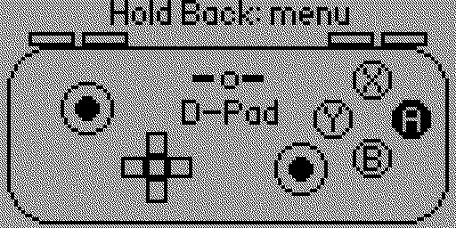
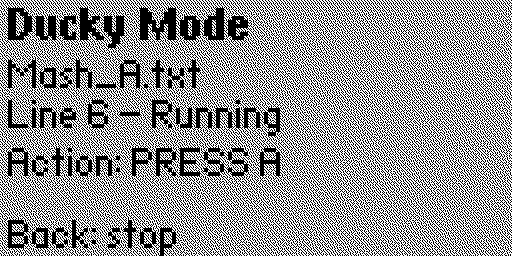

# Controller Ducky for Flipper Zero

Turn your Flipper Zero into a wired USB game controller. Controller Ducky emulates a **Nintendo Switch Pro Controller**, a **DualSense (PS5)** or an **Xbox** controller, and has two modes: play live with the Flipper's buttons (**Controller mode**), or run **Ducky-style scripts** that press controller buttons for you (**Ducky mode**).

Tested on real hardware, including a Switch 2.




---

## Table of contents

- [Getting started](#getting-started)
- [Supported controllers](#supported-controllers)
- [Features](#features)
  - [Controller mode](#controller-mode)
  - [Ducky mode](#ducky-mode)
- [Ducky scripting language](#ducky-scripting-language)
- [Building the app](#building-the-app)
- [Installing on your Flipper](#installing-on-your-flipper)
- [License](#license)
- [Disclaimer](#disclaimer)

---

## Getting started

1. Open the app from your Flipper's **Apps** menu.
2. **Select Controller**: pick **Switch Pro**, **DualSense (PS5)** or **Xbox**.
3. **Connect to Host**: plug the Flipper into a Switch or a computer. The app waits until the host recognizes the controller.
4. **Main menu**: choose **Controller Mode**, **Ducky Mode** or **Switch Controller**.

**Leaving a controller.** Choosing **Switch Controller**, or pressing **Back** on the main menu or the connect screen, returns to the select screen and stops the USB connection completely: the host sees the controller disappear, the Flipper's normal USB mode comes back, and nothing is sent until you pick a controller again.

**Unplugging.** If the host goes away (cable pulled, host asleep or reset) for about a second, the app does the same thing and shows **Connection Lost** on the select screen. Pick a controller again and it waits on the connect screen until the host is back.

---

## Supported controllers

| Controller | USB identity | Notes |
|---|---|---|
| Switch Pro | VID `057E` / PID `2009` | Answers the Switch's wired handshake and subcommands. On the Switch, enable **Pro Controller Wired Communication** under System Settings → Controllers and Sensors, or the console will ignore it. |
| DualSense (PS5) | VID `054C` / PID `0CE6` | Plain HID. For PCs (Windows, Linux, Steam, emulators). |
| Xbox | VID `045E` / PID `028E` | Uses the older XInput (Xbox 360 wired) protocol, not the Xbox One/Series GIP protocol. For PCs, Steam and most emulators. |

PlayStation and Xbox consoles authenticate their controllers with keys that can't be emulated, so DualSense and Xbox modes will not work on their respective consoles.

---

## Features

### Controller mode

Play directly with the Flipper. The screen shows a picture of the controller that lights up as you press buttons, so you can see exactly what is being sent to the host. The name of the active layout is shown in the middle of the picture.

**Layouts: changing what the buttons do**

The Flipper has only six keys, so Controller mode has six layouts that put different controller buttons under them. **Holding OK** cycles through them in order and wraps around. Cycle through the layouts and watch the picture to see which button each key sends.

| Layout | Arrow keys | OK (tap) | Back (tap) |
|---|---|---|---|
| **D-Pad** | D-Pad | Confirm: A / Cross / A | Cancel: B / Circle / B |
| **L-Stick** | Left stick | Confirm | Cancel |
| **R-Stick** | Right stick | Confirm | Cancel |
| **Face** | Face buttons (see below) | Plus / Options / Menu | Minus / Create / View |
| **Shoulder** | Up: ZL / L2 / LT<br>Down: ZR / R2 / RT<br>Left: L / L1 / LB<br>Right: R / R1 / RB | Home / PS / Xbox | Capture / Touchpad / none |
| **Home** | Left: Minus / Create / View<br>Right: Plus / Options / Menu | Home / PS / Xbox | none |

Each cell lists **Switch / DualSense / Xbox** where they differ.

**Face layout:** the arrow keys press the face buttons by position.

| Arrow key | Position | Switch | DualSense | Xbox |
|---|---|---|---|---|
| Up | North | X | Triangle | Y |
| Right | East | A | Circle | B |
| Down | South | B | Cross | A |
| Left | West | Y | Square | X |

**Home layout:** the three buttons in a row at the top centre of the controller (Switch: Minus, Home, Plus; DualSense: Create, PS, Options; Xbox: View, Xbox, Menu). Hold Left and Right while you tap OK to press all three at once.

**Not reachable from the Flipper's keys:** the stick clicks (L3/R3) and the DualSense mic mute button are not on any layout. They can be pressed from [Ducky scripts](#ducky-scripting-language). Triggers (ZL/ZR, L2/R2, LT/RT) are digital: fully pressed or released.

### Ducky mode

Run scripts from the SD card that press controller buttons automatically, like USB Rubber Ducky payloads but for gamepads. Use them for macros, repetitive grinding, menu navigation, input testing and automation.

1. Choose **Ducky Mode** from the main menu.
2. Pick a `.txt` script from the list (up to 24 scripts, sorted by name).
3. The script runs as soon as the host is polling the controller. The screen shows the current line, the state, which buttons are held, and the USB status.

| While | Back | OK |
|---|---|---|
| Running | Stop the script | |
| Done or stopped | Return to the script list | Run it again |

If a script can't run (wrong controller, loop error, file can't be opened), the screen says why. Fix the script and pick it again.

**Script folder on the SD card:**

```
/ext/apps_data/controller_ducky/scripts/
```

The folder is created automatically the first time you open the script list.

---

## Ducky scripting language

One command per line. Commands and button names are case-insensitive. Delays and hold times are in milliseconds. Button names that don't exist on the selected controller are ignored.

### Commands

| Command | Description |
|---|---|
| `CONTROLLER <name>` | Header declaring the controller the script is written for (see below) |
| `REM <text>` | Comment |
| `DELAY <ms>` | Wait before the next command |
| `PRESS <button> [button ...]` | Tap one or more buttons together (held about 105 ms) |
| `HOLD <button> [button ...] <ms>` | Hold one or more buttons for the given time, then release them |
| `PUSH <button> [button ...]` | Press and keep held, with no wait |
| `RELEASE <button> [button ...]` | Release held buttons |
| `RELEASE ALL` | Release everything the script is holding |
| `REPEAT <n>` | Run the previous command `n` more times (up to 10000) |
| `REPEAT START [n]` | Begin a loop: run the block `n` times, or forever if `n` is left out (until you press Back) |
| `REPEAT END` | End the innermost open loop |

`PRESS` and `HOLD` take several buttons for chords (`PRESS L R`). Use `PUSH` and `RELEASE` when you need to hold one button while doing something else, such as holding ZL while tapping A.

### Sticks

The sticks are controlled with direction names, which act like buttons. Opposite directions cancel out, and two directions at once make a diagonal.

| Left stick | Right stick |
|---|---|
| `LS_UP` `LS_DOWN` `LS_LEFT` `LS_RIGHT` | `RS_UP` `RS_DOWN` `RS_LEFT` `RS_RIGHT` |

```
HOLD LS_UP 2000        REM walk forward for 2 seconds
PRESS RS_LEFT          REM flick the camera
PUSH LS_UP LS_RIGHT    REM hold up-right until released
```

### Button names

| | Switch | DualSense | Xbox |
|---|---|---|---|
| Face buttons | `A` `B` `X` `Y` | `CROSS` `CIRCLE` `SQUARE` `TRIANGLE` | `A` `B` `X` `Y` |
| D-Pad | `UP` `DOWN` `LEFT` `RIGHT` | `UP` `DOWN` `LEFT` `RIGHT` | `UP` `DOWN` `LEFT` `RIGHT` |
| Shoulders | `L` `R` | `L1` `R1` | `LB` `RB` |
| Triggers | `ZL` `ZR` | `L2` `R2` | `LT` `RT` |
| Stick clicks | `LSTICK` `RSTICK` | `L3` `R3` | `LS` `RS` |
| System | `PLUS` `MINUS` `HOME` `CAPTURE` | `OPTIONS` `CREATE` `PS` `TOUCHPAD` `MUTE` | `MENU` `VIEW` `XBOX` |
| Left stick | `LS_UP` `LS_DOWN` `LS_LEFT` `LS_RIGHT` | same | same |
| Right stick | `RS_UP` `RS_DOWN` `RS_LEFT` `RS_RIGHT` | same | same |


### The CONTROLLER header

Put `CONTROLLER <name>` before any other command (comments and blank lines may come first). If the script names a different controller from the one you selected, it won't run and the screen shows which controller it needs. Scripts without a header run on whichever controller is selected.

| Controller | Accepted names |
|---|---|
| Switch Pro | `SWITCH` `SWITCHPRO` `PRO` `NINTENDO` |
| DualSense | `DUALSENSE` `PS5` `DS` `PLAYSTATION` |
| Xbox | `XBOX` `XINPUT` |

### Loops

`REPEAT START` and `REPEAT END` must pair up, and loops can be nested up to 8 deep. A script with an unpaired `START` or `END`, or loops nested too deeply, won't run: the screen shows the line with the problem.

### Example scripts

**Mash A forever (Back to stop)**

```
CONTROLLER SWITCH
REM mash A forever
REPEAT START
PRESS A
DELAY 200
REPEAT END
```

**Nested loops: press A once, then B five times, three times over**

```
CONTROLLER SWITCH
REPEAT START 3
PRESS A
REPEAT START 5
PRESS B
DELAY 100
REPEAT END
REPEAT END
```

**Hold a button while tapping another**

```
CONTROLLER SWITCH
PUSH ZL
PRESS A
DELAY 300
PRESS A
RELEASE ZL
```

**DualSense: sprint forward and jump**

```
CONTROLLER DUALSENSE
PUSH L3
HOLD LS_UP 2000
PRESS CROSS
RELEASE ALL
```

**Xbox: open the menu and pick the third item**

```
CONTROLLER XBOX
PRESS MENU
DELAY 500
PRESS DOWN
REPEAT 1
PRESS A
```

---

## Building the app

### 1. Install ufbt

You need Python3 with `pip`. Install the Flipper build tool:

```
python -m pip install --upgrade ufbt
```

### 2. Compile

From the project folder (the one containing `application.fam`):

```
ufbt
```

The first run downloads the Flipper SDK automatically. The compiled app is written to:

```
dist/controller_ducky.fap
```

To build and run it on a connected Flipper in one step, use `ufbt launch`.

> The app id must stay `controller_ducky`: the scripts folder and the generated icon header (`controller_ducky_icons.h`, built from `images/icon.png`) are named after it.

---

## Installing on your Flipper

1. Copy `dist/controller_ducky.fap` to the `apps` folder on the SD card (`ufbt launch` and `ufbt install` do this for you).
2. Copy your scripts to `/ext/apps_data/controller_ducky/scripts/`.
3. Open **Controller Ducky** from the Flipper's **Apps** menu.

---

## License
This project is licensed under the standard Apache license. See included [License](LICENSE).

## Disclaimer

This project is unofficial and is not affiliated with or endorsed by Nintendo, Sony, Microsoft or Flipper Devices. Use it with hardware you own. Using automation or macros in online games may violate their terms of service; you are responsible for how you use it.
