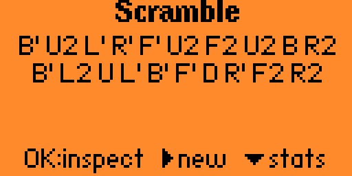
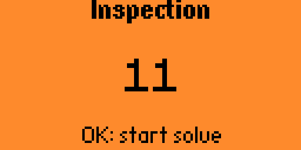
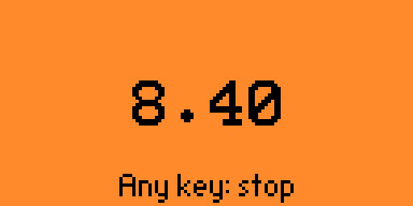
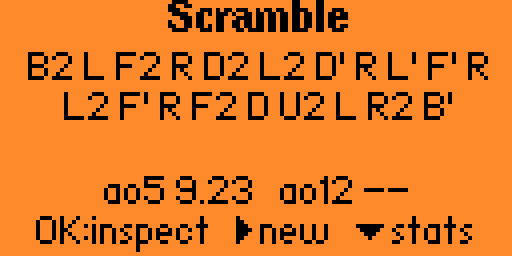
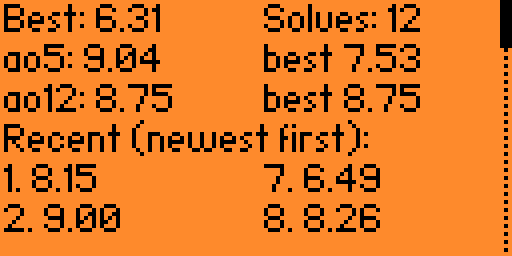

# Cube Timer for Flipper Zero

A speedcubing timer and 3x3 scrambler for the Flipper Zero. It generates a scramble, runs a WCA-style 15-second inspection, times your solve with the center button, and tracks your session stats including ao5 and ao12.

<p>
  
  
  
  
  
</p>

## Features

- **3x3 scrambles**: 20-move scrambles using the Flipper's hardware random number generator
- **WCA inspection**: 15-second countdown with vibration calls at 8s and 12s, automatic +2 (15–17s) and DNF (over 17s)
- **Solve timer**: start and stop with the center button, displayed to the hundredth of a second (`12.34`, `1:02.34`)
- **Session stats**: best single, current and best ao5 / ao12, solve count, and your last 12 times
- **Backlight stays on** during inspection and solving

## Usage

The app lives under **Apps → Tools → Cube Timer**.

1. Scramble your cube using the scramble on screen.
2. Press **OK** to begin inspection.
3. Press **OK** again to start the solve.
4. Press **any button** (except Back) to stop the timer.
5. Press **OK** for the next scramble.

### Controls

| Screen | Button | Action |
| --- | --- | --- |
| Scramble | OK | Start inspection |
| | Right | New scramble |
| | Down | Open stats |
| | Back | Exit app |
| Inspection | OK | Start solve |
| | Back | Cancel (not recorded) |
| Solving | Any except Back | Stop timer |
| | Back | Cancel (not recorded) |
| Result | OK / Back | Next scramble |
| | Down | Open stats |
| Stats | Up / Down | Scroll |
| | OK / Back | Return |

### Inspection and penalties

Inspection follows WCA rules:

| Inspection time | Result |
| --- | --- |
| Under 15s | No penalty |
| 15–17s | +2 seconds |
| Over 17s | DNF (recorded automatically) |

The Flipper vibrates once at 8s and twice at 12s, matching the calls a WCA judge makes.

### Averages

ao5 and ao12 are calculated WCA-style: drop the best and worst solve, take the mean of the rest, and round to the nearest hundredth.

- +2 penalties are included in a solve's time.
- One DNF counts as the worst solve and is dropped. Two or more DNFs make the average a DNF.
- An average shows `--` until there are enough solves.

Cancelled solves are not recorded.

### Scrambles

Scrambles are **random-move**: 20 random turns where the same face never repeats back-to-back and redundant patterns on one axis (like `R L R`) are skipped. This is the approach most timer apps use and works well for practice. Official WCA scrambles are **random-state** (a uniformly random cube position), which would need a full cube solver and more memory than the Flipper comfortably has.

## Installation

### Build from source

Requires [uFBT](https://github.com/flipperdevices/flipperzero-ufbt):

```bash
python3 -m pip install --user --upgrade ufbt
git clone https://github.com/navarr393/CubeTimer.git
cd CubeTimer
ufbt            # build → dist/cube_timer.fap
ufbt launch     # build, install to the connected Flipper, and run
```

If the app is already open on the Flipper, close it before running `ufbt launch`.

### Install a prebuilt .fap

Download `cube_timer.fap` from the [Releases](https://github.com/navarr393/CubeTimer/releases) page (or the GitHub Actions build artifacts) and copy it to `/ext/apps/Tools/` on the SD card with [qFlipper](https://flipperzero.one/update) or the Flipper mobile app.

### Compatibility

Built for the **official Flipper Zero firmware** (tested on release 1.5.1, API 88.2). FAPs are tied to the firmware's API version, so if the app refuses to load, rebuild it against your firmware's SDK (`ufbt update --channel=release` or `--channel=dev`). Custom firmwares need their own SDK.

## Limitations

- Session history lives in memory only and resets when you close the app.
- 3x3 only.
- Penalties can't be edited after a solve.

## Roadmap

- Save history to the SD card (`/ext/apps_data/cube_timer/`)
- Edit penalties (+2 / DNF) from the result screen
- Scrambles for other puzzles (2x2, 4x4, Pyraminx, Skewb)
- Hold-to-start "ready" indicator, like a stackmat

## Project structure

```
application.fam         App manifest (name, category, icon, version)
cube_timer.c            All app code: scrambler, timer, inspection, stats, UI
cube_timer.png          10x10 menu icon
images/                 Image assets compiled into the app
screenshots/            qFlipper screenshots (used here and in the Apps Catalog)
docs/changelog.md       Version history (used by the Apps Catalog)
docs/catalog.md         App description for the Apps Catalog (limited Markdown)
.github/workflows/      CI build for release and dev SDK channels
```

## License

MIT. See [LICENSE](LICENSE).
