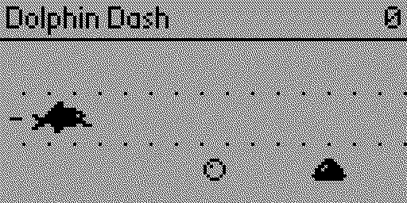

# Dolphin Dash

Every bubble is worth three points. Every bubble has a rock right behind it.

Swim through three lanes on your Flipper Zero. Stay in a clear lane to earn a point for each rock you pass, or dart in for a bubble and get out before the rock arrives. The game picks up speed after 6, 12, and 18 rocks. A wipeout ends the round. Your best score lasts until you close the game.

## Controls

- **OK** starts a dive or retries after a wipeout.
- **Up** and **Down** move one lane per press.
- **Back** exits the game.

## Play on a Flipper Zero

Download the game file that matches your firmware from [GitHub Releases](https://github.com/rasulkireev/dolphin-dash/releases). Use qFlipper's file manager to copy it into the apps/Games folder on the microSD card. On the Flipper, open **Apps → Games → Dolphin Dash**. The game uses the built-in screen and buttons.

## Build from source

From the repository root, run the official [uFBT build tool](https://github.com/flipperdevices/flipperzero-ufbt) with `ufbt` to build the game or `ufbt launch` to install and run it over USB. Use an SDK compatible with your device firmware.
