# Dooya Remote Emulator for Flipper Zero

A Flipper Zero app that emulates a Dooya shutter remote. Store a single remote
or a whole group of remote serials in one file, pick a channel, and send
Up / Stop / Down over Sub-GHz. A group sends the command to every stored serial
on the selected channel, so one key press can drive a roomful of blinds at once.

> **Transmit only.** This app sends Dooya commands, it never listens on the air.
> Serials come from `.sub` captures you recorded earlier or are typed in by hand.
> You still pair a serial with a motor the normal Dooya way (press P2 on a paired
> remote, then send P2 from the app).

## Protocol

Dooya DC90 / DC1602 family remotes, 433.92 MHz, OOK. Each frame is 24 bits of
serial, one channel byte and one button byte. The app auto-detects the channel
byte format of every imported serial (standard `0x0n` or the mask variant `0x1n`)
and keeps it per serial.

## Screenshots

| Main menu | Remote keypad | Remote menu |
|:---:|:---:|:---:|
| 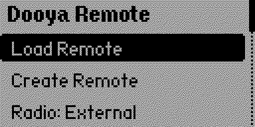 | 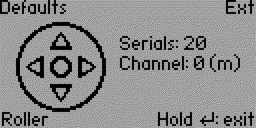 | 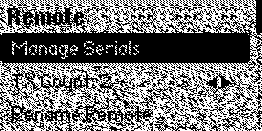 |

## Features

* **One remote or a whole group.** A file holds a single serial or many. A group
  sends every stored serial on the selected channel, one after another.
* **Import from `.sub` captures.** Point the app at any Dooya `.sub` file and it
  pulls out the 3 byte serial. The recorded button does not matter.
* **Type serials by hand.** Enter the serial as six independent hex digits.
* **Wildcards.** Set any digit to `*` and it expands to every value from 0 to F.
  `AA BB C*` sends 16 frames, `** ** **` sweeps the whole range. The list and the
  keypad tag show the expanded total.
* **Channels 0 to 15.** Left and Right change the channel and wrap around.
  Channel 0 is the master address that every channel answers to.
* **Per serial channel format.** Standard (`0x0n`) and mask (`0x1n`) are detected
  on import and stored for each serial, so a mixed group still works.
* **Roller and tilt modes.** Roller sends long Up / Down. Tilt sends short taps,
  and holding Up or Down jogs the motor until you let go.
* **Adjustable repeat count (TX Count).** Pick how many frames a single tap sends,
  from 1 to 5. The default of 2 matches a real remote.
* **Disable serials without removing them.** A disabled serial stays in the file
  but is skipped when sending and drops out of the group count.
* **External CC1101.** Switch to the add-on radio in the main menu. OTG power is
  held for the whole keypad view and the radio is checked before each send.
* **Save, rename, delete.** Changes are tracked, and leaving an edited remote asks
  whether to save first.

Managing the serials in a remote:

| Manage Serials | Serial list | Row actions |
|:---:|:---:|:---:|
| 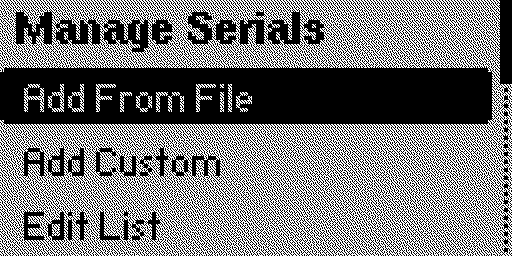 | 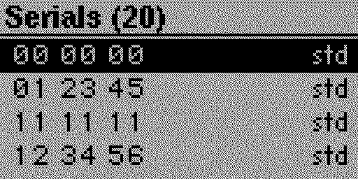 | 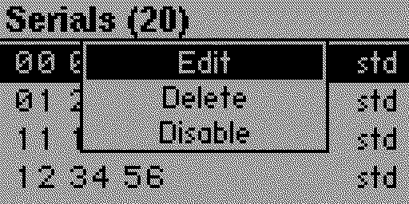 |

Editing a serial, adding a wildcard, and a disabled (struck out) row:

| Serial editor | Wildcard digit | Disabled row |
|:---:|:---:|:---:|
| 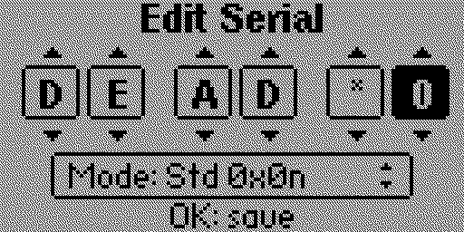 | 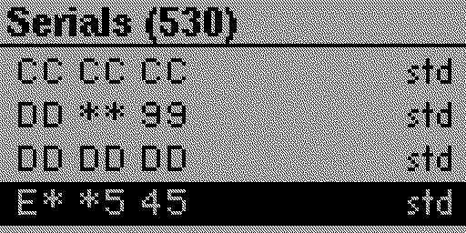 | 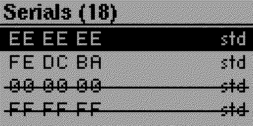 |

Sending commands from the keypad:

| Sending batch | Actions menu (hold OK) | Limit menu (hold Up / Down) |
|:---:|:---:|:---:|
| 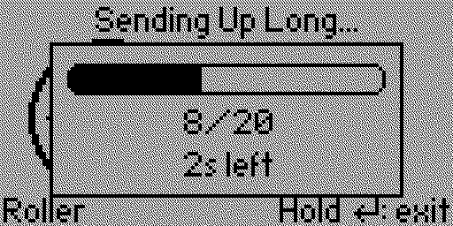 | 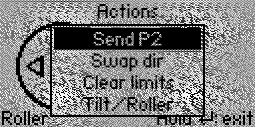 | 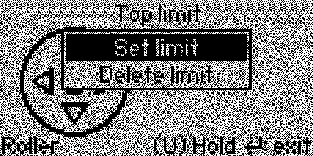 |

## Controls

The keypad view is drawn as a d-pad. The pressed key is highlighted and the last
command, with its hex code, is shown under the channel number.

| Button | Action |
|---|---|
| Left / Right | Change channel, wraps 0 to 15 (channel 0 = master) |
| Up (tap) | Send Up (long in roller mode, short in tilt mode) |
| Down (tap) | Send Down (long in roller mode, short in tilt mode) |
| OK (tap) | Send Stop |
| Up (hold) | Roller: top limit menu. Tilt: jog up until released |
| Down (hold) | Roller: bottom limit menu. Tilt: jog down until released |
| OK (hold) | Actions menu (**P2 / Swap dir / Clear limits / Tilt-Roller**) |
| Back | Open the Remote menu |
| Back (hold) | Exit to the main menu |
| Back (while sending) | Cancel the transmission and stay on the keypad |

A single tap sends *TX Count* frames (2 by default). The hold menus send for the
right duration and show a "sending, wait" box so no other key is pressed meanwhile.

The top left shows the loaded file name. The top right tag shows `S` only when a
single plain serial is stored, otherwise `G:<n>`, where `n` is the number of enabled
frames (wildcards expanded, disabled serials skipped). So two serials with one of
them disabled still read `G:1`. When every serial is disabled the tag gains `(D)`,
for example `S (D)` or `G:0 (D)`, and a key press then shows `No remotes`. The tag
ends in `I` or `E` for the internal or external radio. The bottom left shows the
current mode, `Roller` or `Tilt`. When there are unsaved changes a `(U)` marker
appears just left of the `Hold ... exit` hint.

## Menus

**Main menu**

* **Load Remote**: open a saved remote or group from `/ext/dooya_remote`. A file
  with no serials is rejected. The app ships with a bundled `Defaults` remote that
  is copied into this folder on first launch, so there is always one entry to pick.
  Edit or delete it like any other; it is not restored once removed.
* **Create Remote**: open a small submenu with **Create From File** and **Create
  Custom**. The first serial you add drops you straight onto the keypad. Back on
  this submenu returns to the main menu.
* **Radio: Internal / External**: pick the internal radio or the external CC1101.
* **About**: version, key map and the Dooya button combos.

**Remote menu** (press Back on the keypad)

* **Save Remote**: shown only when there are unsaved changes. It opens the name
  editor prefilled with the current name. If a file with that name already exists
  it asks "Overwrite the file?" (Discard / Save) instead of overwriting silently,
  and a confirmation is shown once it is written. Keeping the current name saves
  the current file. Typing a different name writes a copy and leaves the loaded
  remote untouched, so the keypad name does not change and the exit prompt still
  offers to save the original.
* **Manage Serials**: add, edit, enable, disable or remove serials.
* **TX Count**: how many frames one tap sends. Left and Right change it, 1 to 5.
  The two small arrows on the row mark it as adjustable.
* **Rename Remote**: rename the file (shown once the remote has a name).
* **Delete Remote**: delete the file after a confirmation (shown once named).

**Manage Serials**

* **Add From File**: pull the serial out of a Dooya `.sub` file.
* **Add Custom**: type the serial as six hex digits, each one Left/Right to pick
  and Up/Down to change. Push a digit past F to reach the `*` wildcard.
* **Edit List**: the stored serials. Press OK on one for **Edit**, **Delete** or
  **Enable / Disable**. Disabled rows are struck out and sorted to the bottom.
  Deleting is refused when only one serial is left, so a remote always keeps at
  least one. Those remaining serials may all be disabled, that is fine.

Duplicate serials and non-Dooya files are rejected. A new serial that overlaps a
serial or a wildcard already in the list is rejected too, even a disabled one.

## File format

Stored in `/ext/dooya_remote/<name>.dr`:

```
Filetype: Dooya Remote
Version: 1
Count: 2
Serials: E1 DC 03 7A 2B 91
Modes: 00 00
Wild: 00 00
Disabled: 00 00
Tilt: 0
TX Count: 2
```

`Serials` holds three bytes per entry. `Modes`, `Wild` and `Disabled` hold one byte
per entry and are optional, so older files still load. `Wild` is a bit mask of the
six digits that are wildcards. `Tilt` and `TX Count` apply to the whole remote.

## Build

Built with [ufbt](https://pypi.org/project/ufbt/). Works with Momentum, Unleashed
and other forks that ship the `subghz_devices` API.

```bash
pip install --upgrade ufbt
ufbt update --channel=release   # or point at your fork's SDK
# from the Dooya-Remote/ folder:
ufbt                            # builds dist/dooya_remote.fap
ufbt launch                     # builds, uploads and runs
```

Manual install: copy `dist/dooya_remote.fap` to `/ext/apps/Sub-GHz/` and launch it
from Apps then Sub-GHz.

## Notes and limitations

* The app transmits only. It does not receive or learn serials over the air.
* Set and delete limit commands are included but not every Dooya motor acts on an
  RF limit command. Many only take limits set at the motor head.
* A very wide wildcard such as `** ** **` is a large sweep (millions of frames).
  Back cancels any send in progress.
