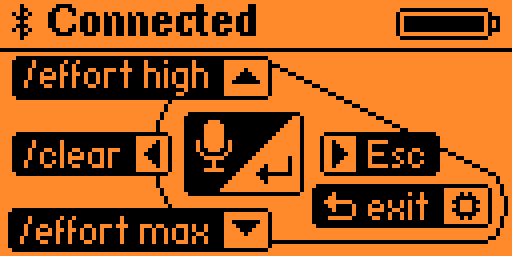
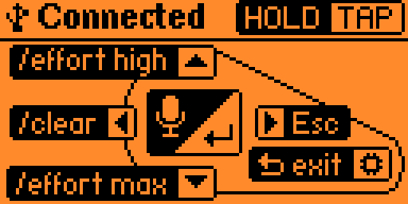
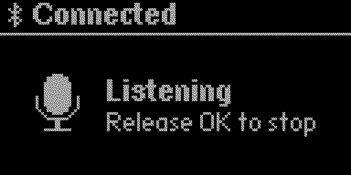
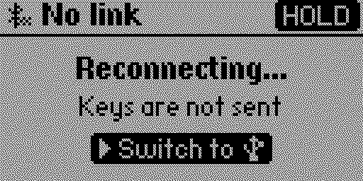
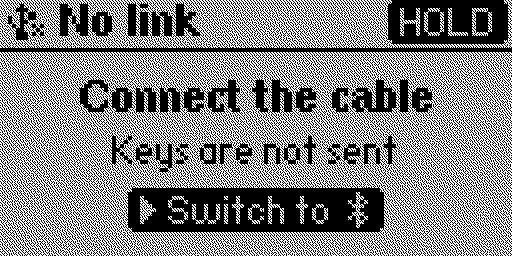
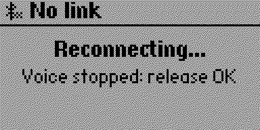
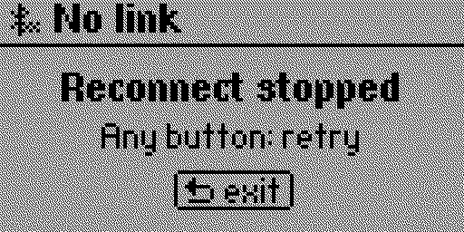
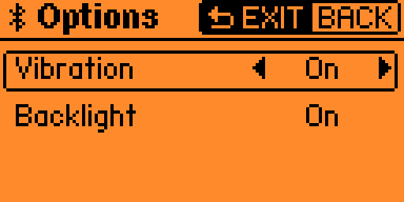

<div align="center">



# F0 Claude Remote

*Your voice runs Claude Code. Your Flipper Zero runs the shortcuts.*

A Flipper Zero app that acts as a Bluetooth remote for Claude Code.

[Documentation](https://petr-korobeinikov.github.io/f0-claude-remote/) ·
[Quick start](https://petr-korobeinikov.github.io/f0-claude-remote/quick-start/) ·
[Debugging](https://petr-korobeinikov.github.io/f0-claude-remote/development/debugging/)

</div>

## Why

Claude Code takes dictation, but a session still asks for the keyboard.
The Flipper's buttons do the rest, so voice and one hand run the whole session.

## Features

- **Dictation:** hold OK and speak; nothing is sent until you tap OK.
- **Prompt:** Enter, the arrows, and Esc to stop a turn.
- **Commands:** hold a button for `/clear` or the effort level.
- **Feedback:** every action buzzes and flashes; a tap on Back opens the options, where the buzz turns off.
- **The dolphin:** a dictation earns it 1 XP, a `/clear` 10.
- **Bluetooth:** a keyboard to the computer, paired once, reconnecting by itself.
- **USB:** with no Bluetooth link, hold Right and the cable takes over.
- **Debugging:** breakpoints on the device from CLion, with no plugin.

## Screens

<table>
<tr>
<td></td>
<td></td>
</tr>
<tr>
<td></td>
<td></td>
</tr>
<tr>
<td></td>
<td></td>
</tr>
<tr>
<td></td>
</tr>
</table>

## Installation

On a Mac with [mise](https://mise.jdx.dev), the Flipper unlocked on USB:

```shell
mise trust
mise install
mise run setup
mise run launch
```

Then pair it and bind the keys by the
[Quick start](https://petr-korobeinikov.github.io/f0-claude-remote/quick-start/).
Requirements and the Release build are under
[Installation](https://petr-korobeinikov.github.io/f0-claude-remote/guide/installation/).

## Contributing

See [Contributing](https://petr-korobeinikov.github.io/f0-claude-remote/contributing/workflow/).

## License

[GPL-3.0](LICENSE). Copyright (C) 2026 Petr Korobeinikov.
