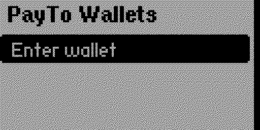
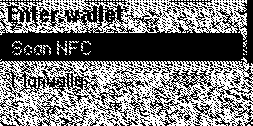
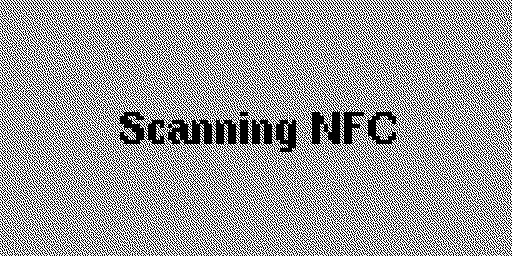

# PayTo Wallets for Flipper Zero

Scan PayTo wallet URIs from NFC NDEF tags, save them with an optional short name, and stream a selected wallet back over NFC.

## Display format

PayTo URIs are validated against supported blockchain address formats. XCB, XAB, and XCE use strict ICAN prefix and MOD-97 checksum validation. The parsed address is displayed using the currency plus the first and last four address characters, uppercased:

```text
payto://xcb/cb7147879011ea207df5b35a24ca6f0859dcfb145999
XCB: CB71-5999
```

Names are optional and limited to 16 characters. Saved wallets are stored on the Flipper under `apps_data/flipper_payto/wallets.txt`.

## Build and install

Install [ufbt](https://github.com/flipperdevices/flipperzero-ufbt), then run:

```sh
ufbt launch
```

The release workflow builds and attaches `flipper_payto.fap` when a GitHub release is published and is not a prerelease. Copy the FAP to the Flipper SD card at `apps/NFC/`.

Host-side parser tests run with:

```sh
make test
```

## Flow

Choose **Scan NFC** and present an NTAG/Mifare Ultralight NFC tag containing a URI NDEF record beginning with `payto://`. **Enter manually** is also available for typing the currency/address portion, such as `xcb/cb7147879011ea207df5b35a24ca6f0859dcfb145999`; the app adds `payto://` automatically. After a successful parse, choose **Save unnamed** or **Add name**. Selecting a saved wallet starts NFC NDEF emulation with that PayTo URI.

## Screenshots







## License

Released under the CORE License. See [LICENSE](LICENSE).
