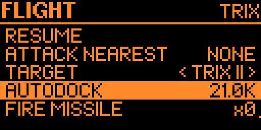
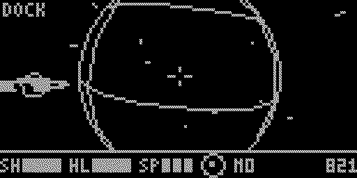
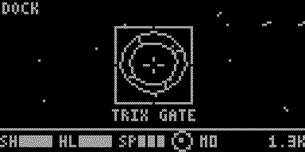
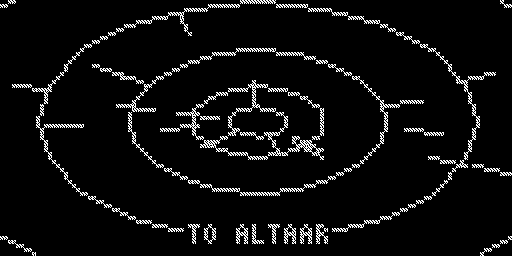
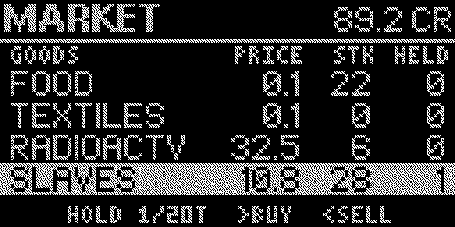
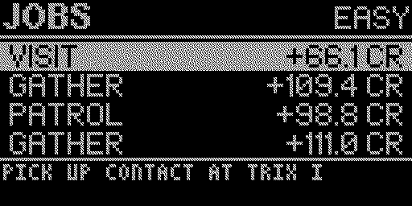
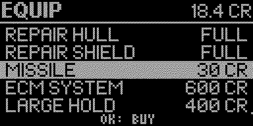
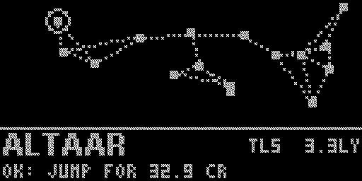
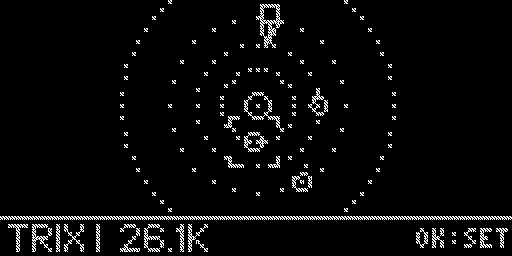
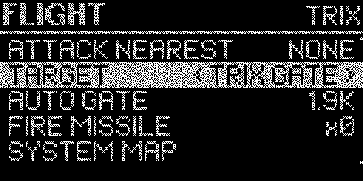

<p align="center">
  
</p>

<h1 align="center">Hazke for Flipper Zero</h1>

<p align="center">
  <b>A wireframe space trading and combat game for the Flipper Zero.</b><br>
  Fly between sixteen star systems, trade cargo, take jobs from planets and fight pirates.<br>
  It plays on the Flipper's six buttons and runs at about 58 frames per second.
</p>

<p align="center">
  <a href="https://github.com/therezor/hazke-flipper/releases/latest"><b>Download hazke.fap</b></a> ·
  <a href="#watch-it-play"><b>Watch it play</b></a> ·
  <a href="#install"><b>Install</b></a> ·
  <a href="#controls"><b>Controls</b></a>
</p>

---

## Watch it play

<table>
<tr>
<td width="50%"><br>
<b>Autodock.</b> Mark a planet and choose AUTODOCK. The ship warps around the sun, drops out near the planet, flies in and lands. The game saves on landing.</td>
<td width="50%"><br>
<b>Jump gates.</b> Fly into the gate and the galactic chart opens. Pick a linked system and press OK. A jump costs 10 CR per light year.</td>
</tr>
</table>

The clip at the top is a fight. ATTACK NEAREST locks the nose onto a pirate, the lasers fire while OK is held, and the kill pays a 25 CR bounty.

## What it is

Hazke for Flipper is a port of [Hazke](https://github.com/therezor/hazke), a space trading game for the M5Stack Cardputer. It uses the Cardputer game's galaxy seed, prices, ships, weapons, factions and jobs, so the sixteen systems have the same names and the same markets. The screen, the controls and the sound are new.

You fly in full 3D with pitch and roll on the D-pad. An autopilot covers what six buttons can't. It warps to a far planet and lands on it, flies into a jump gate, or keeps the nose on an enemy while you fire. Planets are wireframe globes, some with rings. The sun has a turning corona, and every ship is a wireframe model.

## By the numbers

| | |
|---|---|
| Galaxy | 16 star systems linked by jump gates |
| Each system | a sun, one to three planets and a jump gate |
| Market | 17 goods, 3 of them illegal |
| Weapons | 3 laser grades, up to 4 homing missiles and an ECM |
| Jobs | 5 kinds: hunt pirates, deliver, fetch, visit and courier |
| Factions | 4, each with a standing from -100 to +100 |
| Ranks | 7, from Harmless to Deadly |
| Frame rate | about 58 frames per second in flight |
| App size | 57 KB of code and 8 KB of RAM |
| Saves | one slot on the SD card, written on every landing and take-off |

## Screens

<p align="center">
  
  
  
</p>
<p align="center">
  
  
  
</p>
<p align="center">
  
  
  
</p>

All the screenshots and clips in this README come from a Flipper Zero. [Under the hood](#under-the-hood) explains the capture.

## Install

1. **Download.** Get `hazke.fap` from [Releases](https://github.com/therezor/hazke-flipper/releases/latest). The file targets the official firmware 1.5, which has app API 88.
2. **Copy it.** Put it in `SD Card/apps/Games/` with qFlipper or the Flipper mobile app.
3. **Play.** Open Apps, then Games, then Hazke, and choose NEW GAME. You start next to a jump gate with 100 credits and the first planet marked.

On other firmware, build it yourself with [ufbt](https://github.com/flipperdevices/flipperzero-ufbt):

```sh
ufbt update   # gets the SDK for your firmware
ufbt launch   # builds the app, installs it to /ext/apps/Games and starts it
```

## Controls

| Button | In flight |
|---|---|
| Up / Down | pitch |
| Left / Right | roll |
| OK, hold | fire the laser |
| OK, double-click | fire a missile at the marked ship, or at the ship nearest the nose |
| BACK, tap | next speed step: stop, 1/3, 2/3, full |
| BACK, hold | open the flight menu |

Pressing any direction ends warp, autodock or autolock and gives you the controls back. In menus BACK goes back one step. On a planet's main menu it takes off.

The flight menu has these items:

- **ATTACK NEAREST** marks the closest hostile ship and locks the nose onto it.
- **TARGET** steps through the planets, the gate and the ships with Left and Right.
- **AUTODOCK** warps to the marked planet when it is far away, then flies in and lands. With the gate marked it reads AUTO GATE and flies you into the ring. With a ship marked it reads LOCK ON.
- **FIRE MISSILE**, **SYSTEM MAP** and **GALAXY CHART**.
- **STATUS**, **FX** for sound and vibration, **SCREEN** for a dark or light screen, and **QUIT TO TITLE**.

## The HUD

The strip under the view shows, from left to right:

- `SH` and `HL`, the shield and hull bars.
- `SP`, the speed in three steps.
- A compass. A solid dot means the marker is ahead and a blinking dot means it is behind you. In deep space it points at the sun.
- `M` and the number of missiles you carry.
- The distance to the marker. For a planet it is your height above the surface.

Flags at the top of the view say `WARP`, `AUTO` for autolock, `DOCK` for autodock, `HEAT` near the sun, `MISSILE` when one is coming at you, and `HULL` when the hull is below 25%. Arrows on the edge of the view point at hostile ships and missiles you can't see.

## How to play

- **Trade.** Buy goods where they are cheap and sell them where they are scarce. Farm worlds sell food cheaply and pay well for machinery, and industrial worlds do the opposite. Each planet stocks its own mix of goods.
- **Take jobs.** Each planet posts four jobs, and you can hold one at a time. When you take off, the marker moves to the planet the job needs next. Most jobs pay when you land back at the planet that posted them. Courier jobs pay on arrival.
- **Fight.** Pirates attack on sight. Below 50% hull a ship's engines drop to half power, and below 25% its weapons stop working.
- **Travel.** Fly into a jump gate to open the galactic chart. You can only jump to systems the gate links to.

Kills, trades and jobs raise or lower your standing with four factions. If a faction's standing drops below -30, its patrols attack you. Standing also moves prices by up to 20% either way.

The shield recharges in about 37 seconds as long as it stays above zero. Once it reaches zero it stays down until you pay for a repair. Only the equipment shop repairs the hull.

| Equipment | Price | What it does |
|---|---|---|
| Repair hull | 10 CR per 10% | fixes hull damage |
| Repair shield | 100 CR | brings a downed shield back |
| Missile | 30 CR | a homing missile, up to 4 |
| ECM | 600 CR | blows up missiles that close in, by itself |
| Large hold | 400 CR | cargo space from 20 t to 35 t |
| Beam laser | 1000 CR | more damage and a faster rate of fire |
| Military laser | 6000 CR | the best laser, needs the beam laser first |

## Saving

The game saves to `apps_data/hazke` on the SD card each time you land and each time you take off. CONTINUE on the title screen puts you back on the planet where you last landed, and that is also where a destroyed ship sends you. The FX and SCREEN settings are kept in their own file.

## Changes from the Cardputer game

- Pitch and roll only. There are no yaw keys, though autolock still turns the ship in yaw.
- Autolock is standard equipment instead of a 300 CR module, because the D-pad can't steer and fire at once.
- The ECM fires by itself when a missile closes in.
- AUTODOCK and ATTACK NEAREST are new.
- A compass and edge arrows replace the 3D scanner.
- One save slot, written on landing and take-off, replaces the five slots in the landing menu.
- There is no hailing or looting ships, no asteroid belts, no gyro aiming and no commander name. Every commander is JAMESON.
- Sound effects are piezo tones, and hits make the Flipper vibrate.

## Under the hood

1. **Shared rules.** The galaxy, market, ships, combat, missiles, jobs, factions and ranks are the Cardputer game's C++ headers. `Platform.h` replaces the few Arduino calls they make.
2. **A frame buffer in the screen's own layout.** `Render.h` draws lines, circles and a 3x5 font into 1 KB laid out like the display's memory, and each frame reaches the screen with one copy. Drawing through the firmware's bitmap call took about 40 ms a frame and starved the button input. The copy takes less than 1 ms.
3. **Wireframe 3D.** `World.h` clips every line at the near plane and the edge of the view. A planet hides the far half of its globe lines, and `World.h` skips anything behind the sun or a nearer planet.
4. **Sound on its own thread.** `Audio.h` plays tone sequences from a thread that owns the speaker, because the firmware only lets the owning thread drive it.
5. **A desktop simulator.** `tools/sim/run.sh` builds the flight code and the renderer for a computer and writes sample frames to `tools/sim/sheet.png`.
6. **Capture builds.** With `HAZKE_CAPTURE` set to 1 in `Config.h`, the game writes every third frame it shows to the SD card. `tools/demo.py` plays a scripted demo over the USB command line, and `tools/frames.py` turns the recording into PNGs and GIFs.

<details>
<summary><b>Code map</b></summary>

```text
hazke.cpp        app setup, frame loop, buttons, all menus
Config.h         version, screen layout, frame rate, capture switch
Platform.h       millis() and the includes the shared headers need
Flight.h         flight, autopilot, autodock, landing, gate contact
World.h          wireframe view, HUD, system map, title ship, hyperspace
Render.h         frame buffer, lines, circles, 3x5 font
Audio.h          piezo sound effects and vibration
Save.h           the save slot and settings on the SD card
Capture.h        frame recording for capture builds
GameState.h      credits, cargo, ship, factions
Galaxy.h         the 16 systems and their gate links
SolarSystem.h    the sun, planets and gate in each system
NPCShip.h        traders, pirates and patrols
Combat.h         lasers and damage
Missile.h        homing missiles and ECM
Particles.h      explosions
Ship3D.h         ship models
Market.h         prices and stock
Quest.h          jobs
Faction.h        faction standing
Rank.h           combat rank
Hyperspace.h     jump cost and range
tools/           simulator, demo driver, frame converter
```

</details>

## License

MIT, see [LICENSE](LICENSE). Made by REZOR, [@therezor](https://github.com/therezor) on GitHub.
