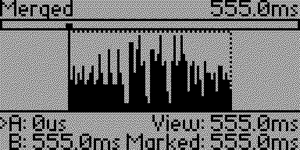
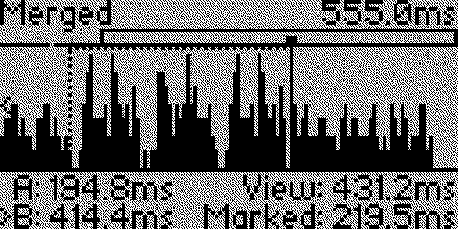
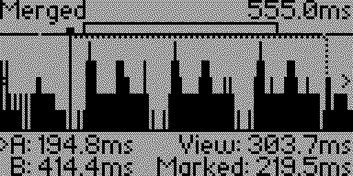
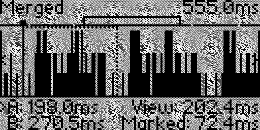
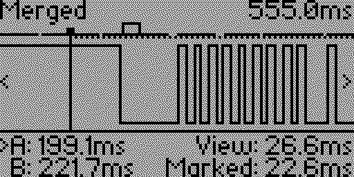
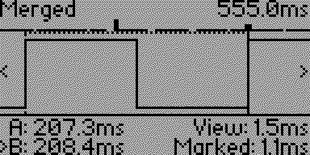
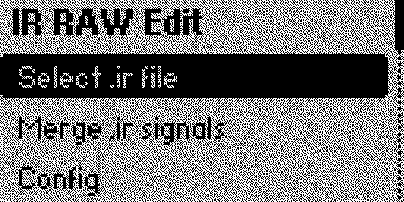
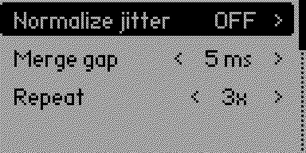
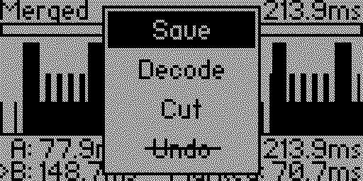
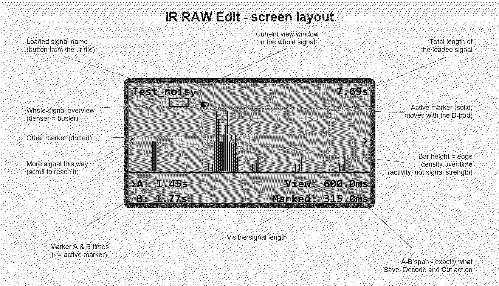

https://github.com/user-attachments/assets/7540fd68-e96a-4da3-8f21-ade4a2166210

# IR .ir RAW Signals Editor for Flipper Zero

<p align="center">
  <a href="https://buymeacoffee.com/Lechnio"></a>
</p>

A tiny on-device waveform editor for **Flipper Zero** that trims infrared `.ir`
signals down to just the part you care about. Open a remote, pick a button,
let the app find the actual frame, slide two markers to the start and end of
one clean copy and save it as a new `.ir` - or cut an unwanted stretch out of
the middle and keep editing.

Built for cleaning up learned signals before analysing or replaying them -
a long capture full of repeats becomes a single tidy frame.

Want one button to do several things (TV on + soundbar on)? Use the merge
feature to combine signals from **any** `.ir` files into a single RAW signal
and play it back from the main Infrared app. No third party applications required.

> **Analysis only.** This app never transmits. It only reads, displays
> and writes files you already have on the SD card.

## Supported signals
Both `raw` and `parsed` signals are supported. Parsed signals (NEC, Samsung32,
RC5, RC6, SIRC, Kaseikyo, ...) are rendered by the firmware's own IR encoder,
so every protocol your firmware knows works.

As `Save` always writes a `raw` signal, it can also turn any parsed signal
back into raw timings.

## Screenshots

Zooming from the full activity envelope all the way down to individual marks
and spaces:

| Envelope (zoomed out) | Signal within noise | Signal zoom |
|:---:|:---:|:---:|
|  |  |  |

| Single signal frame | Signal waveform | Single waveform edge |
|:---:|:---:|:---:|
|  |  |  |

## Features

- **Pick a signal.** An `.ir` file holds many buttons, so after choosing the
  file you pick the signal from a list (skipped when the file has only one).
- **Auto-locates the frame.** On open it finds the longest burst between long
  spaces (the most complete frame copy) and places the A/B markers around it.
- **Two view modes, switched automatically by zoom:**
  - *Envelope* when zoomed out - bar height shows edge density, not amplitude.
  - *Real square wave* when zoomed in past ~40 ms - inspect individual marks
    and spaces to place cuts precisely.
- **Overview strip** along the top shows the whole signal with a bracket
  marking where your current zoomed view sits.
- **Trim, decode, cut or undo.** Hold **OK** to open a small action menu:
  - *Save* writes just the A..B selection to a new `.ir` file, and lets you
    edit the suggested name first.
  - *Decode* runs the A..B selection through the firmware's IR decoders. When
    several different frames are found they are listed (identical consecutive
    frames and their repeat codes collapse into one entry, `x3` = 3 frames).
    Picking one shows the protocol, address, command, frame and repeat counts.
    *Save* there writes it as a `parsed` signal, so a learned raw signal can
    become a clean parsed one.
  - *Cut* removes everything between the markers from the in-RAM working copy
    and joins the two sides back together. Nothing is written to the card until
    you Save.
  - *Undo* reverts the last cut. It is struck through when there is nothing to undo.
- **Merge multiple signals** into one with *Merge .ir signals*. Signals are
  separated by the *Config → Merge gap* (1 ms - 1 s).
- **Repeat** any loaded signal up to 64 times with *Config → Repeat*. It applies
  to both **Select .ir file** and **Merge .ir signals**. A repetition keeps the
  signal's own trailing space when it has one, otherwise the merge gap is used.
- **Clean output.** The saved signal starts and ends on a mark, with the
  original `frequency` and `duty_cycle` preserved. *Config → Normalize jitter*
  snaps the timings to a common base unit.

| Main menu | Config menu | Action menu |
|:---:|:---:|:---:|
|  |  |  |

## Controls

| Button       | Action                                          |
|--------------|-------------------------------------------------|
| Left / Right | Move the active cut marker (hold = move faster) |
| Up / Down    | Zoom in / out (centered on the active marker)   |
| OK (short)   | Switch the active marker between **A** and **B**|
| OK (hold)    | Action menu (**Save / Decode / Cut / Undo**)    |
| Back         | Exit                                            |

The active marker is the one drawn as a solid line with a small box on top, and
marked with `>` in the bottom bar. The other marker is dotted.



## Usage

1. Launch **IR RAW Edit** from *Apps -> Infrared*.
2. Pick any `.ir` file from `/ext/infrared`, then the signal.
3. The view opens on the detected frame. Zoom out (Down) to see the whole
   signal, zoom in (Up) to see individual marks.
4. Place **A** at the start of one clean frame, press OK, place **B** at the end.
5. Hold **OK** and choose **Save**. A name is suggested (`<name>_edit1`, the
   next free `_edit2`, ...), the selection is written to `/ext/infrared/<name>.ir`
   under the original signal name.

## File format

Writes a standard Flipper infrared file with a single raw signal:

```
Filetype: IR signals file
Version: 1
#
name: Power
type: raw
frequency: 38000
duty_cycle: 0.330000
data: 9024 4512 579 552 ...
```

## Build

Works with the official firmware, Momentum, Unleashed and other forks.

```bash
pip install --upgrade ufbt
ufbt update --channel=release        # or point at your fork's SDK
# from the IR-RAW-Edit/ folder:
ufbt                                 # builds dist/ir_raw_edit.fap
ufbt launch                          # builds + uploads + runs
```

Manual install: copy `ir_raw_edit.fap` to `/ext/apps/Infrared/` and launch it
from **Apps -> Infrared**.

## Notes & limitations

- **No signal strength.** An `.ir` raw signal is only a list of mark and space
  durations, so the Y axis of the envelope is edge density, not power.
- **1024 timings per saved signal.** That is the limit of the Infrared app, so
  a longer selection is refused with `Too long`. Trim or cut it first. The
  editor itself holds up to ~24000 samples, so long merges can still be viewed.
- **Up to 256 signals** are listed from one file (large universal libraries are
  cut off there).
- Durations are stored as samples of at most 32 ms; longer spaces are split
  internally and joined back on save.
- **Undo is one level deep.**
- Merged signals must share the same carrier frequency.
