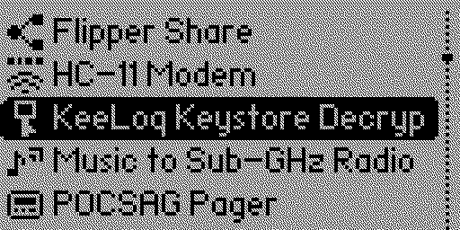
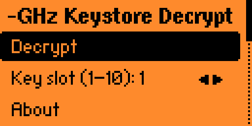
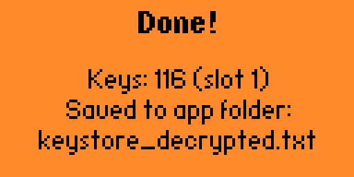

# Sub-GHz Keystore Decryptor for Flipper Zero

  

As the name suggests, if you've made it this far, you already know what the purpose of all this is.\
I'm not gonna share decrypted database here, at least build it by yourself.\
Decrypted keys will be stored on your SD Card under `/ext/apps_data/subghz_keystore_decryptor/keystore_decrypted.txt`.

## Why
To find out what types of keys are bundled with the firmware.

## Features
Decrypt KeeLoq database bundled with the firmware.
Works with any currently released firmware (e.g. Momentum rev. MNTM-012).
Choose the secure enclave key slot in the app menu (Left/Right on `Key slot`, factory slots 1-10, default 1).

## Screenshots
||||
|:---:|:---:|:---:|
|  |  |  |

## Notes & limitations
- Decryption must be performed on the Flipper Zero device because the AES key is stored in its secure enclave.
- If a firmware encrypts the keystore with a key from a different slot, select that slot in the app menu. The keystore ships to every device, so only the factory slots 1-10 (the same keys on all Flippers) are offered. A different IV permutation still needs a code change.
