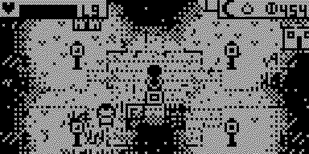

# Lanternfall for Flipper Zero

A lantern-lit action RPG for the Flipper Zero: a procedural island of villages, forests and coast, a full day and night with lantern light, storms, slimes, wolves, charging boars and night shades, quests, a merchant, a map, auto-attack and an idle mode that plays on by itself.

It is a single-player demake of Lanternfall, a browser pixel-art MMORPG by Dusk Engineering, and shares its village names and townsfolk.



## Install

Build it yourself with [uFBT](https://github.com/flipperdevices/flipperzero-ufbt):

```
pip install ufbt
ufbt            # builds dist/lanternfall.fap
ufbt launch     # installs to /ext/apps/Games and runs it on a connected Flipper
```

## Controls

| Button | In play |
|---|---|
| D-pad | walk (hold to keep walking) |
| OK | attack, talk, trade, read a notice board, drink at a well |
| Hold OK | eat bread |
| Back | pause menu: Resume, Go idle, Bag, Hero, Map, Settings, Save & quit |
| Hold Back | save and quit |

Settings: auto-attack, idle range (Near or Roam), sound, vibration, LED, backlight, screen shake, lightning flash, rain. A Controls page is in Settings too. The save is `/ext/apps_data/lanternfall/save.bin` and settings are in `settings.bin` beside it.

## How it is built

- `game.c` / `game.h`: all game logic, with no Flipper dependencies, so it runs and is tested on a computer. The world is a pure function of its seed: value-noise terrain, one village per 48-tile cell from a template, monster AI, quests, shop, saves, settings and idle (breadth-first path search over a cached walkability map).
- `render.c`: draws the 128x64 1-bit frame (tiles, props, actors, particles, rain, lantern light with a dithered night pass, HUD, title, map).
- `lanternfall.c`: the Flipper shell. 20 fps loop, input, sound, vibration and LED, saves, menus and dialogue in Flipper fonts. The frame is drawn as runs of black pixels from a snapshot, because `canvas_draw_xbm` costs about 28 ms a frame on the device.
- `sprites.txt`: all the art as ASCII, turned into `sprites.h` by `tools/gen_sprites.py`.

Checks and tools:

```
cc -O1 -g -fsanitize=address,undefined -I. test.c game.c render.c -o /tmp/lft && /tmp/lft
cc -O2 -I. tools/preview.c game.c render.c -o /tmp/lfprev && mkdir -p /tmp/prev && /tmp/lfprev /tmp/prev && python3 tools/png.py /tmp/prev
python3 tools/screen.py shot.png    # capture the Flipper's screen over USB (needs pyserial)
```

After regenerating `sprites.h`, run `ufbt format` so `ufbt lint` stays clean.

## Licence

MIT, see [LICENSE](LICENSE).
