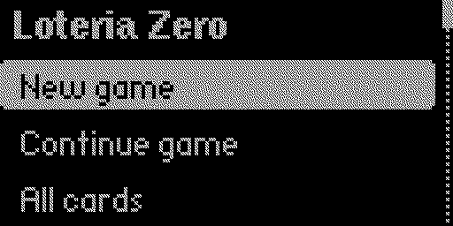
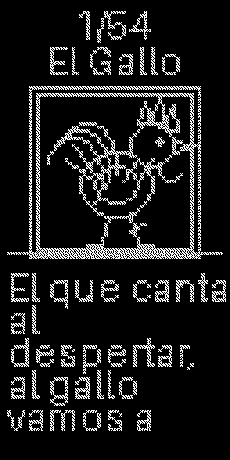
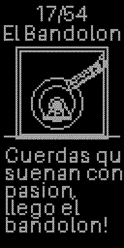
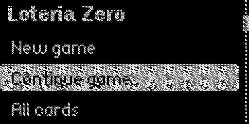
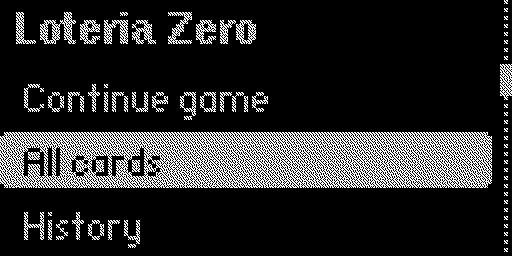

# Loteria Zero

**Tradition in your hands.**

Native Flipper Zero app (`.fap`) that turns the device into a **digital caller** for classic Mexican Loteria (54 cards).

Visual identity: Mexican tradition + retro aesthetic + Flipper monochrome minimalism.

## Screenshots

Main menu:



Card view - El Gallo (1) and El Bandolon (17), upright for reading:





Menu navigation:





---

## A special dedication

# For APA

The inspiration behind every line of code, every idea, and every project.

Because the best creations are born from what we love most.

---

## Features

- Full deck of **54 traditional cards**
- Original Spanish **rhymes** (ASCII-folded on device)
- Original **1-bit** illustrations for 128x64
- Fisher-Yates shuffle with no repeats in a game
- Vertical card view (rotate the Flipper)
- History of called / pending cards
- Persistent statistics
- Auto-call mode (5 / 10 / 15 s or manual)
- Dedicated welcome (skippable after first run)
- **Our story** section

## Architecture

`cards.json` is the **single source of truth** for the catalog. At build time it becomes static C (`src/cards_data.c`) so the device never parses JSON.

| Module | Role |
|--------|------|
| `cards.json` + `tools/gen_cards.py` | Catalog and validation |
| `tools/gen_card_art.py` | 1-bit illustrations |
| `src/game.c` | Engine / shuffle / progress |
| `src/renderer.c` | Vertical card drawing |
| `src/storage.c` | Persistence (`saved_struct` via `APP_DATA_PATH`) |
| `src/scenes/*` | SceneManager navigation |
| `src/loteria_zero.c` | FAP entry point |

### Screen orientation

Hybrid layout:

- Menus stay in native landscape (128x64)
- Gameplay uses `ViewOrientationVertical` (logical canvas 64x128)

The physical panel does not resize: hold the Flipper with the D-pad at the bottom. Firmware remaps buttons.

## Structure

```
loteria-zero/
├── application.fam
├── cards.json
├── loteria_zero.png
├── README.md
├── docs/                   # Catalog description + changelog
├── screenshots/            # Catalog / README captures
├── catalog/manifest.yml    # Draft for Apps Catalog PR
├── images/                 # 54 PNG 1-bit (+ icons)
├── files/cards.json        # Asset packed into the FAP
├── src/
│   ├── loteria_zero.c/.h
│   ├── cards_data.c/.h     # generated
│   ├── game.c/.h
│   ├── renderer.c/.h
│   ├── storage.c/.h
│   └── scenes/
├── tools/
│   ├── gen_cards.py
│   ├── gen_card_art.py
│   └── capture_screenshots.py
├── tests/
└── dist/loteria_zero.fap   # after build
```

## Requirements

- Python 3.8+
- [uFBT](https://github.com/flipperdevices/flipperzero-ufbt) (`pip install --upgrade ufbt`)
- Pillow (to regenerate art): `pip install pillow`
- Flipper firmware matching the uFBT SDK (tested on **release 1.5.1 / API 88.2**)

## Build

```bash
# Install tooling
python3 -m pip install --upgrade ufbt pillow

# Regenerate C catalog and art (when cards.json changes)
python3 tools/gen_card_art.py
python3 tools/gen_cards.py --json cards.json --out-h src/cards_data.h --out-c src/cards_data.c --images images

# Build FAP
ufbt
```

Artifact:

`dist/loteria_zero.fap`

After regenerating sources, run `ufbt format` (or `ufbt lint`) so clang-format stays clean for catalog checks.

## Install on Flipper Zero

1. Connect Flipper over USB
2. `ufbt launch` (build, upload, run), **or**
3. Copy `dist/loteria_zero.fap` to `SD Card/apps/Games/` with qFlipper
4. Open **Apps → Games → Loteria Zero**

If the API/SDK mismatches: `ufbt flash_usb` (updates firmware to the SDK channel).

## Controls

### Menus

| Button | Action |
|--------|--------|
| UP / DOWN | Navigate |
| OK | Select |
| BACK | Back / exit |

### Game (Flipper held vertically)

| Button | Action |
|--------|--------|
| OK | Call next card (or exit history browse first) |
| Right | Next card, or step forward in history |
| Left | Step back through all called cards |
| Up / Down | Scroll the rhyme |
| BACK | Leave history browse, then save and menu |

Down also pauses auto-call when a timed mode is active.

## Settings

- **Auto mode**: Manual, 5s, 10s, 15s
- **Skip welcome**: after the first run

## Catalog data

The 54 traditional cards (El Gallo … La Rana), each with:

- `id`, `name`, `image`, `rhyme`

Edit `cards.json` and regenerate with the scripts in `tools/`.

Spanish names and rhymes are kept; on-device text is ASCII-folded so Flipper fonts do not show blank boxes.

## Tests

```bash
python3 -m unittest tests/test_catalog.py -v
```

Checks: 54 cards, unique IDs, rhymes, illustrations, traditional order, shuffle without duplicates, and the README dedication.

## Apps Catalog

Catalog-facing copy lives in `docs/description.md` and `docs/changelog.md` (allowed markdown only — do not point the catalog at this README).

Draft manifest: `catalog/manifest.yml` → copy to `applications/Games/loteria_zero/manifest.yml` in [flipper-application-catalog](https://github.com/flipperdevices/flipper-application-catalog).

Validate:

```bash
python3 tools/bundle.py applications/Games/loteria_zero/manifest.yml bundle.zip
```

One app per pull request. Update `commit_sha` to the release commit before opening the PR.

## Technical limits

1. Vertical orientation only works on the fullscreen view layer (firmware GUI limit).
2. Flipper fonts may not draw accented glyphs; display strings are ASCII-folded. Canonical text stays in `cards.json` and **Our story**.
3. No voice audio: calling is visual (name + rhyme) with vibration on reveal.

## License

This project is released under the [MIT License](LICENSE).

## Credits

- Tradition: popular Mexican Loteria
- Platform: Flipper Zero Official Firmware SDK / uFBT
- Project: **Loteria Zero**

## A special dedication

# For APA

The inspiration behind every line of code, every idea, and every project.

Because the best creations are born from what we love most.
