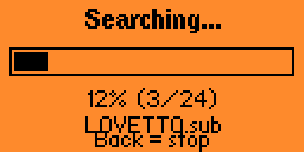
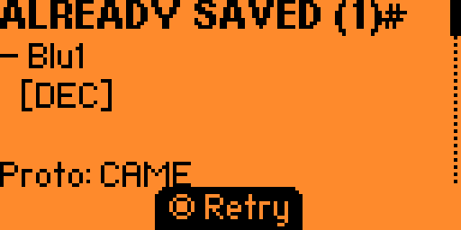

# Flipper-Zero-RFidentifier
Flipper Zero apps that identifies SubGhz signal and duplicates.

 

**RFidentifier v1.0** is an external application for **Flipper Zero running Momentum firmware**, created by **Marcopiiit**.

RFidentifier helps identify previously saved Sub-GHz signals and find duplicate recordings in your Flipper Zero `.sub` file collection.

It supports both decoded protocol identification and RAW signal fingerprint comparison.

*SEARCH IN ALL FILES IS NOT RECOMMENDED IF YOU HAVE A BIG SUBGHZ DATABASE, CHANGE APP SETTINGS BEFORE SEARCHING YOUR SIGNAL*

## Features

### Read
- Listen for incoming Sub-GHz transmissions.
- Identify decoded protocols and signal keys.
- Compare captured signals against saved `.sub` files.
- Support decoded, RAW and combined detection.
- Display matching filenames.
- Report whether a signal is already saved.

### Duplicate
- Scan saved `.sub` files for duplicate signals.
- Compare decoded protocol names and keys.
- Compare RAW signal fingerprints.
- Display matching filename pairs.
- Show scanning progress.
- Cancel an ongoing scan.

### Settings

Customize the application:

| Setting | Options |
|---|---|
| Frequency | 18 selectable frequencies |
| Signal Type | Decoded / RAW / Both |
| Search In | All files / Saved only / Folder |
| Folder | Browse and select a directory |
| Sensitivity | Low / Medium / High / Max |

Settings are automatically saved and restored between sessions.

## Supported Frequencies

- 300.00 MHz
- 303.87 MHz
- 304.25 MHz
- 310.00 MHz
- 315.00 MHz
- 318.00 MHz
- 330.00 MHz
- 345.00 MHz
- 390.00 MHz
- 433.07 MHz
- 433.42 MHz
- 433.92 MHz
- 434.42 MHz
- 434.77 MHz
- 438.90 MHz
- 868.35 MHz
- 915.00 MHz
- 925.00 MHz

Default frequency: **433.92 MHz**

Actual reception depends on hardware capabilities and regional radio-frequency regulations.

## Search Modes

**Decoded**

Compares decoded protocol names and keys.

**RAW**

Compares captured RAW signal fingerprints based on pulse timing.

**Both**

Uses both decoded protocol identification and RAW fingerprint matching.

## Search Scope

- **All files:** Searches `/ext/subghz` and its subfolders.
- **Saved only:** Searches files directly inside `/ext/subghz`.
- **Folder:** Searches a user-selected folder and its subfolders.

## Technical Details

| Parameter | Value |
|---|---|
| Platform | Flipper Zero |
| Firmware | Momentum |
| Application type | External |
| Version | 1.0 |
| Default frequency | 433.92 MHz |
| Radio module | CC1101 |
| Default sensitivity | Medium (-70 dBm) |
| Maximum captured pulses | 700 |
| Minimum valid capture | 60 pulses |
| Maximum files scanned | 400 |
| Maximum displayed matches | 30 |
| Maximum duplicate pairs | 60 |

### RAW Fingerprint Detection

RFidentifier extracts a fingerprint consisting of 24 pulse durations following the first long signal gap.

Pulse comparison uses timing tolerance to account for variations between recordings.

This allows comparison of RAW signals even when their recorded pulse durations are not perfectly identical.

## File Locations

**Signal recordings:**

`/ext/subghz/`

**Application settings:**

`/ext/apps_data/rfidentifier/settings.conf`

The application scans `.sub` files without modifying or deleting existing recordings.

## Limitations

- Maximum of 400 files per scan.
- Maximum of 60 duplicate pairs displayed.
- RAW matching relies on pulse fingerprints and timing tolerance.
- Very short or noisy signals may not be recognized.
- Decoded identification depends on the available Sub-GHz protocol decoders.
- Reception depends on the selected frequency, signal strength and hardware limitations.

## Disclaimer

RFidentifier is intended for signal identification and management of your own Sub-GHz recordings.

Use the application responsibly and comply with applicable radio-frequency regulations.

## Credits

**Created by Marcopiiit**

Version: 1.0

Platform: Flipper Zero – Momentum Firmware
