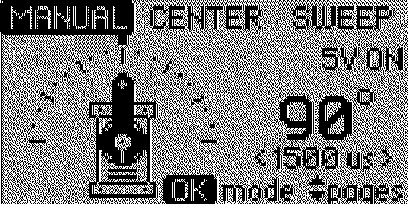
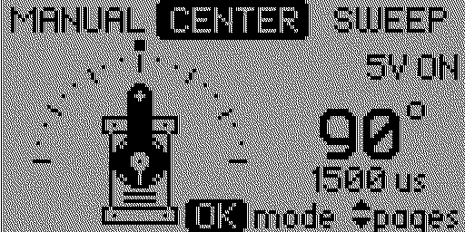
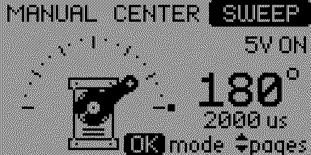
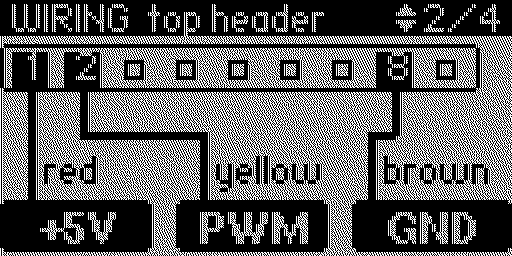
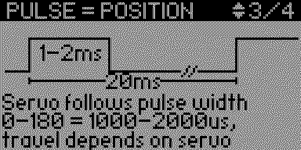
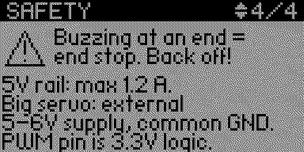
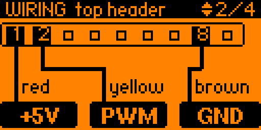

# ServoMotor

**Hobby servo tester for Flipper Zero with angle control, jitter-free hardware PWM and an animated servo on screen.**

<p align="center">
  
</p>

ServoMotor drives a standard RC servo from the Flipper Zero GPIO header. Pick an angle,
the app sends the matching pulse and a pixel-art servo shows how the output shaft and horn
should be moving.

The pulse is generated by the **TIM1 hardware timer on PA7**, not by a software delay loop.
GUI redraws, button handling or Bluetooth cannot stretch or shift the pulses, so the servo
holds its position without twitching.

## Why another servo tester?
There are already servo apps for Flipper Zero. ServoMotor combines the parts that matter for testing a real servo:

| | **ServoMotor** | Servo Tester+ | ServoTester |
|---|---|---|---|
| Pulse generation | **Hardware timer (TIM1)** | Software delay loop in a thread | Hardware timer (TIM1) |
| Control | **Angle, 0-180 degrees** | Angle, 0-180 degrees | Pulse width in us |
| Frame period | **Fixed 20 ms (50 Hz)** | Pulse + 18 ms delay (varies) | 50 Hz |
| On-screen servo | **Animated servo and horn** | Text | Text |
| Built-in help | **Wiring diagram, pulse info, safety** | Wiring text | - |

**Why hardware PWM matters.** A software-timed pulse is made by setting the pin high, waiting and setting it low.
If the Flipper runs another task during that wait (screen, buttons, Bluetooth), the pulse comes out longer and the
servo twitches. Measured with an oscilloscope, a software-timed tester produced isolated pulses hundreds of
microseconds too long (one pulse +362 us out of 100, about 65 degrees for a moment). ServoMotor's pulses come from
the timer peripheral: 1000.0 / 1500.0 / 2000.0 us with a standard deviation below 0.3 us.

**Why angles and a picture.** ServoTester is also stable, but you set raw microseconds. ServoMotor keeps that
stability and lets you think in degrees, while showing what the horn should be doing and which pins to use.

## Features
- **Manual** mode: move the horn in 10 degree steps with Left / Right (hold to keep stepping).
- **Center** mode: jump straight to 90 degrees (1500 us).
- **Sweep** mode: travel 0 <-> 180 degrees with a 2 s dwell at each end.
- Animated servo (top view): case with offset output shaft and mounting tabs, single-arm clamp horn (hub, clamp slit, linkage hole), scale every 30 degrees and a marker for the commanded angle.
- Live readout of the commanded angle and pulse width in microseconds.
- Built-in help pages: wiring diagram, pulse vs. position, safety tips.
- Automatically enables the GPIO 5 V rail and restores it on exit.
- Fixed 50 Hz frame (20 ms) with 0.3125 us pulse resolution.

## Controls
The bottom bar of the main screen shows the two key groups: **[OK] mode** (OK cycles the modes) and **up/down pages** (the arrow keys switch windows). Help pages show the arrows next to the page number.

Pressing Left / Right in Center or Sweep switches to Manual and applies the step.

| Button | Action |
|---|---|
| OK | Change mode: Manual -> Center -> Sweep |
| Left / Right | -10 / +10 degrees (hold to repeat) |
| Down / Up | Next / previous page: Main, Wiring, Pulse info, Safety |
| Back | Return to the main page / exit the app |

## Screenshots

| Manual | Center | Sweep |
|---|---|---|
|  |  |  |
| **Wiring** | **Pulse = position** | **Safety** |
|  |  |  |

Manual mode in action:

<p align="center">
  
</p>

Help pages (Down button):

<p align="center">
  
</p>

## Wiring
<p align="center">
  
</p>

| Servo wire | Typical colours | Flipper pin |
|---|---|---|
| Power (+) | Red | Pin 1 (5 V) |
| Signal (PWM) | Yellow / White / Orange | Pin 2 (PA7, 3.3 V logic) |
| Ground (-) | Brown / Black | Pin 8 (GND) |

All three pins are on the top row of the GPIO header.

The Flipper 5 V rail is limited to about 1.2 A. For larger servos use an external 5-6 V supply
for the servo and connect its ground to Flipper GND.

## Pulse width, not degrees
A servo follows the **pulse width**, not an angle. ServoMotor maps 0-180 degrees to the
standard 1000-2000 us range:

`pulse_us = 1000 + 1000 * angle / 180`

| Angle | Pulse |
|---|---|
| 0 | 1000 us |
| 40 | 1222 us |
| 70 | 1389 us |
| 90 | 1500 us |
| 180 | 2000 us |

The degrees on screen are nominal. Real travel depends on the servo: many micro servos
(SG90, MG90S) only move about 90 degrees over 1000-2000 us and need roughly 500-2500 us
for a full 180 degrees.

Measured with an oscilloscope: 0, 90 and 180 degrees give 1000.0, 1500.0 and 2000.0 us with a
standard deviation below 0.3 us.

## Safety
- If the servo **buzzes** at one end of its travel, it is pushing against its mechanical end stop.
  Move it back right away: a stalled servo draws its maximum current, heats up and can strip its gears.
- The Flipper 5 V rail provides at most about 1.2 A.
- The PWM signal on PA7 is 3.3 V logic.

## Build
Requires [uFBT](https://github.com/flipperdevices/flipperzero-ufbt) and an SDK that matches
your firmware.

```bash
pip install ufbt
ufbt          # build -> dist/servo_motor.fap
ufbt launch   # build, install on a connected Flipper and run
```

Tested on Momentum `mntm-012` (API 87.1, target f7).

## Credits
- App structure and angle logic derived from Servo Tester+ (MIT).
- Hardware-timer approach inspired by the ServoTester app by Alexander Semion and ThunderFly s.r.o.

## License
MIT, see [LICENSE](LICENSE).
