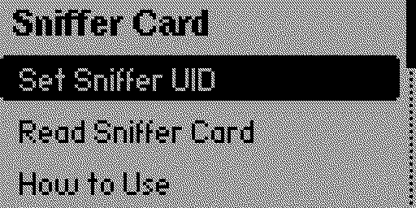
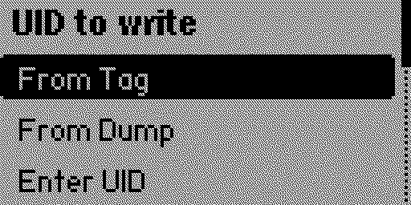
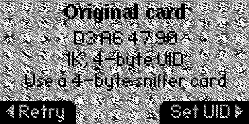
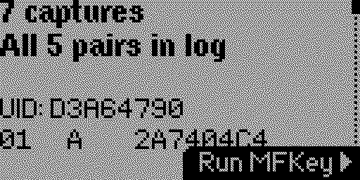
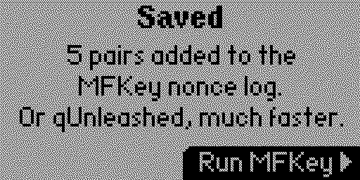
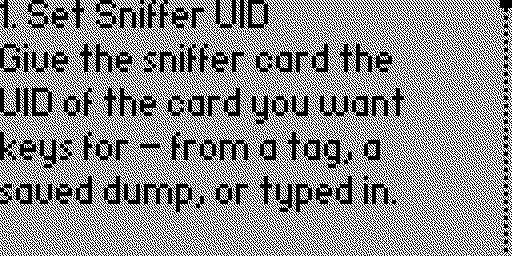

# Sniffer Card

A Flipper Zero app for Super Sniffer cards: it reads the MIFARE Classic authentications the card
collected from a reader and hands them to the MFKey app as nonces, which recovers the keys.

## What the card is

A Super Sniffer card emulates a MIFARE Classic to a reader and records what the reader tried
against it. It is sold as a "Super Sniffer", "sniffer card" or "detection card" in 4-byte and
7-byte UID variants, for 1K and 4K. Proxmark3 calls the same device a "super card" and reads it
with `hf mf supercard`.

The attack it enables is mfkey32: two authentications made with the same key, captured as
(nt, nr, ar), are enough to recover that key. The card does the capturing; something else has to
do the arithmetic.



## How to use it

Two menu entries, not one wizard - the card spends the middle of the job on a reader, away from
the Flipper, so there is nothing to walk through in between. One UID, many readers.

**Set Sniffer UID**

The UID can come from a tag, from a dump you saved earlier, or typed in by hand - the card whose
keys you want is not always the one in reach.



1. Hold the card you want keys for against the Flipper. The app reads its UID and size, and names
   the UID length so you know which sniffer card will take it - these cards are physically a
   4-byte or a 7-byte part and will refuse the other.
2. Hold the **sniffer** card against the Flipper. Its UID is set to the original's, then read back
   off the card to confirm it took.



Then take the sniffer card to the reader and hold it there at least twice. Each tap records one
authentication, and recovering a key needs two of the same sector. Come back whenever.

**Read Sniffer Card**

3. Hold the sniffer card against the Flipper. The app lists what it captured, and says how much of
   it is new.



Each row is one authentication the reader attempted: sector, key type, and the tag nonce. The
nonce is there because it is the only thing that tells two captures apart - a reader working one
sector produces rows identical in everything else, and a reader trying several keys against that
sector produces them with different keys behind them.
4. Press **Save**. The new pairs are appended to `/ext/nfc/.mfkey32.log`.
5. Open the **MFKey** app and let it run. Keys it recovers go into the user dictionary, so the
   Flipper's NFC app can then read the original card.



Reading the same card twice is safe: the card keeps its captures until a reader overwrites them,
and a pair the log already holds - all six of its words, either way round - is skipped rather than
appended again. The screen says how many were skipped, so a card with nothing new on it reads as
"all pairs already in the log" rather than as a card that captured nothing.

Pairs are formed from every combination of two captures of one card, sector and key type. Which of
them actually share a key is what mfkey32 answers, so it cannot be decided here - a reader may
present several keys to one sector, the real one among decoys, and pairing only the first two
would write confident lines that can never succeed while a recoverable pair went unwritten.

## Why MFKey does the recovery

The Flipper SDK exports the Crypto1 primitives - `crypto1_prng_successor`,
`crypto1_lfsr_rollback_word`, `crypto1_word` - but not `lfsr_recovery32`, which is the expensive
half of mfkey32. The MFKey app already implements it with the memory tricks the hardware needs
(state bucketing, bitslice verification) and already writes recovered keys into the user
dictionary. Doing it twice would mean carrying a second copy of that machinery, with its RAM
budget, for no new capability.

So this app's job ends at producing nonces in the format MFKey reads. The nonce log is the same
file and the same line format the firmware's own NFC app writes in Detect Reader
(`applications/main/nfc/helpers/mfkey32_logger.c`), so nonces from a sniffed reader and nonces
from a sniffer card accumulate side by side.

## What is supported

| Revision | How it is read | Status |
|---|---|---|
| Gen2 | plain `30 00`..`30 07`, 16 bytes a slot | read, UID write |
| Gen1 | ISO14443-4 APDU `00 A6 B0 00 10`, DES-encrypted | not yet |
| Furui | `AA A8 00 <i>`, 18 bytes a slot | not yet |

The Gen2 UID write is the one thing here that Proxmark3 cannot do - `hf mf supercard` answers
"Not supported on this card" for Gen2. The sequence came out of the vendor app: five READ commands
that mean nothing as reads (`30 F3`, `30 2A`, `30 BD`, `30 EF`, `30 01`) and then one command per
UID byte. The vendor app always sends seven UID bytes, zero-padding a 4-byte UID, which makes the
last three commands a read of page 0; that is mirrored rather than shortened, because seven is what
is known to work and four is a guess. It is also why the app reads the UID back off the card before
calling a write a success.

Gen2 identification is deliberately passive: the card is recognised by answering an
unauthenticated `30 00` while presenting a MIFARE Classic SAK, which a genuine Classic refuses
and a plain Ultralight cannot do. The vendor app has a better signature - `30 F3` answers with
`0x11` - but that byte is also the first step of the five-command sequence that arms a UID write,
and a read must not be able to change the card.

## Trace layout

Gen2, one slot, 16 bytes:

```
0..3   cuid, the 4 UID bytes that take part in authentication
4      auth command: 0x60 key A, 0x61 key B
5      block the reader authenticated against
6..7   nt, as the 16-bit Crypto1 PRNG state
8..11  nr
12..15 ar
```

`nt` is stored short because the generator is a 16-bit LFSR; the nonce the reader saw is
`prng_successor(nt16, 31)`. Proxmark3 does the same in `mfc_supercard_gen2_recovery()`.

An unused slot is recognised by its contents, not its index: the command byte has to be one a
reader would send, and a slot that captured nothing leaves `nr` and `ar` zero. The vendor app
reads eight slots, Proxmark3 reads seven, and on the card the vendor app ships test data for, the
eighth slot holds the card's own UID and twelve zero bytes.

## Screenshots

Captured with `tools/flipshot.py`, which drives the Flipper over its protobuf RPC: the firmware
has no screenshot command, so this asks for the screen stream the way qFlipper does and can also
inject key presses, which means the shots can be regenerated after a UI change rather than
re-taken by hand.

```
python tools/flipshot.py COM12 screenshots menu "uid-source:OK" "confirm-uid:OK"
```

Each argument is a filename, optionally followed by the keys to press first.



## Credits

The protocol came from two places: the Proxmark3 Iceman firmware
(`client/src/cmdhfmf.c`, `doc/magic_cards_notes.md`), and the vendor's own Android app,
`com.fnstar.sniffercard`.
