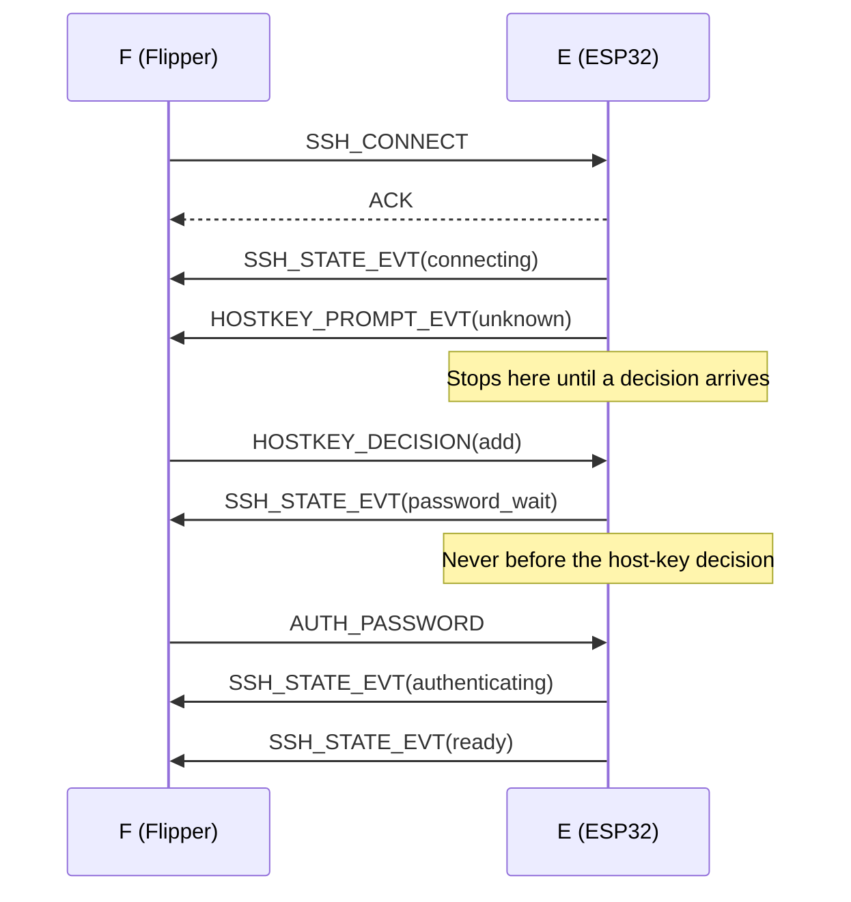

# UART Protocol (v1)

[← Documentation index](README.md)

This document is the single source of truth for the Flipper ↔ ESP32 link.
The reference implementation is [`proto/`](../proto) (portable C99, no allocation),
compiled into the Flipper app, the ESP32 firmware and the host unit tests.
If this file and the code disagree, that is a bug; fix one of them in the same change.

Status: **v1** (SSH keys as files on the Flipper's SD card). `PROTO_VERSION = 1`.
Every breaking change bumps the version; F and E with different versions do not talk
(§4.1).

Terms: **F** = Flipper (the app), **E** = ESP32 (the firmware).
All multi-byte integers are **little-endian**.

## Contents

- [1. Physical Layer](#1-physical-layer)
- [2. Framing](#2-framing)
- [3. Reliability](#3-reliability)
- [4. Session Lifecycle](#4-session-lifecycle)
- [5. Message Catalog](#5-message-catalog)
- [6. Unknown and Invalid Frames](#6-unknown-and-invalid-frames)
- [7. Changelog](#7-changelog)

## 1. Physical Layer

| Item | Value |
|---|---|
| Port | Flipper USART1 (pins 13 TX / 14 RX) ↔ ESP32-S3 UART1 |
| Format | 8N1, no hardware flow control |
| Initial baud | 115200 |
| Maximum baud | 921600 (negotiated by `HELLO`, §4.1) |

## 2. Framing

Every frame on the wire is

```text
0x00 | COBS( type:u8 | seq:u16 | len:u16 | payload[len] | crc:u16 ) | 0x00
```

- **COBS** (Consistent Overhead Byte Stuffing) removes every `0x00` from the frame,
  so `0x00` is only ever a delimiter. A frame is sent with a leading *and* trailing
  delimiter; the leading one flushes any partial garbage in the receiver after a
  reconnect. Empty frames (back-to-back delimiters) are ignored.
- `len` ≤ **512** (`PROTO_MAX_PAYLOAD`). A raw frame is at most 519 bytes; on the
  wire at most 523 bytes plus delimiters (`PROTO_MAX_WIRE`).
- `crc` is **CRC-16/CCITT-FALSE** (poly `0x1021`, init `0xFFFF`, no reflection,
  no final XOR) over `type | seq | len | payload`. Check value: `"123456789"` → `0x29B1`.
- The receiver drops a frame **silently** if COBS decoding fails, `len` disagrees with
  the decoded size, or the CRC does not match. The sender's retry covers it (§3).
- A frame longer than `PROTO_MAX_WIRE` without a delimiter is discarded up to the next `0x00`.

## 3. Reliability

Bit 7 of `type` splits frames into two classes:

| Bit 7 | Class | Rule |
|---|---|---|
| 0 | **Reliable** — requests (F→E) and events (E→F) | Must be answered by exactly one reply with the **same `seq`** |
| 1 | **Reply** — `ACK`, `ERROR`, typed responses | Never answered |

- **Stop-and-wait, per direction.** Each side has at most one reliable frame
  outstanding. The two directions are independent, so an event and a request may
  cross on the wire.
- `seq` is a per-sender u16 counter, incremented for every new reliable frame
  (it wraps; 0 is legal). Replies echo the request's `seq`.
- **Timeout 200 ms, up to 3 retries** (4 transmissions). After that the sender
  reports a link timeout to its owner; the Flipper UI shows "ESP32 not responding".
- **Duplicate suppression.** The receiver remembers the `seq` of the last reliable
  frame it accepted and its reply. A frame with the same `seq` is not processed
  again; the cached reply is re-sent (or nothing, if the reply is still being produced).
- `HELLO` always resets duplicate suppression, because a restarted peer begins again
  at seq 1. `HELLO` is idempotent, so processing a retransmitted `HELLO` twice is harmless.
- A reply whose `seq` does not match the outstanding frame is dropped as stale.

The reference implementation is `proto/src/proto_link.c`; `proto/tests/test_link.c`
runs it over a channel with 10 % frame loss and random bit flips.

## 4. Session Lifecycle

### 4.1 HELLO and Baud Negotiation

1. Both sides start at 115200 baud.
2. F sends `HELLO {proto_version, max_baud, version}`.
3. E replies `HELLO_RESP {proto_version, max_baud, baud, version}` where
   `baud = min(F.max_baud, E.max_baud)`, chosen from 115200, 230400, 460800, 921600.
4. If `proto_version` differs, F shows "Firmware mismatch" and stops (no fallback).
5. Both switch to `baud` 20 ms after the `HELLO_RESP` is fully sent / received.
6. F sends a second `HELLO` at the new rate. If it times out, both fall back to
   115200: E does so by itself if it sees no valid frame within 1 s of switching.

### 4.2 Flow Control

`STREAM_DATA_EVT` is the only high-volume E→F message. E may send stream data only
while it holds enough **credit**: each `STREAM_DATA_EVT` consumes `len(data)` bytes of
credit. F grants credit with `FLOW_CREDIT {bytes}` (additive). Credit resets to 0 at
every `EXEC_REQ` / `SCRIPT_END`. F grants 2048 bytes when a run starts and tops up as
it renders. When F's view buffer is full it stops granting credit and sends `CANCEL`
if the user leaves; the remote command then sees back-pressure (and eventually SIGPIPE
once E closes the channel).

### 4.3 Keepalive and Peer Loss

Neither side can see the other appear or vanish on the wire (the app exits, the board
is reset or unplugged), so:

- **F** sends an empty `ECHO` whenever it has sent nothing for 0.7 s while the link is up.
  When any request times out after its retries (§3), F treats the board as gone:
  "No board", back to 115200, and a new `HELLO` right away. A lost keepalive is
  not reported as a failed user action.
- **E** treats the Flipper as gone after 2 s without a valid frame: it stops sending
  events, resets its duplicate detection, closes an SSH session that the app left open, and
  returns to 115200 to wait for the next `HELLO`. So a restarted app always finds the board
  at the initial rate. A `HELLO` also closes such an orphaned session.

Recovery after a board reset is therefore at most about 1.3 s (keepalive period plus
3 × 200 ms), and after an app restart at most 2 s plus one `HELLO` (measured on
hardware).

## 5. Message Catalog

Field notation: `u8 u16 u32 i32 i8`; `str` = `u8 length + bytes` (no NUL, no embedded
NUL); `rest` = the remaining payload bytes. Max lengths are in `proto_msg.h`
(`PROTO_STR_*`); a string longer than its field is **rejected**, never truncated.
A decoder rejects trailing bytes.

### Housekeeping

| Type | Name | Dir | Payload | Answer |
|---|---|---|---|---|
| 0x01 | `HELLO` | F→E | `proto_version:u8, max_baud:u32, version:str` | `HELLO_RESP` |
| 0x81 | `HELLO_RESP` | E→F | `proto_version:u8, max_baud:u32, baud:u32, version:str` | — |
| 0x02 | `FLOW_CREDIT` | F→E | `bytes:u32` | `ACK` |
| 0x03 | `CANCEL` | F→E | — | `ACK`; aborts the running exec/script/scan/ping |
| 0x04 | `LOG_EVT` | E→F | `level:u8, msg:str` (debug builds only) | `ACK` |
| 0x05 | `ECHO` | F→E | 0–512 opaque bytes | `ECHO_RESP` |
| 0x85 | `ECHO_RESP` | E→F | the same bytes | — |
| 0xFE | `ERROR` | reply | `code:u16, msg:str` | — |
| 0xFF | `ACK` | reply | — | — |

`ECHO` is the keepalive (empty, §4.3) and the link test (Settings > Developer > Link Test:
2048 × 512 pseudo-random bytes, every reply compared byte for byte). E answers it in
the link layer, before request decoding.

`ERROR.code`: 1 unknown type, 2 bad payload, 3 busy, 4 wrong state, 5 too large,
6 not found, 7 internal.

### Network

| Type | Name | Dir | Payload | Answer |
|---|---|---|---|---|
| 0x10 | `NET_SET_CFG` | F→E | `iface:u8, mode:u8, ip:u32, mask:u32, gw:u32, dns:u32` | `ACK` / `ERROR` |
| 0x11 | `NET_GET_STATUS` | F→E | — | `NET_STATUS` |
| 0x91 | `NET_STATUS` | reply | same as `NET_STATUS_EVT` | — |
| 0x12 | `NET_STATUS_EVT` | E→F | `lan:iface_status, wifi:iface_status, wifi_rssi:i8, wifi_ssid:str` | `ACK` |
| 0x13 | `WIFI_SCAN` | F→E | — | `ACK`, then `WIFI_SCAN_RESULT`… |
| 0x14 | `WIFI_SCAN_RESULT` | E→F | `total:u8, first:u8, count:u8, last:u8, count × {ssid:str, rssi:i8, auth:u8, channel:u8}` (≤ 8 per event) | `ACK` |
| 0x15 | `WIFI_JOIN` | F→E | `ssid:str, password:str` | `ACK`; outcome via `WIFI_JOIN_RESULT` and `NET_STATUS_EVT` |
| 0x16 | `PING_REQ` | F→E | `host:str, count:u8, transport:u8` | `ACK`, then `PING_RESP` |
| 0x17 | `PING_RESP` | E→F | `sent:u8, received:u8, min_ms:u16, avg_ms:u16, max_ms:u16, iface:u8` | `ACK` |
| 0x18 | `WIFI_JOIN_RESULT` | E→F | `result:u8, reason:u8` | `ACK` |

- `iface`: 0 = LAN (W5500), 1 = WiFi STA. `mode`: 0 = DHCP, 1 = static.
- IPv4 addresses are u32 with the first octet in the most significant byte
  (`192.168.1.10` → `0xC0A8010A`), then sent little-endian like every u32.
- `iface_status` = `flags:u8, mode:u8, ip:u32, mask:u32, gw:u32`;
  `flags` bit 0 = hardware present, bit 1 = link up (cable / associated), bit 2 = has IPv4.
- E sends `NET_STATUS_EVT` on every link or address change.
- `transport`: 0 = auto, 1 = LAN, 2 = WiFi. Auto picks as a routing table does: the interface
  whose subnet holds the target; otherwise the one with a gateway, LAN before WiFi.
- WiFi credentials sent with `WIFI_JOIN` are stored only in ESP32 NVS, and only after a
  successful join. E sends **exactly one** `NET_STATUS_EVT` when the join attempt ends
  (up to 3 tries): WiFi associated with an address = success, otherwise failure. Just before
  it, E sends `WIFI_JOIN_RESULT`: `result` 0 = joined, 1 = password refused (WPA2 4-way
  handshake, WPA3 SAE), 2 = network not found, 3 = other (signal, router); over the tries the
  clearest one wins (1, then 2, then 3). `reason` is the last try's ESP-IDF disconnect reason,
  for logs. An F that does not know the type answers `ERROR(1)` and still gets the status
  event; an E without it sends only the status event, and F shows a general failure.

### SSH Session

| Type | Name | Dir | Payload | Answer |
|---|---|---|---|---|
| 0x20 | `SSH_CONNECT` | F→E | `profile:str, user:str, host:str, port:u16, transport:u8, auth:u8, policy:u8, flags:u8, key_id:str` | `ACK` / `ERROR(busy)`, then `SSH_STATE_EVT`… |
| 0x21 | `SSH_STATE_EVT` | E→F | `state:u8, reason:u8, iface:u8, stored_secret:u8, msg:str` | `ACK` |
| 0x22 | `HOSTKEY_PROMPT_EVT` | E→F | `kind:u8, key_type:str, fp:str, trusted_total:u8, count:u8, count × {fp:str, label:str}` (≤ 4) | `ACK` |
| 0x23 | `HOSTKEY_DECISION` | F→E | `decision:u8, label:str` | `ACK` |
| 0x24 | `HOSTKEY_LIST` | F→E | `profile:str` | `HOSTKEY_LIST_RESP` |
| 0xA4 | `HOSTKEY_LIST_RESP` | reply | `log_count:u8, count:u8, count × {fp:str, label:str}` (≤ 4) | — |
| 0x25 | `HOSTKEY_DELETE` | F→E | `profile:str, fp:str` | `ACK` / `ERROR(not found)` |
| 0x26 | `AUTH_PASSWORD` | F→E | `password:str, remember:u8` | `ACK` |
| 0x27 | `SSH_DISCONNECT` | F→E | — | `ACK` |

- `profile` is the host-key and secret namespace: the profile alias,
  or `host:port` for an unsaved Quick Connect.
- `auth`: 0 = password, 1 = the key file staged with `KEY_BLOB_*` right before.
  `policy`: 0 = prompt, 1 = strict, 2 = off.
- `flags` bit 0 = remember the password in ESP32 NVS after a successful login; bit 1
  (`WANT_PUB`) = the key came without a `.pub`: E sends `KEY_PUB_EVT` after parsing it; bit 2
  (`KEY_FALLBACK`, Quick Connect only) = a key the server refuses falls back to
  `password_wait` instead of failing.
- `key_id` (auth = key): names the key's remembered passphrase. F sends the key's
  fingerprint (`SHA256:…`, from its `.pub` or the OpenSSH container's public section), or
  nothing; E then uses `file:SHA256:…` of the file bytes.
- `state`: 0 idle, 1 connecting, 2 waiting for host-key decision, 3 waiting for password,
  4 authenticating, 5 ready, 6 running, 7 failed, 8 closed, 9 waiting for the key's
  passphrase (`KEY_PASSPHRASE`).
- `reason`: 0 none, 1 no link, 2 DNS, 3 refused, 4 timeout, 5 host key rejected (strict),
  6 host key canceled, 7 auth failed, 8 no key file staged, 9 protocol, 10 peer closed,
  11 busy, 12 internal, 13 wrong passphrase (with state 9: asked again), 14 key file not
  usable (`msg` says why: public key, DSA, RSA < 2048, PuTTY, unknown format).
- Key auth: E parses (and, if needed, decrypts) the staged file **before** it opens
  the TCP connection, wipes the file right after parsing, offers exactly that key
  (IdentitiesOnly: no agent, no other key, no password fallback) and signs RSA with
  `rsa-sha2-512` / `rsa-sha2-256` only.
- `kind`: 0 = unknown key (profile trusts nothing yet), 1 = mismatch (key not in the
  trusted set). `fp` is the OpenSSH SHA256 fingerprint, `SHA256:` + 43 base64 chars.
- `decision`: 0 cancel, 1 connect once, 2 trust & add, 3 replace all. `label` is
  optional and stored next to the key.

**Connect sequence (password profile, prompt policy, unknown key):**



- **Password-safety rule:** E never asks for, and never sends, a password before the
  host-key decision. With `stored_secret = 1`, E uses the remembered password and
  skips `password_wait`; if that fails it sends `password_wait` with reason 7.
- `strict` + mismatch → `SSH_STATE_EVT(failed, 5)` without a prompt.
  `off` never prompts and never stores.
- Every decision other than cancel is logged on E with alias, fingerprint and time.

### Run

| Type | Name | Dir | Payload | Answer |
|---|---|---|---|---|
| 0x30 | `EXEC_REQ` | F→E | `command:rest` (1–512 bytes, no NUL) | `ACK` / `ERROR(state)`, then stream |
| 0x31 | `STREAM_DATA_EVT` | E→F | `stream:u8, data:rest` (≤ 511 bytes) | `ACK` |
| 0x32 | `EXEC_DONE_EVT` | E→F | `exit_code:i32, flags:u8, duration_ms:u32` | `ACK` |
| 0x33 | `SCRIPT_BEGIN` | F→E | `interp:str, total:u32` (≤ 64 KiB) | `ACK` / `ERROR(too large)` |
| 0x34 | `SCRIPT_CHUNK` | F→E | `offset:u32, data:rest` (≤ 508 bytes) | `ACK` / `ERROR` |
| 0x35 | `SCRIPT_END` | F→E | `crc32:u32` | `ACK` / `ERROR(bad payload)`, then stream |

- `stream`: 0 = stdout, 1 = stderr. Output is raw bytes; F strips ANSI escapes.
- `EXEC_DONE.flags`: bit 0 = killed by a signal (`exit_code` = signal number),
  bit 1 = canceled by the user, bit 2 = connection lost before an exit status.
- **Scripts:** E buffers the chunks (in PSRAM), checks offsets are contiguous and the
  CRC-32 (IEEE, check value `0xCBF43926`) matches, then runs `exec <interp> -s`, writes
  the script to the channel's stdin and sends EOF. Nothing is written on the target's
  disk. F picks `interp` from the shebang: `#!/bin/bash` → `bash`, otherwise `sh`.

### Keys and Secrets

Key files live on the Flipper's SD card (`keys/`). A private key crosses the link only
while E needs it: staged for one connect, or sent back once when E generates it. Neither
side logs it.

| Type | Name | Dir | Payload | Answer |
|---|---|---|---|---|
| 0x43 | `KEY_BLOB_BEGIN` | F→E or E→F | `total:u32` (1 … 16384) | `ACK` / `ERROR` |
| 0x44 | `KEY_BLOB_CHUNK` | same | `offset:u32, data` (≤ 508 bytes, contiguous) | `ACK` / `ERROR` |
| 0x45 | `KEY_BLOB_END` | same | `crc32:u32` of the whole file | `ACK` / `ERROR` |
| 0x46 | `KEY_PASSPHRASE` | F→E | `passphrase:str, remember:u8` | `ACK` / `ERROR(state)` |
| 0x47 | `KEY_PUB_EVT` | E→F | `status:u8, fp:str, total:u16, offset:u16, data` | `ACK` |
| 0x40 | `KEY_GEN` | F→E | `key_type:u8` (0 = Ed25519, 1 = ECDSA P-256), `passphrase:str` | `ACK`, then blob + `KEY_PUB_EVT` |
| 0x42 | `SECRET_FORGET` | F→E | `kind:u8, id:str` | `ACK` |

- **Staging** (F→E `KEY_BLOB_*` right before `SSH_CONNECT` with auth = 1): E keeps the
  file in one static internal-RAM buffer and zeroes it after parsing, on any error, on
  `CANCEL`, on `SSH_CONNECT` with password auth, when a new app says `HELLO` or the
  Flipper goes silent, and 30 s after `KEY_BLOB_END` without a connect.
- **E→F blob** (a generated key, ≤ 4096 bytes): the same three messages as
  events; F writes the file, reads it back and compares the CRC. Then `KEY_PUB_EVT`.
- `KEY_PUB_EVT` carries the public key line (`<type> <base64> ssh_runner`) in pieces of
  ≤ 443 bytes (`offset` / `total`, up to 2048), with its fingerprint. `status` ≠ 0 is a
  failure: a `reason` code, and `data` is the message.
- A passphrase given with `KEY_GEN` or accepted with `remember = 1` is stored in E's NVS
  by key id ("decrypt once"); a stored one that stops working is erased and asked for
  again.
- `SECRET_FORGET`: kind 0 = a profile (remembered password and pinned host keys; sent
  when a host is deleted or renamed), kind 1 = a key passphrase (`id` = key id) and its
  unlocked copy in RAM, kind 2 = only the unlocked copy ("lock"; sent when a key is renamed).
- E keeps an encrypted key unlocked in RAM after its first unlock with `remember = 1` (up to 4,
  until kind 1/2 above or a restart): a later connect with that key needs no passphrase and
  skips the KDF.
- `0x41 KEY_GET_PUB` and `0xC1 KEY_PUB_RESP` (v0) are gone; `0x41` is unassigned.
- `0x48`, `0x49`: retired, never reuse (they were `KEY_LEGACY_EXPORT` and `KEY_LEGACY_DELETE`).

### Security

| Type | Name | Dir | Payload | Answer |
|---|---|---|---|---|
| 0x60 | `SEC_GET_STATUS` | F→E | — | `SEC_STATUS` |
| 0xE0 | `SEC_STATUS` | E→F | `tier:u8, key_block:u8, free_blocks:u8, efuse_virtual:u8` (`key_block` 0xFF = none) | — |
| 0x61 | `SEC_ENABLE` | F→E | `tier:u8` (1), `word:str` | `ACK`, then `SEC_STATE_EVT`s; `ERROR(bad payload)` / `ERROR(state)` |
| 0x62 | `SEC_STATE_EVT` | E→F | `phase:u8, result:u8, migrated:u8, msg:str` | `ACK` |

- `SEC_ENABLE` decodes only with tier 1 and a word that `proto_sec_word_ok()` accepts (trimmed,
  case-insensitive `confirm`, shared by both firmwares); anything else is `ERROR(bad payload)`
  and touches nothing. During an SSH session: `ERROR(state)`.
- Phases: 0 check, 1 burn, 2 migrate, 3 erase, 4 done; result 0 running, 1 ok, 2 failed (`msg`
  says which step failed and what state the board is in). After phase 3 the ESP32 restarts and
  erases the plaintext copy at boot (before WiFi opens NVS); the Flipper sees the link drop,
  relinks, and reads `SEC_STATUS` (tier 1). Enabling twice answers phase 4 "Already protected".
- While it runs, every request except `HELLO`, `FLOW_CREDIT`, `NET_GET_STATUS` and
  `SEC_GET_STATUS` is answered `ERROR(busy)`.

### Shell (Reserved)

`0x50 SHELL_OPEN`, `0x51 SHELL_INPUT`, `0x52 SHELL_CLOSE` are reserved; E answers
them with `ERROR(unknown type)`.

## 6. Unknown and Invalid Frames

- Unknown reliable type → `ERROR(1)`.
- Payload that fails to decode → `ERROR(2)`.
- Valid but not allowed now (e.g. `EXEC_REQ` before `ready`) → `ERROR(4)`.

## 7. Changelog

- **v1** (release 0.2.0): the protocol as described in this document. The app compares the
  board's version in the `HELLO` reply and does not use a board that speaks another one.

## See Also

- [Architecture](ARCHITECTURE.md): where each side of the protocol lives
