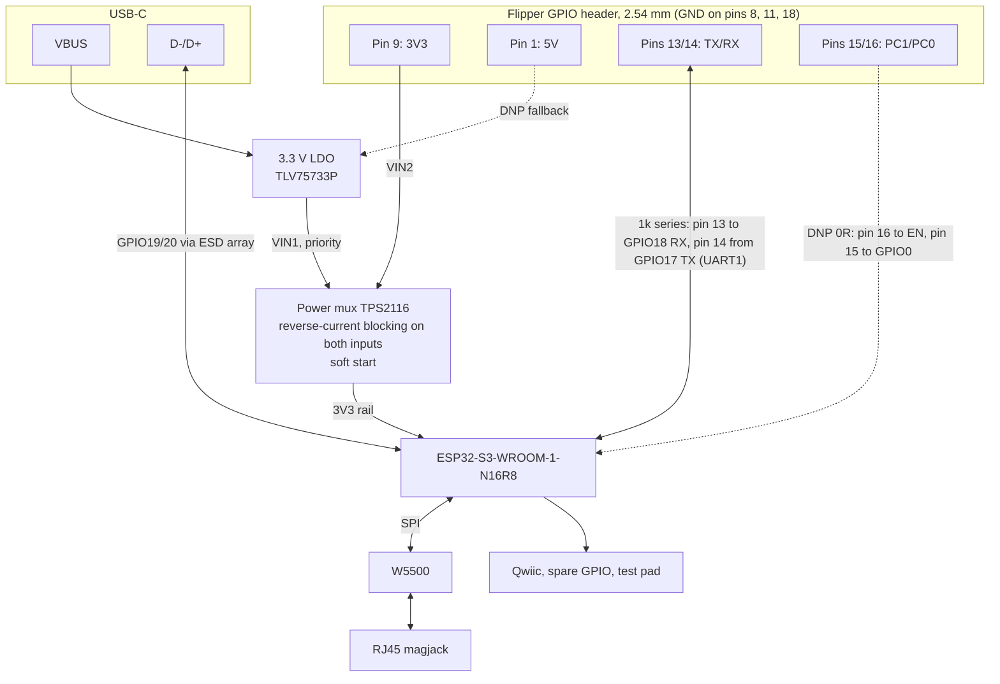

# SSH Runner Add-on Board: Design

[← Hardware](README.md)

The design of the SSH Runner add-on board, rev 0.1: what it does, why each part and value was
chosen, and how the board is laid out. The section numbers are used throughout the hardware
folder (tools and docs cite them).

## 1. Goal

A Flipper Zero GPIO add-on that replaces the Waveshare ESP32-S3-ETH prototype with one board:
ESP32-S3-WROOM-1-N16R8, W5500 and an RJ45 magjack. It is powered by the Flipper alone in normal
(portable) use, with USB-C for flashing, debugging and bench power. Few nets, a little room to
grow, mainstream practice, made and assembled by JLCPCB.

## 2. Mechanical Base

The outline and header positions come from Flipper Devices' official external-module files
([flipperdevices/flipperzero-3d-models](https://github.com/flipperdevices/flipperzero-3d-models),
`external-module/`, GPL-3.0; see [`ref/README.md`](ref/README.md)):

- the bottom edge of the official outline (67.34 mm, two tabs and a notch) and its 45° corner
  chamfers;
- two right-angle 2.54 mm headers, Flipper pins 1–8 and 9–18, 17.78 mm apart;
- the recommended board thickness, 1.0–1.2 mm.

The board stands up from the Flipper's top edge like the official Wi-Fi Devboard. That keeps the
ESP32's antenna away from the Flipper's electronics and leaves room for the RJ45 jack.

## 3. Block Diagram

## 4. Electrical Design

### 4.1 MCU

**ESP32-S3-WROOM-1-N16R8** (16 MB flash, 8 MB octal PSRAM), the module on Espressif's
DevKitC-1 N16R8. Espressif rates the R8 variants for −40 to 65 °C ambient.

- EN: 10 kΩ pull-up and 1 µF to GND (Espressif's RC delay), plus the RESET button.
- GPIO0: 10 kΩ pull-up and the BOOT button to GND.
- Strapping pins GPIO3, 45 and 46 are left unconnected. GPIO35–37 belong to the octal PSRAM
  and are not used.
- Decoupling per Espressif: 22 µF + 0.1 µF at the 3V3 pin.

### 4.2 Pin Map

The same defaults as the Waveshare prototype, so the firmware needs no pin change
([Hardware and Wiring](../docs/HARDWARE.md); build with `sdkconfig.addon` for the add-on's
status LED).

| Function | ESP32-S3 GPIO | Notes |
|---|---|---|
| W5500 SCLK / MOSI / MISO / CS | 13 / 11 / 12 / 14 | SPI2 at 20 MHz; the W5500 is rated to 33.3 MHz |
| W5500 INT / RST | 10 / 9 | |
| UART1 TX → Flipper pin 14 (RX) | 17 | 1 kΩ series resistor: limits current if one side is unpowered |
| UART1 RX ← Flipper pin 13 (TX) | 18 | 1 kΩ series resistor |
| USB D− / D+ | 19 / 20 | native USB (USB-Serial-JTAG console, flashing) |
| BOOT / EN | 0 / EN | buttons |
| UART0 TX / RX | 43 / 44 | expansion pads J203 only (ROM boot log), never wired to the Flipper |
| Status LED | 21 | the Waveshare board's RGB LED pin |
| Qwiic I2C SDA / SCL | 1 / 2 | |
| Spare GPIOs (pads J203) | 38, 39, 40, 41, 42 | 39–42 are the JTAG pins, free while debugging runs over USB-Serial-JTAG |

### 4.3 Ethernet

- **W5500** (LQFP-48), with values from its datasheet (v1.0.5):
  - 12.4 kΩ 1 % from EXRES1 to AGND;
  - 4.7 µF at TOCAP and 10 nF at 1V2O, at the pins;
  - VBG left floating, RSVD pin 23 tied to GND;
  - PMODE[2:0] on their internal pull-ups (auto-negotiation, all capable);
  - 0.1 µF at each AVDD and VDD pin, the analog supply fed through a ferrite bead.
- **Crystal:** 25 MHz. The W5500 asks for an 18 pF load. The crystal (YXC X322525MOB4SI, a
  JLC Basic part) is a 12 pF part, so its load caps are 2 × (12 − ~3 pF stray) = 18 pF.
- **RJ45 with integrated magnetics and LEDs:** HanRun **HY911105AE** on KiCad's HR911105A
  footprint. Its datasheet gives the same mounting pattern and pinout as the HR911105A: TD+ 1,
  TD− 2, RD+ 3, TX centre tap 4, RX centre tap 5, RD− 6, chassis 8; green LED 9 (+) / 10,
  yellow LED 12 (+) / 11. It is rated −40 to +85 °C.
- **PHY side** as in WIZnet's reference schematic "W5500-Ref-RJ45WithMag":
  - TXP and TXN each pulled to the analog 3.3 V through 49.9 Ω 1 %;
  - TX centre tap: 10 Ω to the analog 3.3 V, plus 22 nF to GND;
  - RXP and RXN AC-coupled to the jack through 6.8 nF;
  - 49.9 Ω from each RX line to the RX centre tap, with 10 nF to GND;
  - the analog 3.3 V fed through a 600 Ω ferrite bead, with six 0.1 µF and one 10 µF.
- **Jack LEDs:** anodes to 3.3 V, cathodes through 330 Ω to the W5500's LED outputs (active
  low): yellow (12/11) for LINK, green (9/10) for ACT.
- **No auto-MDIX** in the W5500. Almost every modern NIC does auto-MDIX itself; an old host on a
  direct cable may need a crossover cable.
- **ESD:** the magnetics give 1500 V isolation. No TVS array on the cable side, as on mainstream
  W5500 boards.
- **No PoE.** Standard 802.3af/at/bt switches never power the port: the jack's termination is
  not a detection signature. Do not use passive PoE injectors (always-on 24/48 V).
- **SPI:** direct, no series resistors. The lines are 30–40 mm on In2 over ground, too short to
  ring at 20 MHz edges. If SCLK ever rings, the firmware can lower GPIO13's drive strength.

### 4.4 Flipper Link

UART on Flipper pins 13 (TX) and 14 (RX), with GND on pins 8, 11 and 18 (all three connected),
as on the prototype at 921600 baud.

Two **DNP 0 Ω links**: Flipper pin 16 (PC0) to ESP32 EN, and pin 15 (PC1) to GPIO0. Unfitted,
they do nothing. Fitted, they would let a Flipper app reset the ESP32 or put it into download
mode, as the ESP flasher apps do for the Wi-Fi Devboard. An app that uses them must drive the
pins open-drain.

### 4.5 Power

**What the Flipper provides** ([docs.flipper.net](https://docs.flipper.net/zero/gpio-and-modules)):

| | Pin 9 (3.3 V) | Pin 1 (5 V) |
|---|---|---|
| Max load | 1.2 A | 1.2 A |
| Default | On | Off on battery until "5V on GPIO" or OTG is turned on |
| Off when | Firmware updates and SD card mounting (pin 9 shares the SD card's supply); the Flipper off | OTG off |
| Both | At most 5 W in total from the I/O pins | |

**What the board draws** on 3.3 V (datasheet figures): ESP32-S3 WiFi TX peak 355 mA (Espressif
asks for a supply of at least 0.5 A), W5500 132 mA transmitting at 100 Mbit/s, about 10 mA for
the rest. The worst case, WiFi TX during a LAN transfer, is about 0.5 A, 42 % of pin 9's rating.

**Design: pin 9 as the main supply, USB-C as a priority input.**

1. Flipper pin 9 → **TPS2116 power mux**, input 2 → 3V3 rail. The mux blocks reverse current,
   so the board can never drive the Flipper's 3V3/SD rail, and its soft start limits the inrush
   when the board is plugged in.
2. USB-C VBUS → Schottky D101 → 1 A LDO (TLV75733P) → mux input 1, the priority input. With USB
   plugged in, the board runs from USB and draws nothing from the Flipper. USB can never
   back-feed the Flipper: there is no path from VBUS to pin 1, and the mux blocks pin 9.
3. **DNP 5 V fallback:** a second Schottky (D102) from Flipper pin 1 into the LDO input, OR-ed
   with VBUS. Fitted, with "5V on GPIO" on, the same LDO feeds the board from the Flipper's 5 V.
   It is a fallback, not the main path: the LDO would carry the whole load as heat.
4. **TPS2116 strapping** (datasheet SLVSFG1A):
   - Priority mode: MODE tied to VIN1 (USB 3.3 V).
   - PR1 has a 0.92–1.08 V reference. The 100 kΩ / 56 kΩ divider from VIN1 selects USB while
     VIN1 is above 2.56–3.01 V. At 3.3 V, PR1 is 1.18 V.
   - Soft start: 1.3 ms at 3.3 V. The ST status pin is not used.
5. **Phantom VBUS.** On Flipper power with USB unplugged, the ESP32-S3's USB D+ pull-up (about
   1.5 kΩ to 3.3 V, on by default) leaks through the USBLC6's internal diode into VBUS: about
   2.7 V, which passes D101 and the LDO in dropout. PR1 could then reach the 0.92 V reference,
   the mux would pick the dead USB input, and the rail would collapse under load.
   - **Fix:** R104, 4.7 kΩ from the LDO input (V5_IN) to GND. It holds V5_IN near 1.9 V, so PR1
     stays at about 0.7 V or below. It costs about 1 mA on USB.
   - C204 (100 nF on VBUS at the USBLC6's pin 5, as ST recommends) decouples the ESD array.
   - Measured on rev 0.1: PR1 0.02 V on Flipper power ([`BRINGUP.md`](BRINGUP.md)).
6. **LDO heat on USB:** U101 carries the whole load, about 0.4 W at 235 mA (5 V in, 3.3 V out).
   Its GND pin goes to two vias under the body, and IN and OUT run on 0.5 mm copper into the
   pour. Expected rise about 60–75 °C: inside the 125 °C rating at room temperature, but warm.
   Flipper power, the main path, does not go through the LDO.
7. **Bulk capacitance on 3V3**, for the WiFi TX bursts: 74 µF nominal (22 + 10 µF at the mux
   output, 22 µF at the module, 10 µF at the W5500's VDD, 10 µF behind the ferrite bead), about
   40 µF after DC-bias loss. A 355 mA burst with a 20 µs regulator response droops the rail by
   about 0.18 V. The soft start charges it with about 190 mA from the Flipper.

Never tie the Flipper's 3V3 to another regulator directly: the mux is what lets USB-C and the
Flipper coexist.

### 4.6 Bench Test on the Prototype

Before the board was drawn, the Waveshare prototype ran from Flipper pin 9 alone (Flipper on
battery, USB unplugged) for 10–11 minutes under the worst load, all at once:

- LAN flood ping, 1400 B: 160,225 sent, 4 lost (0.0025 %);
- WiFi flood ping, 1400 B: 98,546 sent, 11 lost (0.011 %);
- `yes | head -c 5M` over WiFi from the Flipper: exit 0 after 3 min 26 s, about 25 KB/s.

ESP32 counters: brownout 0, watchdog 0, crashes 0. The Flipper did not reboot and its SD card
stayed mounted. So pin 9 is the main supply.

### 4.7 USB-C

- USB 2.0 16-pin receptacle (HRO TYPE-C-31-M-12).
- 5.1 kΩ on CC1 and CC2, so C-to-C chargers supply 5 V.
- D−/D+ straight to GPIO19/20 as a 90 Ω differential pair, with a USBLC6-2SC6 ESD array.
- The USB-Serial-JTAG console and `esptool` flashing work as on the prototype; BOOT + RESET
  give manual download mode.

### 4.8 Expansion, Test Pad and LEDs

- **Qwiic / STEMMA QT** (J202, DNP): a 4-pin JST-SH footprint (3V3, GND, SDA, SCL). The 4.7 kΩ
  pull-ups are fitted.
- **Expansion and UART0 pads** (J203, unpopulated, parts side): nine 1.0 mm pads at 1.27 mm
  pitch for soldering wires, beside the module's right column. From the top (pin 1 square):
  U0TXD, U0RXD, IO42, IO41, IO40, IO39, IO38, GND, 3V3.
- **Test pad:** the 3V3 rail (TP104), on the Flipper header's 2.54 mm grid between its two
  groups, so one 0.1" probe header reaches it and the GPIO pins together. Probe VBUS at D101's
  anode (the pad nearer the USB-C); GND, the Flipper's 3V3 and 5V, EN and BOOT are at the header
  pins (18, 9, 1) and the buttons.
- **LEDs:** power (3V3 rail, white, D103) and status (GPIO21, green, D201).
  - Reverse-mount 1206 parts on the parts side, shining through holes to the art side: from the
    front they read as two lit dots on the black board, with no part visible.
  - Each runs at about 1.3 mA through 470 Ω.
  - Footprint: KiCad's reverse-mount 1206 with its pads moved 0.15 mm outward, 0.325 mm from the
    hole (`ssh_runner:LED_1206_3216Metric_ReverseMount_Hole1.8x2.4mm_JLC`).
  - **Rev 0.1 erratum: the holes are too small for the ordered LEDs (E1, §8).**

### 4.9 Antenna Keep-out

Per the ESP32-S3-WROOM-1 datasheet and Espressif's hardware design guidelines:

- The module sits at the top edge, farthest from the Flipper, antenna end flush with the edge.
- No copper on any layer, no parts and no traces under the antenna or within 15 mm beside it
  (KiCad's module footprint carries this as a rule area; DRC finds nothing inside it).
- Dense ground stitching along the module's edge.
- The Flipper body is about 30 mm below the antenna, twice Espressif's 15 mm clearance. A future
  case must keep metal 15 mm from the antenna too.

## 5. Board

### 5.1 Stack-up: 4 Layers, 1.2 mm

Espressif recommends four layers. A solid ground plane under the module, the W5500's analog side
and the crystal, and controlled-impedance Ethernet and USB pairs, are what make a first spin
work.

**JLCPCB JLC04121H-7628**, JLC's free 4-layer stack-up at 1.2 mm. The order must name it
([`CAM.md`](CAM.md)): the trace widths are sized for it.

| Layer | Material | Thickness | Er | Use |
|---|---|---|---|---|
| F.Cu | copper, 1 oz | 0.035 mm | — | parts, short connections, both Ethernet pairs, ground pour |
| Prepreg | 7628 | 0.2104 mm | 4.4 | |
| In1.Cu | copper, 0.5 oz | 0.0152 mm | — | solid ground, never routed |
| Core | FR-4 | 0.6 mm | 4.6 | |
| In2.Cu | copper, 0.5 oz | 0.0152 mm | — | long signals and supply lines, ground fill between them |
| Prepreg | 7628 | 0.2104 mm | 4.4 | |
| B.Cu | copper, 1 oz | 0.035 mm | — | solid ground under the art, no tracks |

Finished thickness: 1.12 mm nominal (1.01–1.23 mm). On JLC04121H-3313, the other 4-layer
option, the same traces would be about 64 Ω (Ethernet) and 53 Ω (USB).

### 5.2 Outline, Orientation and Fit

- **Faces:** the official DXF is drawn from the face toward the Flipper's screen, so the board
  uses it mirrored. **F carries all parts and both headers and faces the back of the Flipper**;
  in the F view, Flipper pin 1 is on the right. **B faces the user** above the screen and
  carries only the art and the through-hole pins.
- **Size:** 67.34 × 36 mm. The length is the official outline's; 36 mm is the lowest height
  that fits the module upright with its antenna keep-out, decoupling at every pin, and the
  parts at their functions.
- **Fit, measured** (`tools/fit_check.py`): Flipper's body STEP and its reference module STEP
  share one assembly frame. The script registers our board through the reference module and
  measures each of our 18 pins against the reference pins and the body's socket openings. Every
  pin is centred, 0.000 mm off (limit 0.2 mm). The header bodies sit in the shell's two slots
  with at least 0.26 mm on every side, and the pins insert 5.95 mm (the drawing asks for 6 mm).
- **Placement of the big parts:**
  - ESP32-S3 module upright at the left end of the F view, antenna at the top edge, about
    30 mm above the Flipper body.
  - RJ45 at the right end, **opening up through the top edge**: a cable plugged from the top
    pushes the board into the socket instead of levering it. Its 13.5 mm height faces the back
    of the Flipper and ends 2.5 mm inside the plane of the Flipper's back face.
  - USB-C on the top edge between the antenna keep-out and the RJ45, reachable with the board
    on the Flipper. Both cables can be plugged at once.
  - W5500 next to the RJ45, its PHY pins facing the jack pins.
- **Handling:** the Flipper header carries the board, as on the official modules. When
  unplugging a latched Ethernet cable, hold the board: the 18 header contacts hold only about
  10–15 N.

### 5.3 Look

- **Black solder mask, white silkscreen.** Black and white masks need 0.13 mm between pads;
  the finest pitch here is the W5500's 0.5 mm (about 0.2 mm gaps).
- **Surface finish:** ENIG gives the flattest pads for the 0.5 mm LQFP and the module; OSP and
  lead-free HASL also work (rev 0.1 was made with OSP).
- **Back (art side):** one block, vertically centred on the board body, close to the board's
  centre while keeping 1.5 mm from the RJ45 shield pin and from the module's tented thermal
  vias:
  - the title "SSH Runner" in Orbitron Bold (SIL OFL 1.1, [`art/Orbitron-OFL.txt`](art/Orbitron-OFL.txt)),
    as silkscreen outlines, so no font file is needed;
  - the logo beside it ([`art/logo-x.svg`](art/logo-x.svg), **all rights reserved**,
    [`art/LICENSE.md`](art/LICENSE.md)), 9 mm tall, generated from the SVG by
    `tools/gen_board.py` and mirrored to read from the back;
  - under the title, "rev 0.1" and the two LED holes; the repository URL under the block, in
    KiCad's stroke font at 1.0 mm / 0.15 mm (JLC's minimum).
- **Corners:** the official module's 45° chamfers (a 1.0 mm face between two R0.5 arcs) on all
  four outer corners; inner corners at the tabs and notch R0.5, the mill radius.
- **Parts side:** function labels only (RESET, BOOT, QWIIC; USB and ETH under their
  connectors), no reference designators; every part keeps its reference on F.Fab.

### 5.4 Floorplan

Every part sits at its function, with courtyards respected (`tools/place.py`). Positions are in
the F view.

| Area | Where | What |
|---|---|---|
| RF / MCU | left end | Module U201, antenna flush with the top edge; C202, C201 and the EN RC beside pins 2–3 |
| USB | top edge, centre | USB-C J201; USBLC6 U202 under its D+/D− pins with C204 at its VBUS pin; CC resistors beside it |
| Power | right of the module, below the keep-out | D101, R104, LDO U101 with C101/C102, mux U102 with C103/C104 and C105, PR1 divider R101/R102 |
| Ethernet | right of centre to the right end | W5500 turned so its PHY pins face the jack and its SPI pins face the module; supply comb and caps above its top pins; crystal level with XI/XO; PHY termination between chip and jack; jack LED resistors near the jack's LED pins |
| LEDs | under the art block's holes | D103, D201 with R103, R203 |
| Flipper interface | left and bottom strips | UART resistors R401/R402 beside the module's UART pins; DNP links R403/R404 above their header pins; DNP 5 V diode D102 at pin 1 |
| Right of the module | middle | Expansion pads J203 facing their pins; I2C pull-ups; BOOT button; Qwiic J202 (DNP) |
| Test pad | bottom centre | TP104 (3V3) on the header grid |
| Back (B) | — | Art only, plus the through-hole pins; every via tented |
| Fiducials | F | FID1–FID3, three corners of a triangle |

Each footprint is linked to its schematic symbol: KiCad's schematic-parity check reports 0
issues.

### 5.5 Routing

Hand-routed: every signal and power connection is a reviewed drawing in `tools/routes.py`, and
`tools/route.py` adds the ground vias, stitching, keep-outs and pours. No autorouter output is
on the board.

**Impedance**, against JLC's impedance calculator for JLC04121H-7628:

| Run | Width / gap | Estimate |
|---|---|---|
| Ethernet RX, and TX at the W5500 (its 0.5 mm pitch) | 0.25 / 0.25 mm, F over In1 | ≈ 100 Ω |
| Ethernet TX from its 45° step to the jack | 0.23 / 0.22 mm | ≈ 101 Ω |
| USB D+/D− | 0.23 / 0.22 mm, In2 between In1 and B | ≈ 91 Ω |

**Lengths and coupling:**

| Pair | Lengths | Match | Coupled |
|---|---|---|---|
| Ethernet RX | 17.61 / 17.60 mm | 0.01 mm | 7.3 mm |
| Ethernet TX | 24.43 / 24.65 mm | 0.22 mm | 12.2 mm |
| USB | 59.7 / 56.3 mm | 3.4 mm (≈ 20 ps, negligible at Full Speed) | 41.8 mm |

Both links are electrically short: the Ethernet runs are under a third of the critical length of
100BASE-TX edges. The MDI pairs are coupled for only part of their length; with the magnetics
inside the jack and runs this short, that is fine at 100 Mbit/s, and rev 0.2 should couple them
end to end (§8).

**Notes by block:**

- **USB:** In2 from the module to the USBLC6, fenced by ground vias on both sides; no USB line
  on B.
- **Module 3V3:** a 0.8 mm In2 trunk along the top edge, below the antenna keep-out, to pin 2,
  with two vias at each end.
- **Ethernet MDI:** all on F over solid In1, no In2 detour, no polarity crossing; the N lines
  carry the length compensation near the jack.
- **Crystal:** XI and XO straight through the gap between the crystal's pad rows to pins
  30/31; ground pour on all sides, In1 solid under it.
- **SPI:** an In2 band under the crystal and the module, fenced on both sides, no series
  resistors (§4.3).
- **Art side:** eleven tented vias sit within 0.5 mm of the back lettering. They show as faint
  dimples under the mask and stay where they are.
- **Geometry:** every track at a multiple of 45°, every bend a 45° mitre, no acute angles and
  no tracks doubled back (`tools/check_angles.py`).

## 6. Bill of Materials

All parts are LCSC / JLC parts; the BOM in [`fab/`](fab/) is the one to upload.

| Ref | Part | MPN | LCSC |
|---|---|---|---|
| U201 | MCU module | ESP32-S3-WROOM-1-N16R8 | C2913202 |
| U301 | Ethernet controller | W5500 | C32843 |
| J301 | RJ45 magjack | HanRun HY911105AE | C69427 |
| J201 | USB-C 16P | HRO TYPE-C-31-M-12 | C165948 |
| J401, J402 | Flipper headers, pins 1–8 and 9–18, right angle, 6 mm mating pin | PZ254R-11-08P, PZ254R-11-10P | C492416, C492418 |
| U101 | 3.3 V LDO, 1 A (USB path) | TLV75733PDBVR | C485517 |
| U102 | Power mux | TPS2116DRLR | C3235557 |
| U202 | USB ESD array | USBLC6-2SC6 | C7519 |
| Y301 | 25 MHz crystal, 12 pF | YXC X322525MOB4SI | C9006 |
| D101 | Schottky (USB path) | B5819W | C8598 |
| SW201, SW202 | RESET, BOOT | XKB TS-1088-AR02016 | C720477 |
| D103 | Power LED, white, reverse mount (see E1) | XINGLIGHT XL-3216UWC-FB | C3646935 |
| D201 | Status LED, green, reverse mount (see E1) | XINGLIGHT XL-3216UGC-FB | C3646937 |
| FB301 | Ferrite bead, 600 Ω at 100 MHz | GZ1608D601TF | C1002 |
| R306 | 12.4 kΩ 1 % (EXRES1) | 0402WGF1242TCE | C11692 |
| R102 | 56 kΩ 1 % (PR1 divider) | 0402WGF5602TCE | C25796 |
| C315, C316 | 6.8 nF (RX coupling) | 0402B682K500NT | C1542 |
| Other R and C | 0402 / 0603 / 0805 jellybeans | — | in the BOM |
| *DNP* D102 | Schottky, 5 V fallback | B5819W | C8598 |
| *DNP* R403, R404 | 0 Ω links | 0402WGF0000TCE | C17168 |
| *DNP* J202 | Qwiic, JST-SH 4P | SM04B-SRSS-TB | C160404 |
| *DNP* J203 | Expansion and UART0 pads | — (pads only) | — |

JLC assembles the two headers in its through-hole step, so the boards arrive complete.

## 7. Review Checklist (rev 0.1)

Checked against the manufacturers' guidance before the fabrication files were made:

- **Espressif** (ESP32-S3-WROOM-1 datasheet, hardware design guidelines): antenna at the edge
  with the keep-out intact (DRC clean); 22 µF + 100 nF at 3V3; 10 k / 1 µF on EN; strapping
  pins as in §4.1; module ground pad and thermal vias on solid ground; USB pair ≈ 91 Ω, fenced,
  no line on B.
- **WIZnet** (W5500 datasheet, reference schematic): PHY termination as the reference, between
  chip and jack; ferrite bead and decoupling at the pins; crystal centred on XI/XO with short
  traces; MDI pairs ≈ 100 Ω on F over solid In1.
  - **Accepted deviation:** WIZnet advises against a power jack near the RJ45, but the USB-C
    sits beside it on the top edge. VBUS, D101 and the LDO input stay on the far side of the
    USB-C, away from the MDI pairs, with ground pour and stitching between.
- **TI** (TPS2116, TLV757P): priority mode and PR1 divider as §4.5; ≥ 1 µF at the LDO's IN and
  OUT, EN tied to IN; LDO heat path; no phantom USB supply (R104).
- **JLCPCB:** every rule in `ssh-runner.kicad_dru` inside JLC's 4-layer capabilities (track and
  space 0.15 mm, vias 0.6/0.3 and 0.5/0.3 mm, minimum drill 0.3 mm, hole to hole 0.5 mm, copper
  to edge 0.3 mm, silkscreen 1.0 mm / 0.15 mm); stack-up named in the board file and in
  [`CAM.md`](CAM.md).
- **Mechanics:** official outline and header positions; all 18 pins centred in the Flipper's
  sockets; RJ45 and USB-C reachable from the top.
- **Result:** ERC 0, DRC 0 errors and 0 unconnected, schematic parity 0, and the 45° check clean.

## 8. Errata and Rev 0.2

**Rev 0.1 errata:**

- **E1. The reverse-mount LED holes are too small for the specified LEDs.**
  - JLC could not place D103 or D201: the lenses of XL-3216UWC-FB (C3646935) and XL-3216UGC-FB
    (C3646937) do not fit the board's holes. Both are indicators only; nothing else depends on
    them.
  - Cause: the footprint keeps KiCad's generic reverse-mount opening, an oval 1.8 mm along the
    pad axis × 2.4 mm across. XINGLIGHT's datasheets (Outline Dimension) give a 1.86 × 1.6 mm
    lens (±0.25 mm), and LCSC/JLC's own land pattern cuts a 2.2 × 1.9 mm rounded rectangle along
    the pads.
  - It is these parts, not the package. **Dialight 597-6301-607F (green, 525 nm) and
    597-6901-607F (white)**, reverse-mount 1206 parts with a 1.6 mm lens (R0.5 corners,
    ±0.13 mm; Dialight drawing C-17970 and the 597-6XX1 series datasheet), pass the rev 0.1
    holes with about 0.1 mm per side. Dialight recommends a round 1.98 mm cutout; opening the
    hole with a 2.0 mm drill stays 0.225 mm off the pad copper.
  - **Fitting by hand:** the anode goes on the pad that carries a voltage. Seen from the parts
    side with the Flipper header at the bottom, D103's anode is the right pad and D201's the left
    pad (D201 is turned 180°). The pads are 0.95 × 1.75 mm at ±1.70 mm, 2.45 mm apart: a
    top-mount LED must be a 1206 (an 0603 cannot bridge the gap) and would light the parts side.
  - Order rev 0.1 without D103 and D201 in the assembly, and fit them by hand.

**Rev 0.2 changes:**

- **LED footprint (E1):** a 2.2 mm (along the pads) × 1.9 mm rounded-rectangle cutout in
  Edge.Cuts, inside corners r ≤ 0.4 mm (KiCad's oval would narrow to about 1.1 mm at the lens
  ends); pads 0.75 × 1.5 mm at ±1.675 mm, 0.2 mm copper to the cutout, with a 0.2 mm exception to
  the 0.3 mm copper-to-edge rule for these two footprints. Check the part in JLC's placement
  preview before ordering.
- **Ethernet:** keep each MDI pair coupled end to end, through the termination parts and into
  the jack pins.
