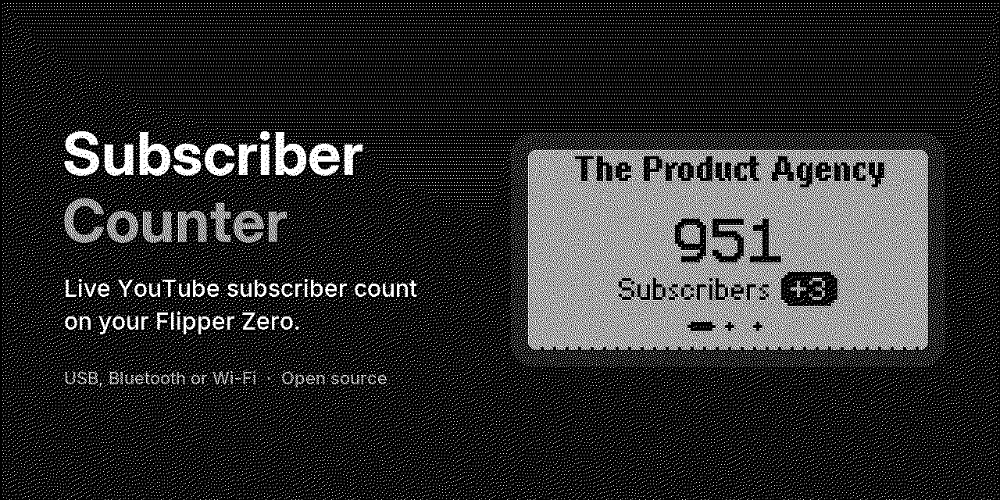
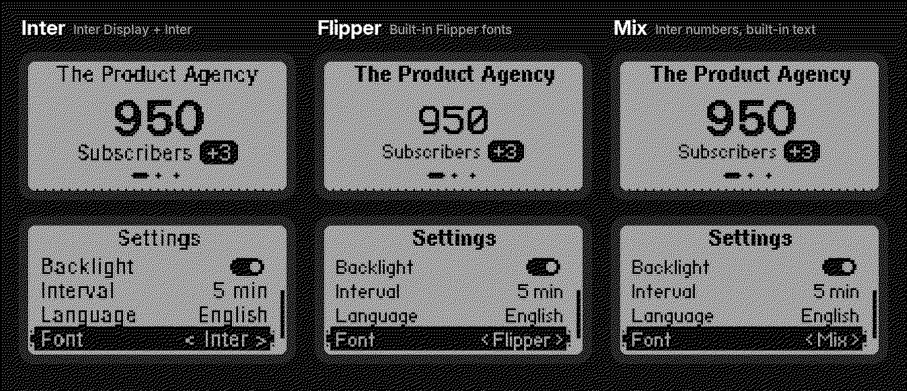

<p align="center">
  
</p>

# Subscriber Counter – Anleitung auf Deutsch

Zeigt die Abonnentenzahl deines YouTube-Kanals live auf dem Flipper Zero an und aktualisiert sie
automatisch – per USB oder Bluetooth über die
[Flipper Internet Bridge](https://github.com/mete888/flipper_internet_bridge).
Die App ist auf Englisch und Deutsch verfügbar (umschaltbar in den Einstellungen).

<p align="center">
  
</p>

## Was du brauchst

- **Flipper Zero** mit offizieller Firmware (Release)
- Am Computer den Desktop-Helper **Flipper Internet Bridge** (macOS, Windows, Linux)
- Einen kostenlosen **YouTube-Data-API-Key** – Schritt für Schritt unten
- Deinen Kanal als `@Handle` oder Kanal-ID (`UC…`)

## Einrichtung

1. **App installieren** über den Flipper-App-Katalog (Flipper Lab oder Flipper-App, Kategorie *Tools*)
   oder `sub_counter.fap` aus dem [neuesten Release](https://github.com/TheProductAgency/flipper-subscriber-counter/releases) nach `SD-Karte/apps/Tools/` kopieren.
2. **Einmal starten.** Die App legt `SD-Karte/apps_data/sub_counter/config.txt` an.
3. **Config ausfüllen** mit qFlipper (Dateimanager):

   ```ini
   api_key=AIza...
   channel=@deinkanal
   language=de
   ```

4. **Desktop-Helper starten**, App öffnen, USB oder Bluetooth wählen und am Computer bestätigen.
   Tipp: Im Helper *Allow always* wählen, dann musst du nicht bei jedem Neuverbinden zustimmen.

### API-Key besorgen (ca. 5 Minuten, kostenlos)

1. [Google Cloud Console](https://console.cloud.google.com/) öffnen und ein neues Projekt anlegen.
2. **APIs & Dienste → Bibliothek → „YouTube Data API v3“ → Aktivieren**.
3. **APIs & Dienste → Anmeldedaten → Anmeldedaten erstellen → API-Schlüssel**.
4. Empfohlen: Schlüssel öffnen → **API-Einschränkungen → nur „YouTube Data API v3“** → Speichern.

Der Key liegt im Klartext auf der SD-Karte. Falls er doch einmal öffentlich wird: unter
*Anmeldedaten* löschen und neu erstellen.

## Bedienung

| Taste | Funktion |
|---|---|
| ◀ ▶ | Abonnenten, Aufrufe, Videos |
| ▲ | Info-Sheet: letztes und nächstes Update, Verbindung, Fehler |
| ▼ | Einstellungen (auch direkt aus dem Info-Sheet) |
| OK | Sofort aktualisieren (offline: neu verbinden) |
| Zurück | Sheet bzw. Einstellungen schließen, dann beenden |

In den **Einstellungen** wählst du mit ▲ ▼ eine Zeile, änderst sie mit OK oder ◀ ▶ und speicherst mit Zurück:
Ton, Vibration, LED, Display an, Intervall (1 Min – 1 Std), Sprache, Schrift und *Testen*.

### WLAN-Board (Beta)

Statt über den Desktop-Helper kann die App auch über ein WLAN-Board am GPIO-Anschluss online gehen,
auf dem die Firmware [FlipperHTTP](https://github.com/jblanked/FlipperHTTP) läuft, z. B. das offizielle
Wi-Fi Developer Board. Dann wird kein Computer gebraucht:

1. FlipperHTTP nach der Anleitung des Projekts auf das Board flashen und das Board aufstecken.
2. WLAN eintragen – mit einer FlipperHTTP-App aus dem Katalog wie *FlipWiFi* oder in der `config.txt`
   (`wifi_ssid=` und `wifi_password=`).
3. In der App **Einstellungen → Verbindung → WLAN** wählen.

Dieser Modus ist mit einem simulierten Board und auf einem Flipper ohne Board getestet, aber noch nicht
mit echter WLAN-Hardware. Details und Hinweise zur Sicherheit: [Wi-Fi board](wifi.md) (englisch).

### Schriftstile

Unter **Einstellungen → Schrift** wählst du zwischen drei Stilen, die Anzeige wechselt sofort:

- **Flipper** (Standard): nur die eingebauten Flipper-Schriften, auf jedem Display gestochen scharf
- **Inter**: Inter Display für die Zahl, Inter für Texte
- **Mix**: Inter-Zahl mit den eingebauten Schriften für Texte

<p align="center">
  
</p>

## Gut zu wissen

- **YouTube rundet öffentliche Abozahlen** ab 1.000 auf drei Stellen (z. B. 12.345 → 12.300).
  Die Zahl springt daher in Stufen.
- **Kontingent:** 10.000 Einheiten pro Tag sind kostenlos, ein Update kostet 1 Einheit.
- Der Ton folgt der Lautstärke und dem Stumm-Modus des Flippers.
- Alle Einstellungen findest du auch in der [englischen README](../README.md#configuration).

## Fehlerbehebung

| Anzeige | Lösung |
|---|---|
| *API-Key fehlt* / *Kanal fehlt* | `api_key` und `channel` in `apps_data/sub_counter/config.txt` eintragen |
| *Offline* | Desktop-Helper starten, dann OK drücken |
| *HTTP 400: API key not valid* | Key prüfen und ob die YouTube Data API v3 im Projekt aktiviert ist |
| *HTTP 403: … quota …* | Tageskontingent aufgebraucht – längeres Intervall wählen |
| *Kanal nicht gefunden* | Handle prüfen oder die Kanal-ID verwenden |
| *Nicht aktuell* | Letztes Update fehlgeschlagen – im Info-Sheet (▲) steht der Grund |

Kein offizielles Produkt von YouTube oder Google. YouTube ist eine Marke der Google LLC.
