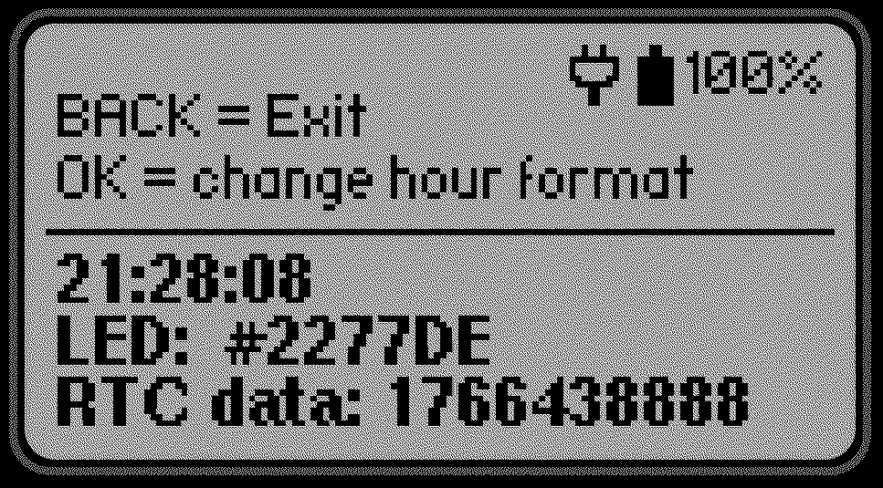
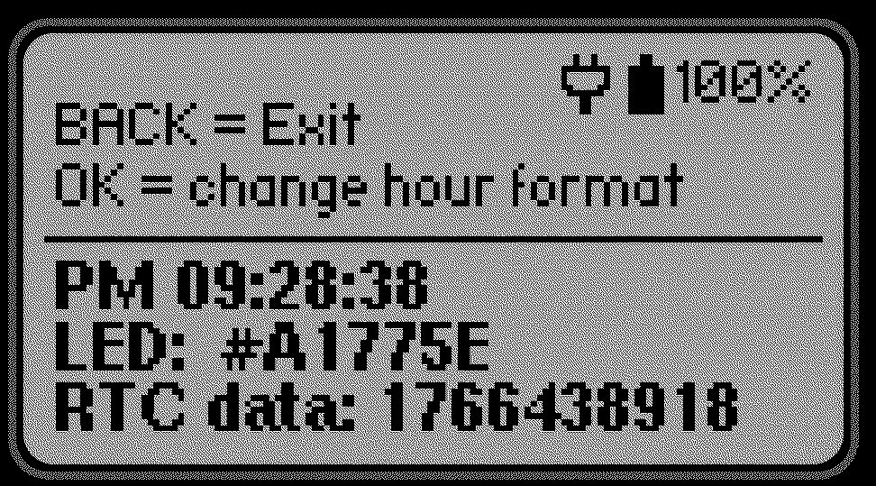
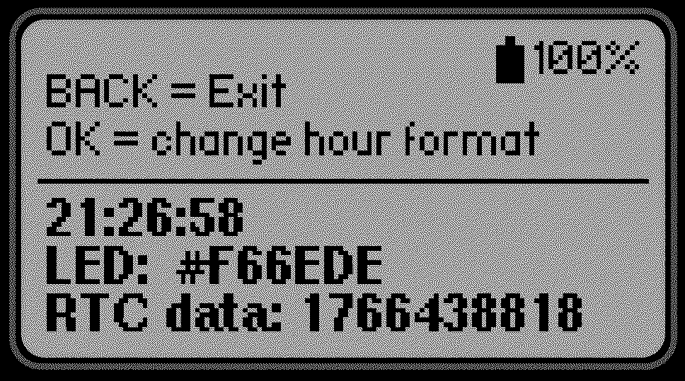
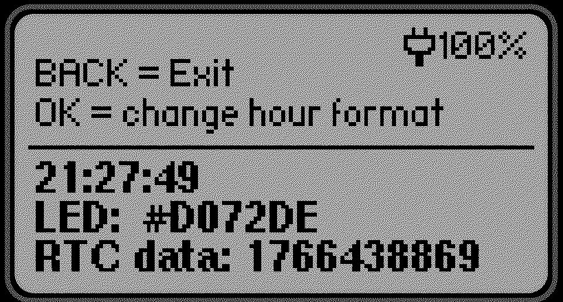

# RGB LED RTC Clock

RGB LED RTC Clock is a Flipper Zero application that visualizes real-time clock (RTC) data using the internal RGB LED.

The LED color changes dynamically based on the current time:
- **Red** channel represents **seconds**
- **Green** channel represents **minutes**
- **Blue** channel represents **hours**

This creates a continuously changing RGB color that reflects the current time.

---

## Features

- Uses Flipper Zero **RTC (Real-Time Clock)**
- RGB LED color driven by time:
  - Seconds → Red
  - Minutes → Green
  - Hours → Blue
- Automatically reads **12h / 24h time format** from Flipper system settings
- Manual override of hour format using the **OK button**
- Displays useful system information on screen:
  - Current time
  - Battery status and charge percentage
  - RGB LED color in HEX format
  - RTC timestamp (seconds since 1.1.1970)

---

## Controls

| Button | Action |
|------|--------|
| **OK** | Change hour format (12h / 24h) |
| **BACK** | Exit application |

---

## On-screen Information

- **Time** (12h or 24h format)
- **Battery status** (charging / charged) and percentage
- **RGB LED color** displayed as HEX value (`#RRGGBB`)
- **RTC data** – Unix timestamp (seconds since 1.1.1970)

---

## Screenshots

### Charging – 24h format

### Charging – 12h format

### Battery only – 24h format

### Charging – alternate view

### Running on Flipper Zero

