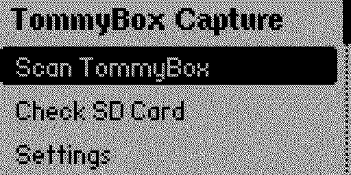
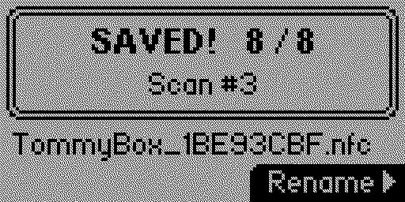
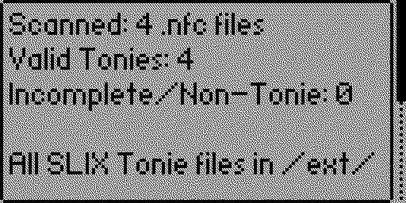
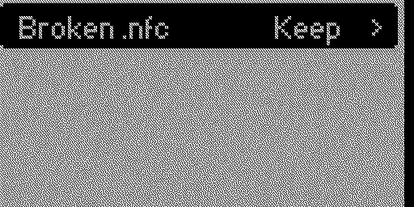

# TommyBox Capture — Flipper Zero Application

A native Flipper Zero application (`NFC` category) purpose-built for rapidly scanning, unlocking, verifying, and saving **Tonie (`NXP ICODE SLIX-L`)** NFC figures without ever saving a truncated or corrupted `.nfc` file.

---

## Screenshots

| Main Menu | Verified Capture (`SAVED! 8 / 8`) |
| :---: | :---: |
|  |  |
| **SD Card Audit (`Check SD Card`)** | **Incomplete File Settings (`Settings`)** |
|  |  |

---

## Why This App Exists

Tonie NFC figures use **NXP ICODE SLIX-L** (`ISO15693-3`) tags locked in **Privacy Mode** with the standard TommyBox privacy password (`7F FD 6E 5B`).

When scanning a figure using the built-in Flipper Zero NFC app (**Extra Actions → Unlock SLIX-L → Auth As TommyBox**), moving the figure away slightly too early often produces a `.nfc` file that looks valid at a glance—and even has a full 8-byte `E0 04 03 ...` UID—but fails when emulated or inspected:

1. **Silent Partial Block Reads (`00 00 00 00` trailing blocks)**: In the Flipper firmware's ISO15693-3 poller (`iso15693_3_poller_filter_error()`), an RF timeout (`Iso15693_3ErrorTimeout`) while reading data blocks is treated as `Iso15693_3ErrorNone` (end-of-memory), leaving any unread blocks zero-filled (`00 00 00 00`). Because figures have thick plastic bases and weak coupling, losing RF lock mid-read is common.
2. **Default Privacy Password (`0F 0F 0F 0F`)**: If `slix_poller_get_random_number()` times out during the post-read password check stage, `slix_poller_handler_check_privacy_password()` still transitions to `SlixPollerStateReady` and saves the default placeholder password (`0F 0F 0F 0F`) instead of `7F FD 6E 5B`.
3. **Slow Multi-Menu Workflow**: Capturing a collection of figures in the stock NFC app requires navigating through **Extra Actions → Unlock SLIX-L → TommyBox → Save → Name** for every single figure.

**TommyBox Capture** solves all three problems by running a continuous, hands-free SLIX-L unlock loop that strictly validates all 8 blocks in memory *and* reads back the saved `.nfc` file from the SD card to verify its integrity before showing a prominent **`SAVED! 8 / 8`** confirmation.

---

## Features

- **Continuous Hands-Free Batch Scanning**: Hold a Tonie figure to the back of your Flipper Zero, wait for the **`SAVED! 8 / 8`** banner and green LED + double-beep, and immediately swap to the next figure—no menu navigation required between captures.
- **Automatic SLIX-L Privacy Unlock**: Automatically supplies the TommyBox privacy password (`7F FD 6E 5B`) on every `SlixPollerEventTypePrivacyUnlockRequest`.
- **Strict 8/8 Block Verification**:
  - Verifies the 8-byte ISO15693 UID and confirms all **8 blocks (32 bytes)** of `Data Content` are present and complete (`block_count == 8`, `block_size == 4`, block 7 non-zero, no 5 consecutive `0x00` bytes).
  - Reads back the newly written `.nfc` file from `/ext/nfc/` on the SD card to confirm `Device type: SLIX`, `Password Privacy: 7F FD 6E 5B`, `Privacy Mode: false`, and all 8 verified data blocks on disk.
- **Live Block Progress & Partial Read Recovery**: If a figure is pulled away mid-read (e.g. `3 / 8` blocks read), the app displays live block progress, alerts you with a short vibration, and immediately resets the poller so you can hold the figure steady to finish.
- **UID Deduplication & Safe Incomplete File Handling (`Settings`)**:
  - Before saving, the app checks `/ext/nfc/*.nfc` by 8-byte `UID`.
  - If a **valid** `.nfc` file with that UID already exists on the SD card, it will **not** create a duplicate file.
  - If an **incomplete/broken** `.nfc` file with that UID exists, nothing is deleted or modified by default. Behavior is controlled via **Settings → Broken .nfc** (persisted in `/ext/apps_data/tommybox_capture/settings.cfg`):
    - **`Keep` (default)**: Leaves existing files in `/ext/nfc` completely untouched and saves the new verified capture to a unique non-colliding filename.
    - **`Rename` (opt-in)**: Appends `_incomplete` to the older broken file only after the new verified `8/8` capture is saved and verified on disk.
    - **`Delete` (opt-in — disabled by default)**: Removes the older broken file only when explicitly enabled in Settings, and only after the new verified `8/8` capture is saved and verified on disk.
- **Repeat Scan Counter (`Scan #1`, `Scan #2`, …)**: Scanning the same figure again performs a full live RF unlock and `8/8` block check, increments the on-screen scan counter, and plays a confirmation chirp without writing duplicate files.
- **One-Button On-Device Rename**: Press **Right (`Rename`)** right after a scan to rename the file on the spot, or leave it auto-named (`TommyBox_<last4bytes>.nfc`) and keep scanning.
- **Built-In SD Card Auditor (`Check SD Card`)**: Scans every `.nfc` file in `/ext/nfc/` and reports how many valid vs. incomplete/other files exist on your SD card, listing the exact filename and failure reason (`Incomplete (4/8 blocks)`, `Bad Pwd (...)`, etc.) for any broken captures.
- **In-App Guide (`About`)**: Scrollable on-device **How to use** instructions and attribution.

---

## Usage

### Main Menu

When you launch **TommyBox Capture** (**Apps → NFC → TommyBox Capture**), you are presented with four options:

1. **Scan TommyBox**: Starts the continuous SLIX-L Tonie figure scanner.
2. **Check SD Card**: Audits all `.nfc` files in `/ext/nfc/` and displays a report of valid vs. incomplete/other files.
3. **Settings**: Configures how older incomplete files with a matching UID are handled (`Keep`, `Rename`, or `Delete`).
4. **About**: Displays scrollable on-device **How to use** instructions and app info.

---

### Scanning Figures

1. Select **Scan TommyBox** from the main menu. The Flipper Zero LED will pulse cyan while waiting for a figure.
2. Hold the base of a SLIX-L figure flat against the back of the Flipper Zero.
3. Keep the figure steady until the double-framed banner appears:
   ```text
   ╔══════════════════════════╗
   ║     SAVED!     8 / 8     ║
   ║         Scan #1          ║
   ╚══════════════════════════╝
   TommyBox_1BE93CBF.nfc
                      [Rename ►]
   ```
4. Once you see **`SAVED! 8 / 8`** (accompanied by a green LED flash and two confirmation beeps):
   - **Hold the next figure** to the back of the Flipper to immediately capture another one.
   - **Hold the same figure again** to re-verify its RF read (`Scan #2`, `Scan #3`, …) without writing a new file.
   - **Press `Right` (`Rename`)** if you want to rename the `.nfc` file right away.
   - **Press `Back`** to return to the main menu.

---

### Auditing Existing `.nfc` Files (`Check SD Card`)

Select **Check SD Card** from the main menu to inspect `/ext/nfc`:
- Every `.nfc` file is checked against the strict TommyBox SLIX-L completeness rules.
- If all files are healthy, it reports `All SLIX-L files in /ext/nfc are complete!`.
- If any incomplete captures are found, each file and its specific defect (e.g., `[BAD] SLIX-L_22A9427F.nfc -> Incomplete (4/8 blocks)`) are listed. Scan the affected physical figure in **Scan TommyBox** mode to capture a verified `8/8` file; the older incomplete file is handled according to your **Settings → Broken .nfc** preference (`Keep` by default).

---

### Settings (`Broken .nfc`)

Select **Settings** from the main menu to configure what happens when a newly verified `8/8` capture matches the UID of an older incomplete `.nfc` file in `/ext/nfc`:
- **`Keep` (default)**: Does not modify, rename, or delete any existing file in `/ext/nfc`.
- **`Rename`**: Renames the older incomplete file by appending `_incomplete` (e.g., `SLIX-L_22A9427F_incomplete.nfc`) after the new verified capture is saved.
- **`Delete`**: Deletes the older incomplete file only after the new verified capture is saved and verified on disk.

Settings are saved to `/ext/apps_data/tommybox_capture/settings.cfg`.

---

## Anatomy of a Valid SLIX-L `.nfc` File

Every `.nfc` file saved or verified by **TommyBox Capture** adheres to the following structure:

```ini
Filetype: Flipper NFC device
Version: 4
# Device type can be ISO15693-3, SLIX, SLIX-S, SLIX-L or SLIX2
Device type: SLIX
# UID is common for all formats
UID: E0 04 03 50 XX XX XX XX
# ISO15693-3 specific data
DSFID: 00
AFI: 00
IC Reference: 03
Lock DSFID: false
Lock AFI: false
# Memory content
Block Count: 8
Block Size: 04
Data Content: XX XX XX XX XX XX XX XX XX XX XX XX XX XX XX XX XX XX XX XX XX XX XX XX XX XX XX XX XX XX XX XX
Security Status: 00 00 00 00 00 00 00 00
# SLIX specific data
Capabilities: Default
Password Privacy: 7F FD 6E 5B
Password Destroy: 0F 0F 0F 0F
Password EAS/AFI: 00 00 00 00
Privacy Mode: false
Lock EAS: false
Lock PPL: false
```

### Verification Criteria

| Field | Required Value | Failure Symptom in Stock NFC App |
| :--- | :--- | :--- |
| `Device type` | `SLIX` | Saved as generic `ISO15693-3` if SLIX poller fails |
| `UID` | 8 bytes (`E0 04 03 ...`) | Missing or wrong IC manufacturer/type |
| `Block Count` / `Block Size` | `8` blocks × `4` bytes (`32` bytes total) | Truncated block count |
| `Data Content` | Block 7 non-zero, no 5 consecutive `00` bytes | Trailing `00 00 00 00` blocks when RF drops mid-read |
| `Password Privacy` | `7F FD 6E 5B` | Left at default `0F 0F 0F 0F` on random-number timeout |
| `Privacy Mode` | `false` | Left `true` if privacy unlock was not completed |

---

## Installation

### Option 1: Pre-Built `.fap` Binary

1. Download [`dist/tommybox_capture.fap`](dist/tommybox_capture.fap) (built for Flipper Zero Official Firmware API `88.2` / Target `f7`).
2. Copy `tommybox_capture.fap` to your Flipper Zero SD card at:
   ```text
   /ext/apps/NFC/tommybox_capture.fap
   ```
3. Launch on your Flipper Zero via **Apps → NFC → TommyBox Capture**.

### Option 2: Build from Source with `uFBT`

Ensure you have [uFBT (micro Flipper Build Tool)](https://pypi.org/project/ufbt/) installed (`pip install ufbt`):

```bash
# Clone the repository
git clone https://github.com/mitchsurp/Tonies-Capture-Flipper.git
cd Tonies-Capture-Flipper

# Build the .fap binary
ufbt

# Or build and launch directly over USB
ufbt launch
```

The compiled binary will be output to `dist/tommybox_capture.fap`.

---

## Project Structure

```text
.
├── application.fam          # Flipper Application Manifest (appid: tommybox_capture)
├── tonies_capture.c         # Application source (SLIX-L poller, 8/8 verifier, UI, Settings & SD auditor)
├── tonies_capture.png       # 10x10 1-bit monochrome Flipper app icon
├── docs/
│   ├── description.md       # Flipper Apps Catalog description
│   └── changelog.md         # Release changelog
├── screenshots/             # qFlipper screenshots for Flipper Apps Catalog
├── dist/
│   └── tommybox_capture.fap # Pre-built Flipper Zero application binary (Target 7, API 88.2)
├── LICENSE                  # MIT License
└── README.md                # Project documentation
```

---

## Disclosure & Credits

- Created by **mitchsurp** ([github.com/mitchsurp](https://github.com/mitchsurp)).
- **AI Assistance Disclosure**: This application and its documentation were created with the assistance of **Google Antigravity (AGY)**.
- Licensed under the [MIT License](LICENSE).
